# verify: full

- because core: convex/_generated/api.d.ts
- because core: convex/schema.ts
- because core: src/theme.ts

| Step | Result | Time | Detail |
| --- | --- | --- | --- |
| base tree | ✔ pass | 0s |  |
| native fingerprint | ✔ pass | 10s | unchanged on iOS and Android: over-the-air updates reach current builds |
| lint | ✔ pass | 100s |  |
| unused code (knip) | ✔ pass | 5s |  |
| typecheck | ✔ pass | 19s |  |
| unit tests with coverage | ✔ pass | 38s |  |
| verify lock | ✔ pass | 379s | took it after waiting 379s for pid 52262, perf/shed-request-step-actors in /Users/xtectra/GitHub/worktrees/the-shed-mobile-step-actors, since 2026-11-24T01:43:12.156Z |
| after: local backend | ✔ pass | 20s | after functions on :3270 |
| after: iOS reset | ✔ pass | 2s |  |
| after: iOS | ✔ pass | 280s | 48 screenshots; still moving after 10 frames: admin-review, admin-all, admin-world |

## Screenshots

| Screen | Before | After |
| --- | --- | --- |
| ios `admin-admin` | (none) |  |
| ios `admin-admin_tab_system` | (none) |  |
| ios `admin-admin_tab_teams` | (none) |  |
| ios `admin-all` | (none) |  |
| ios `admin-announcements` | (none) | 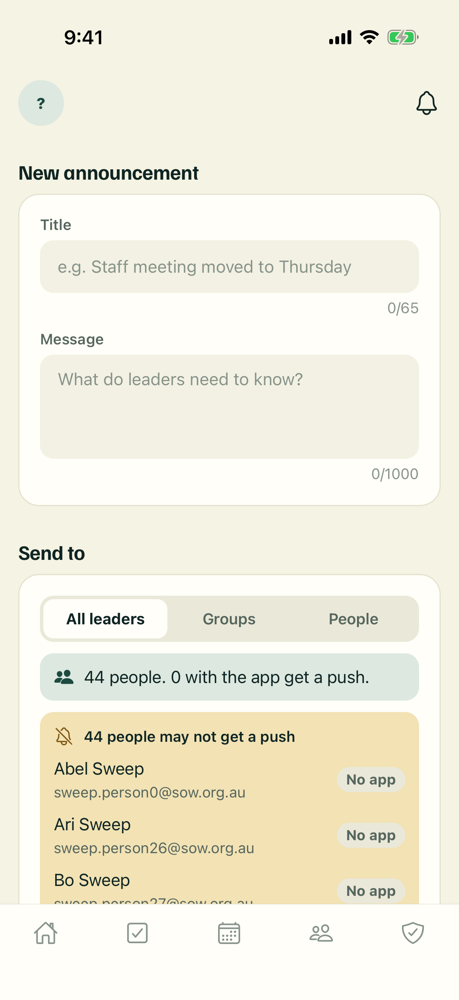 |
| ios `admin-attendance` | (none) | 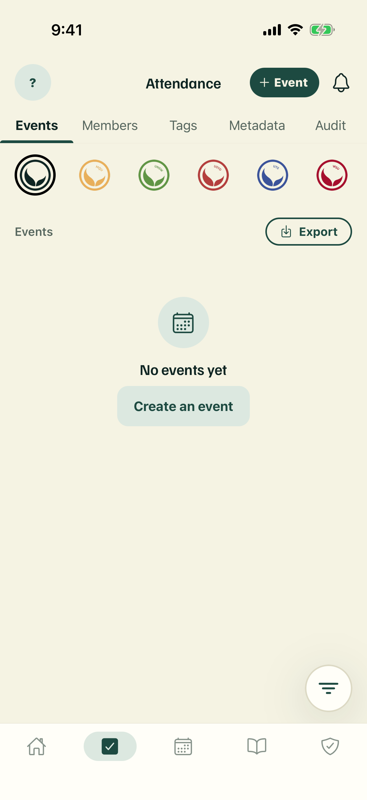 |
| ios `admin-attendance_event_eventId` | (none) | 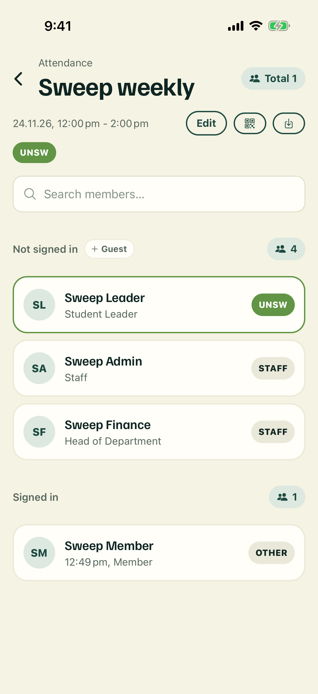 |
| ios `admin-attendance_member_member_3A_memberId` | (none) |  |
| ios `admin-attendance_merges` | (none) | 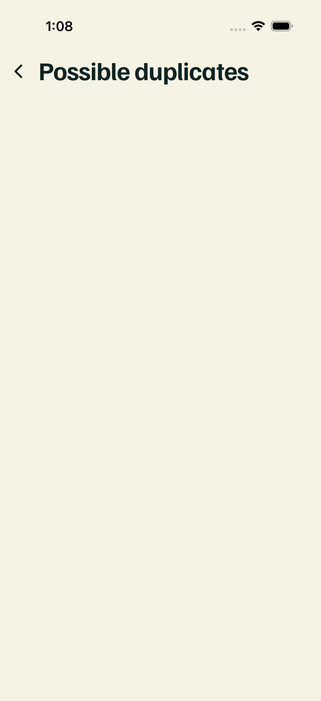 |
| ios `admin-calendar` | (none) |  |
| ios `admin-calendar_history` | (none) |  |
| ios `admin-calendar_view_week` | (none) |  |
| ios `admin-checkin_checkInToken` | (none) |  |
| ios `admin-churches` | (none) | 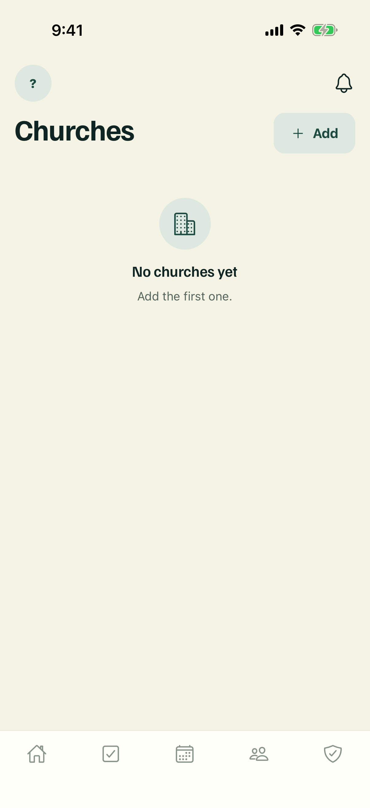 |
| ios `admin-design_requests` | (none) | 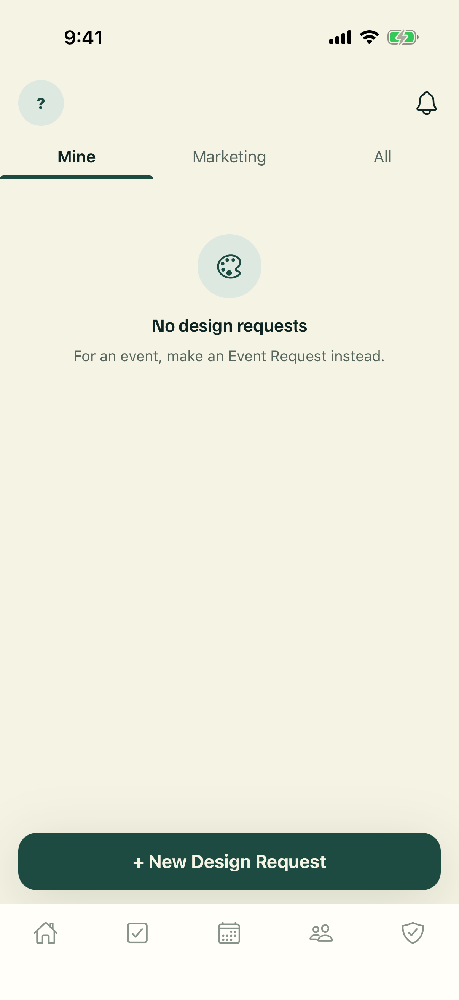 |
| ios `admin-design_requests_new` | (none) |  |
| ios `admin-edit_home` | (none) |  |
| ios `admin-event_requests` | (none) | 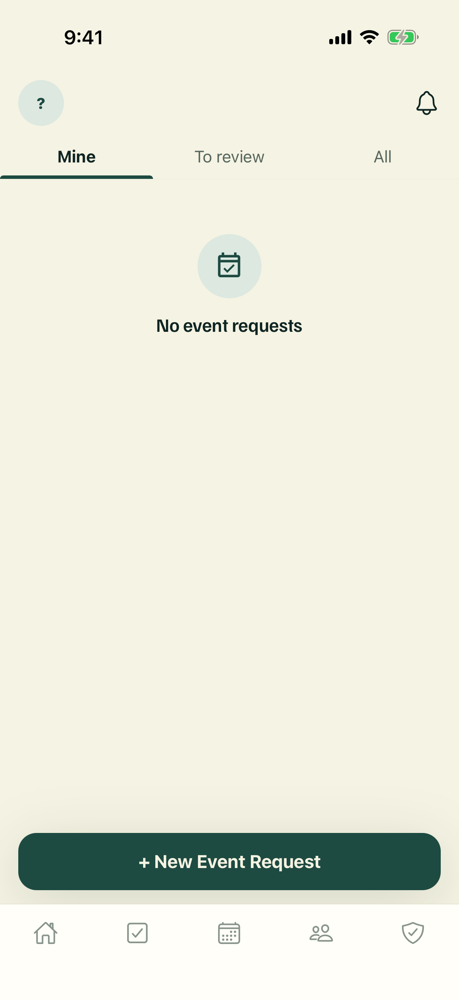 |
| ios `admin-event_requests_new` | (none) |  |
| ios `admin-finance_settings` | (none) |  |
| ios `admin-games` | (none) | 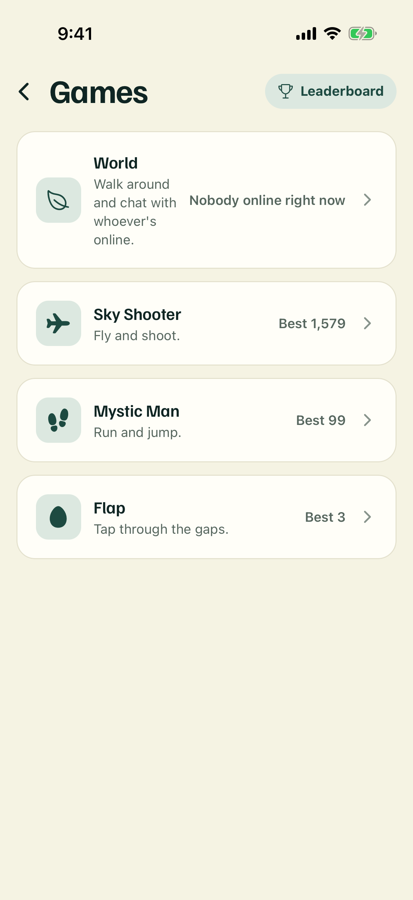 |
| ios `admin-games_flappy` | (none) | 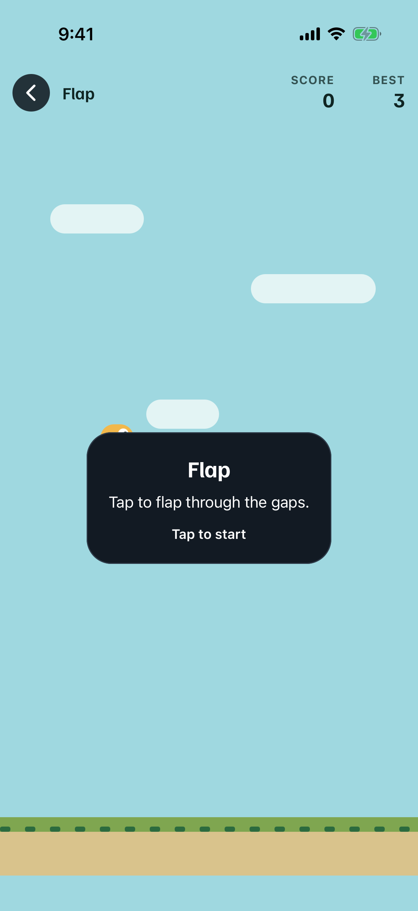 |
| ios `admin-games_leaderboard` | (none) |  |
| ios `admin-games_leaderboard_game_runner` | (none) |  |
| ios `admin-games_runner` | (none) |  |
| ios `admin-games_runner_preview_double` | (none) |  |
| ios `admin-games_runner_preview_hang` | (none) |  |
| ios `admin-games_runner_preview_tall` | (none) | 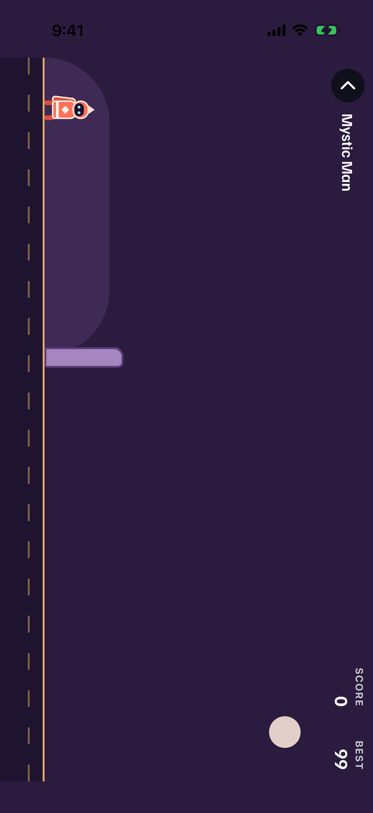 |
| ios `admin-games_runner_preview_wide` | (none) |  |
| ios `admin-games_shooter` | (none) |  |
| ios `admin-grievances` | (none) |  |
| ios `admin-grievances_new` | (none) |  |
| ios `admin-grievances_tab_settings` | (none) |  |
| ios `admin-home` | (none) |  |
| ios `admin-insights_tab_attendance` | (none) |  |
| ios `admin-insights_tab_general` | (none) | 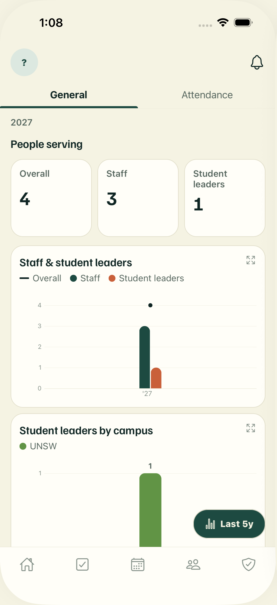 |
| ios `admin-mentoring` | (none) | 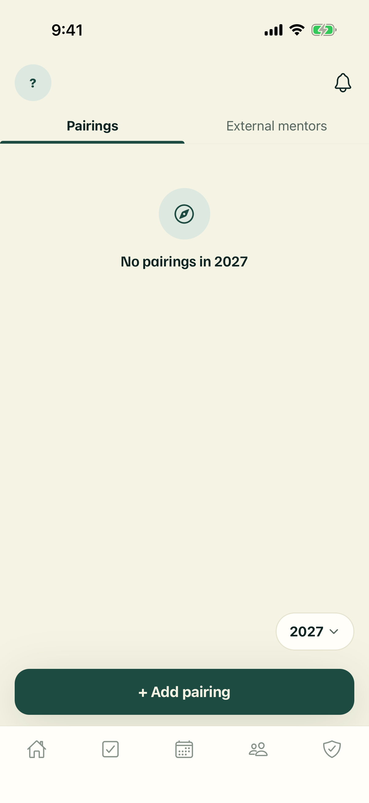 |
| ios `admin-music` | (none) |  |
| ios `admin-notifications` | (none) | 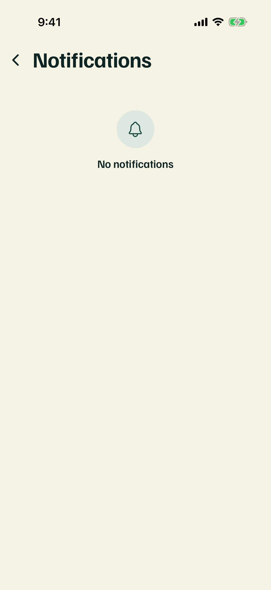 |
| ios `admin-org` | (none) | 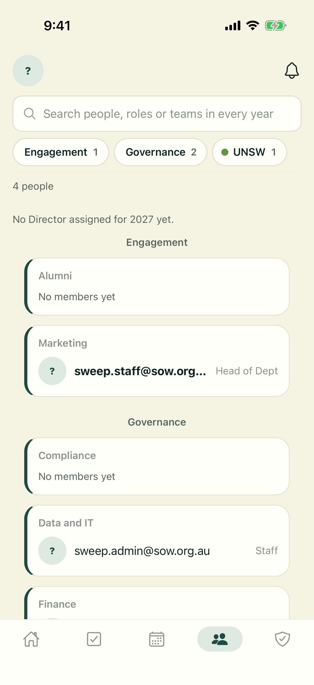 |
| ios `admin-profile` | (none) |  |
| ios `admin-review` | (none) | 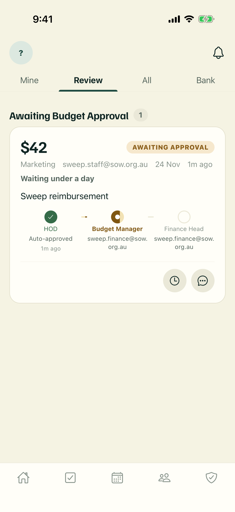 |
| ios `admin-root` | (none) |  |
| ios `admin-world` | (none) |  |
| ios `admin-world_sheet_character` | (none) |  |
| ios `admin-world_sheet_poke` | (none) | 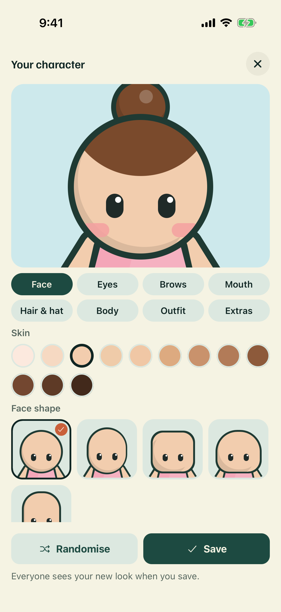 |
| ios `out-home` | (none) |  |
| ios `out-root` | (none) |  |
