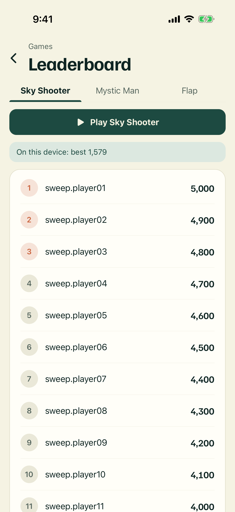
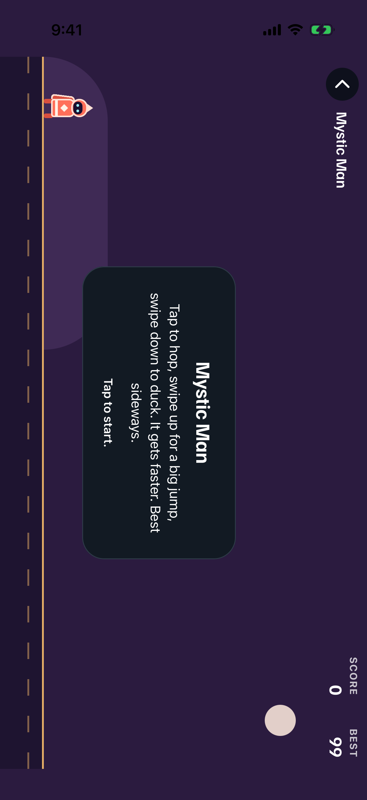
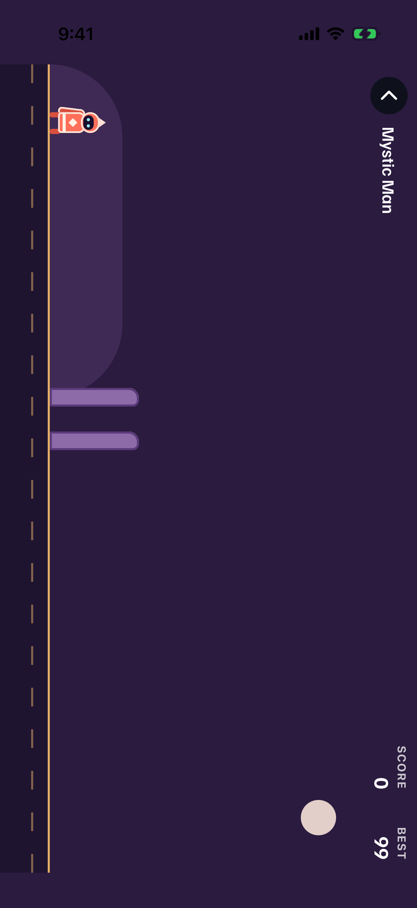
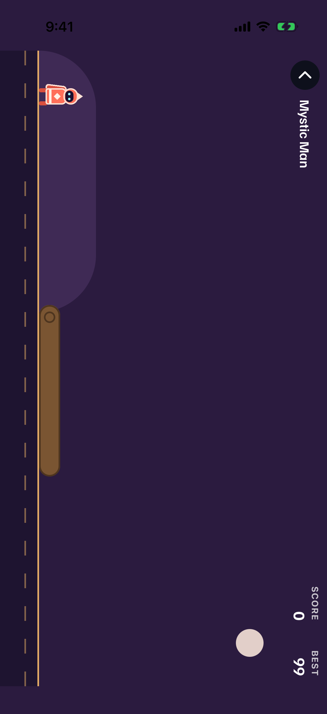
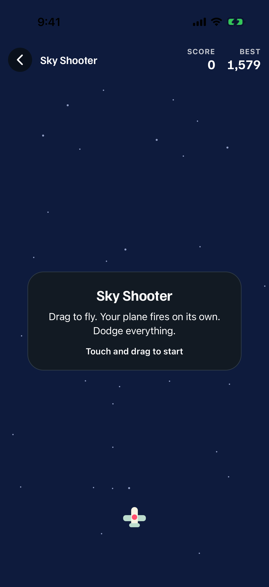

# verify: scoped

- because games: src/components/games/FlappyGame.tsx
- because games: src/components/games/GameFrame.tsx
- because games: src/lib/games/fit.ts
- because games: src/lib/games/flappy.ts

| Step | Result | Time | Detail |
| --- | --- | --- | --- |
| base tree | ✔ pass | 0s |  |
| native fingerprint | ✔ pass | 5s | unchanged on iOS and Android: over-the-air updates reach current builds |
| lint | ✔ pass | 112s |  |
| unused code (knip) | ✔ pass | 6s |  |
| typecheck | ✔ pass | 21s |  |
| related unit tests | ✔ pass | 3s | 32 passed (32) |
| verify lock | ✔ pass | 28s | took it after waiting 28s for pid 99097, fix/world-looks-ping in /Users/xtectra/GitHub/worktrees/the-shed-mobile-world-ping, since 2026-11-24T06:41:59.841Z |
| before: local backend | ✔ pass | 19s | before functions on :3270 |
| before: iOS reset | ✔ pass | 1s |  |
| before: iOS | ✔ pass | 136s | 14 screenshots, every one settled |
| after: local backend | ✔ pass | 17s | after functions on :3270 |
| after: iOS reset | ✔ pass | 1s |  |
| after: iOS | ✔ pass | 106s | 14 screenshots, every one settled |

## Screenshots

| Screen | Before | After |
| --- | --- | --- |
| ios `admin-games` |  |  |
| ios `admin-games_flappy` |  |  |
| ios `admin-games_leaderboard` |  |  |
| ios `admin-games_leaderboard_game_runner` |  |  |
| ios `admin-games_runner` |  |  |
| ios `admin-games_runner_preview_double` |  |  |
| ios `admin-games_runner_preview_hang` |  |  |
| ios `admin-games_runner_preview_tall` |  |  |
| ios `admin-games_runner_preview_wide` |  |  |
| ios `admin-games_shooter` |  |  |
| ios `admin-home` |  |  |
| ios `admin-root` |  |  |
| ios `out-home` |  |  |
| ios `out-root` |  |  |
