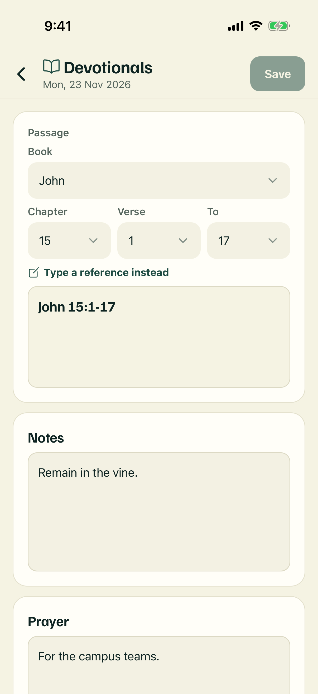
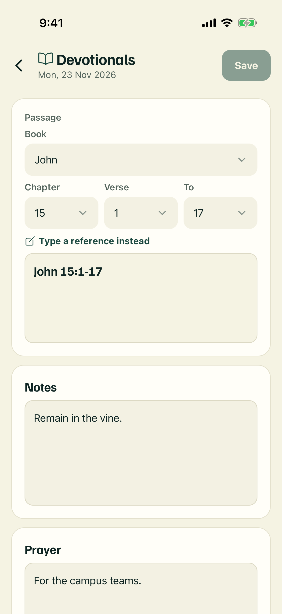
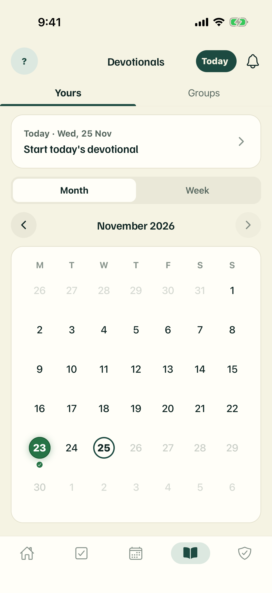
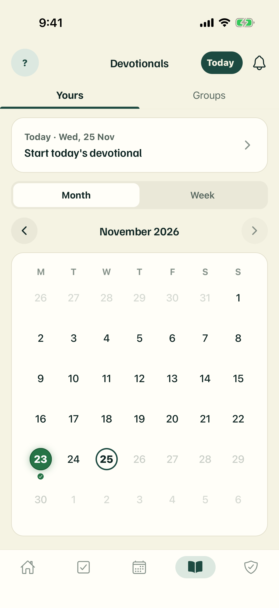

# verify: scoped

- because --only devotionals

| Step | Result | Time | Detail |
| --- | --- | --- | --- |
| base tree | ✔ pass | 0s |  |
| native fingerprint | ✔ pass | 3s | unchanged on iOS and Android: over-the-air updates reach current builds |
| lint | ✔ pass | 66s |  |
| unused code (knip) | ✔ pass | 6s |  |
| typecheck | ✔ pass | 17s |  |
| verify lock | ✔ pass | 0s | free, taken at once |
| before: local backend | ✔ pass | 16s | before functions on :3270 |
| before: iOS reset | ✔ pass | 1s |  |
| before: iOS | ✔ pass | 140s | 8 screenshots, every one settled; checks passed: passage-picker-close |
| after: local backend | ✔ pass | 16s | after functions on :3270 |
| after: iOS reset | ✔ pass | 1s |  |
| after: iOS | ✔ pass | 137s | 8 screenshots, every one settled; checks passed: passage-picker-close |

## Screenshots

| Screen | Before | After |
| --- | --- | --- |
| ios `admin-devotionals` |  |  |
| ios `admin-devotionals_devotionalDate` |  |  |
| ios `admin-devotionals_devotionalEmptyDate` |  |  |
| ios `admin-devotionals_tab_groups` |  |  |
| ios `admin-home` |  |  |
| ios `admin-root` |  |  |
| ios `out-home` |  |  |
| ios `out-root` |  |  |
