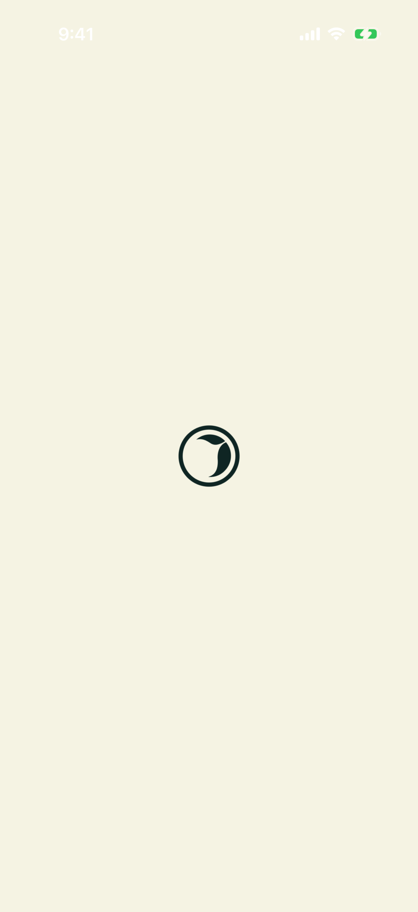
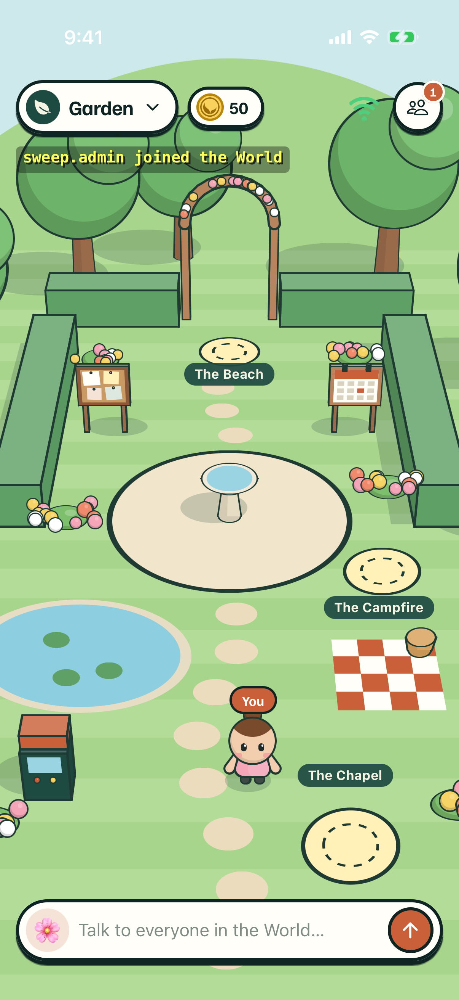
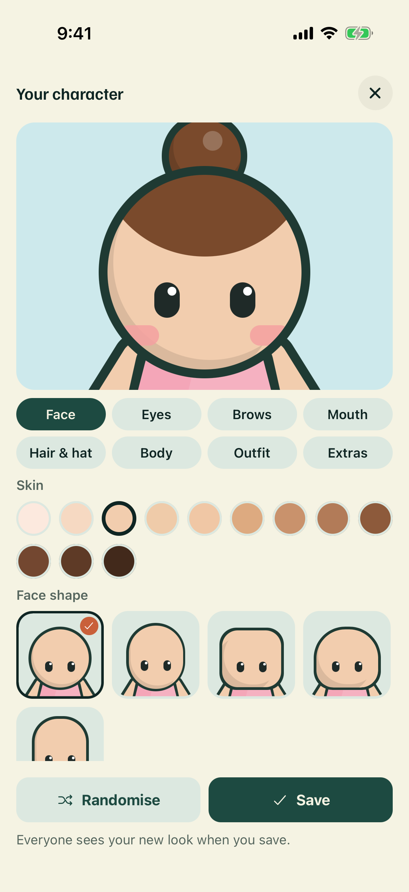

# verify: scoped

- because world: src/world/Person.tsx
- because world: src/world/hatHeight.ts

| Step | Result | Time | Detail |
| --- | --- | --- | --- |
| base tree | ✔ pass | 0s |  |
| native fingerprint | ✔ pass | 3s | unchanged on iOS and Android: over-the-air updates reach current builds |
| lint | ✔ pass | 62s |  |
| unused code (knip) | ✔ pass | 5s |  |
| typecheck | ✔ pass | 15s |  |
| related unit tests | ✔ pass | 2s | 4 passed (4) |
| verify lock | ✔ pass | 0s | free, taken at once |
| before: local backend | ✔ pass | 15s | before functions on :3270 |
| before: iOS reset | ✔ pass | 1s |  |
| before: iOS | ✔ pass | 110s | 10 screenshots, every one settled |
| after: local backend | ✔ pass | 15s | after functions on :3270 |
| after: iOS reset | ✔ pass | 1s |  |
| after: iOS | ✔ pass | 108s | 10 screenshots, every one settled |

## Screenshots

| Screen | Before | After |
| --- | --- | --- |
| ios `admin-games` |  |  |
| ios `admin-home` |  |  |
| ios `admin-root` |  |  |
| ios `admin-world` |  |  |
| ios `admin-world_calendar` |  |  |
| ios `admin-world_praise` |  |  |
| ios `admin-world_sheet_character` |  |  |
| ios `admin-world_sheet_poke` |  |  |
| ios `out-home` |  |  |
| ios `out-root` |  |  |
