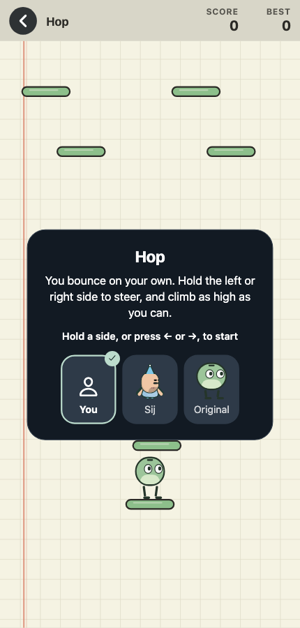
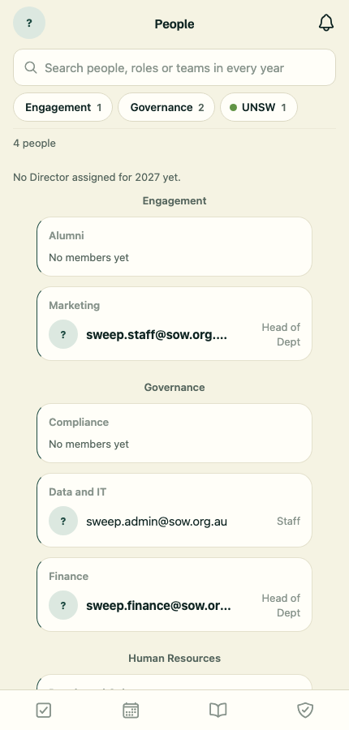
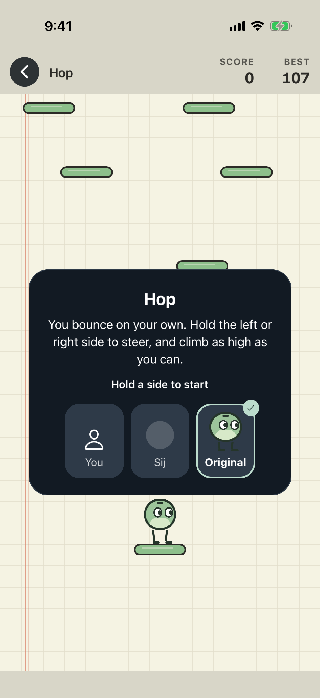
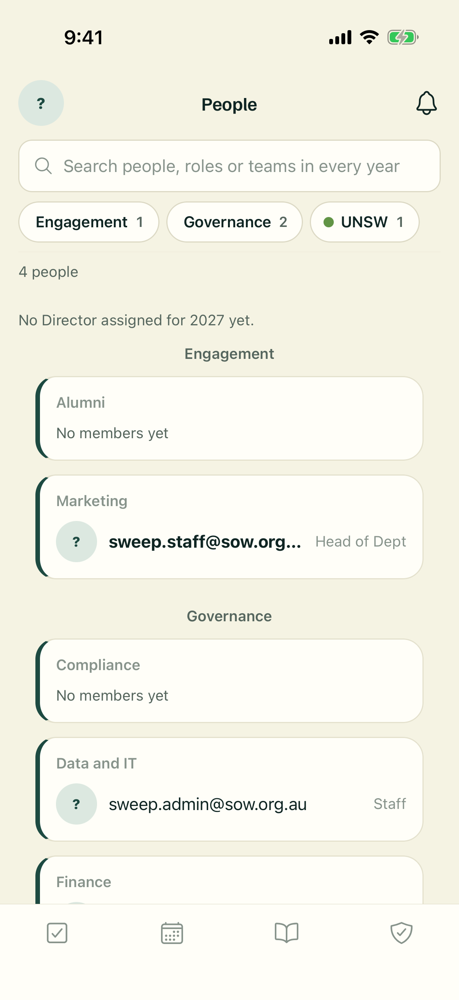
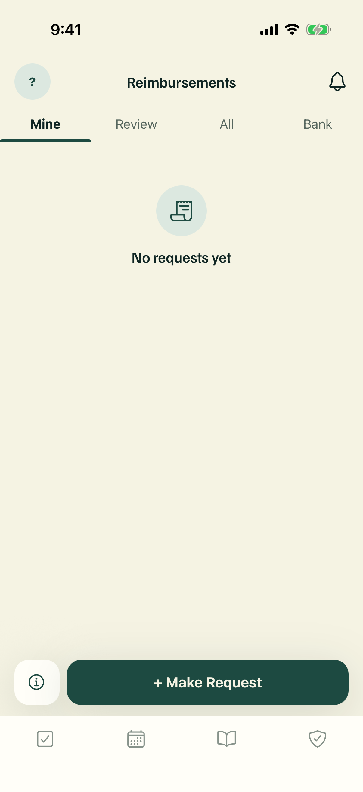
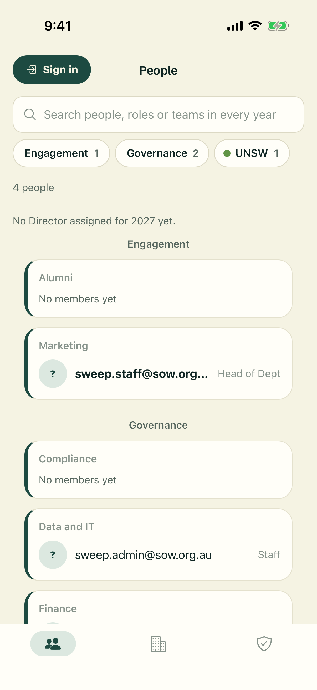

# verify: scoped

- because --only /games/hop

| Step | Result | Time | Detail |
| --- | --- | --- | --- |
| base tree | ✔ pass | 0s |  |
| native fingerprint | ✔ pass | 4s | unchanged on iOS and Android: over-the-air updates reach current builds |
| lint | ✔ pass | 159s |  |
| unused code (knip) | ✔ pass | 6s |  |
| typecheck | ✔ pass | 25s |  |
| ports | ✔ pass | 0s | convex :3270, convexSite :3271, web :8192, metro :8092 |
| Playwright Chromium | ✔ pass | 1s |  |
| before: local backend | ✔ pass | 24s | before functions on :3270 |
| before: web | ✔ pass | 97s | 6 screens, 0 broken. |
| before: simulator lock | ✔ pass | 0s | free, taken at once |
| before: iOS reset | ✔ pass | 3s |  |
| before: iOS | ✔ pass | 121s | 5 screenshots, every one settled |
| after: local backend | ✔ pass | 54s | after functions on :3270 |
| after: web | ✔ pass | 105s | 6 screens, 0 broken. |
| after: simulator lock | ✔ pass | 0s | free, taken at once |
| after: iOS reset | ✔ pass | 2s |  |
| after: iOS | ✔ pass | 83s | 5 screenshots, every one settled |

## Screenshots

| Screen | Before | After |
| --- | --- | --- |
| web `admin-games_hop` |  |  |
| web `admin-org` |  |  |
| web `admin-root` |  |  |
| web `out-games_hop` |  |  |
| web `out-org` |  |  |
| web `out-root` |  |  |
| ios `admin-games_hop` |  |  |
| ios `admin-org` |  |  |
| ios `admin-root` |  |  |
| ios `out-org` |  |  |
| ios `out-root` |  |  |
