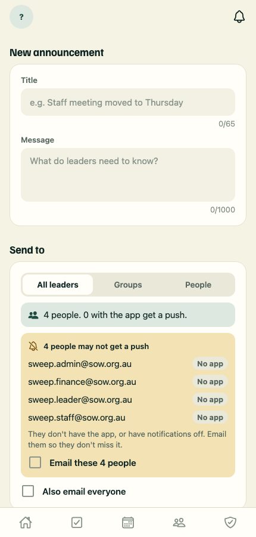
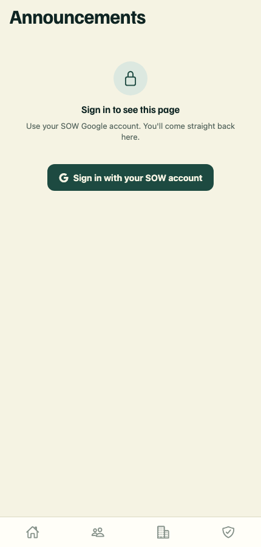
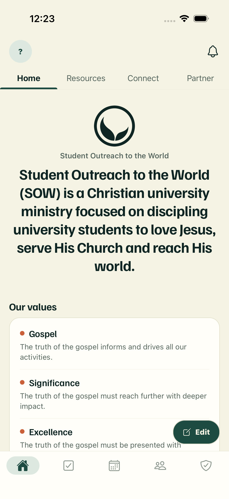

# verify: scoped

- because --only announcements

| Step | Result | Time | Detail |
| --- | --- | --- | --- |
| base tree | ✔ pass | 0s |  |
| native fingerprint | ✔ pass | 21s | unchanged on iOS and Android: over-the-air updates reach current builds |
| lint | ✔ pass | 60s |  |
| typecheck | ✔ pass | 14s |  |
| Playwright Chromium | ✔ pass | 1s |  |
| before: local backend | ✔ pass | 15s | before functions on :3280 |
| before: web | ✔ pass | 95s | 6 screens, 0 broken. |
| before: iOS reset | ✔ pass | 5s |  |
| before: iOS | ⚠ warning | 18s | Command failed: xcrun simctl openurl 0BA0266F-3B68-4DE3-B05E-FDE3B0654828 exp+the-shed-mobile://expo-development-client/?url=http%3A%2F%2Flocalhost%3A8103 An error was encountered processing the command (domain=NSPOSIXErrorDomain, code=60): Simulator device failed to open exp+the-shed-mobile://expo-development-client/?url=http%3A%2F%2Flocalhost%3A8103. Operation timed out Underlying error (domain= |
| after: local backend | ✔ pass | 48s | after functions on :3280 |
| after: web | ✔ pass | 59s | 6 screens, 0 broken. |
| after: iOS reset | ✔ pass | 12s |  |
| after: iOS | ✔ pass | 367s | 5 screenshots |

## Screenshots

| Screen | Before | After |
| --- | --- | --- |
| web `admin-announcements` |  |  |
| web `admin-home` |  |  |
| web `admin-root` |  |  |
| web `out-announcements` |  |  |
| web `out-home` |  |  |
| web `out-root` |  |  |
| ios `admin-announcements` | (none) |  |
| ios `admin-home` | (none) |  |
| ios `admin-root` | (none) |  |
| ios `out-home` | (none) |  |
| ios `out-root` | (none) |  |
