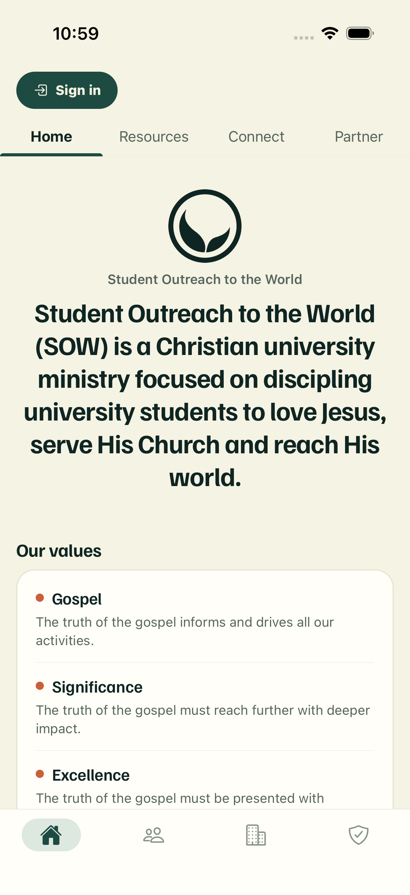

# verify: scoped (after merging main at 871bf16, 2.11.41)

- because --only announcements
- three runs on head 571920e, on ports 3280/3281/8103/8197 and the simulator "iPhone 17 Pro announce"

Run 1, full (web + iOS):

| Step | Result | Detail |
| --- | --- | --- |
| native fingerprint | ✔ pass | unchanged on iOS and Android: over-the-air updates reach current builds |
| lint | ✔ pass |  |
| typecheck | ✔ pass |  |
| before: web | ✔ pass | 6 screens, 0 broken |
| after: web | ✔ pass | 6 screens, 0 broken |
| before / after: iOS | ✔ pass | 5 + 5 screenshots, but all covered by the dev client's first-launch menu on a fresh simulator (fixed for run 2) |

Run 2, iOS (`--no-web`):

| Step | Result | Detail |
| --- | --- | --- |
| lint, typecheck | ✔ pass |  |
| before: iOS | ✔ pass | 5 screenshots |
| after: iOS | ✔ pass | 5 screenshots; the announcements link raced the sign-in redirect and landed on Home |

Run 3, iOS after only (`--no-web --no-before`):

| Step | Result | Detail |
| --- | --- | --- |
| after: iOS | ✔ pass | 5 screenshots; announcements opened |

Web screenshots are from run 1, iOS before from run 2, iOS after from run 3.

## Screenshots

| Screen | Before | After |
| --- | --- | --- |
| web `admin-announcements` |  |  |
| web `admin-home` |  |  |
| web `admin-root` |  |  |
| web `out-announcements` |  |  |
| web `out-home` |  |  |
| web `out-root` |  |  |
| ios `admin-announcements` |  |  |
| ios `admin-home` |  |  |
| ios `admin-root` |  |  |
| ios `out-home` |  |  |
| ios `out-root` |  |  |
