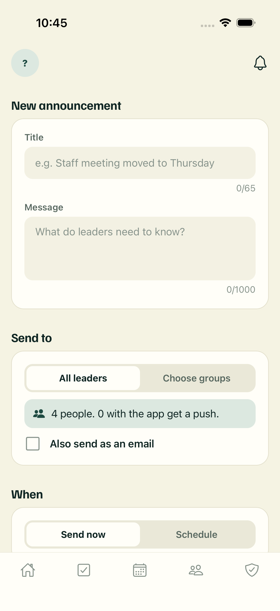
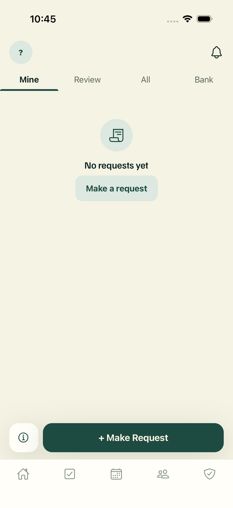
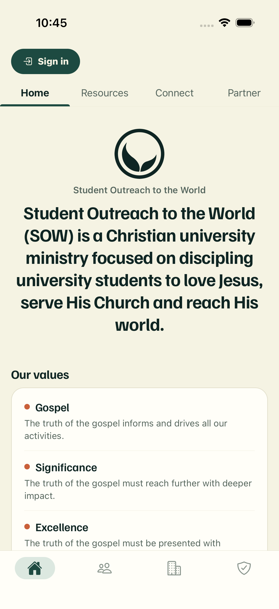

# verify: scoped

- because --only announcements

| Step | Result | Time | Detail |
| --- | --- | --- | --- |
| base tree | ✔ pass | 0s |  |
| native fingerprint | ✔ pass | 10s | unchanged on iOS and Android: over-the-air updates reach current builds |
| lint | ✔ pass | 65s |  |
| typecheck | ✔ pass | 19s |  |
| Playwright Chromium | ✔ pass | 1s |  |
| before: local backend | ✔ pass | 18s | before functions on :3280 |
| before: web | ✔ pass | 83s | 6 screens, 0 broken. |
| before: iOS reset | ✔ pass | 195s |  |
| before: iOS | ✔ pass | 90s | 5 screenshots |
| after: local backend | ✔ pass | 21s | after functions on :3280 |
| after: web | ✔ pass | 68s | 6 screens, 0 broken. |
| after: iOS reset | ✔ pass | 2s |  |
| after: iOS | ✔ pass | 84s | 5 screenshots |

## Screenshots

| Screen | Before | After |
| --- | --- | --- |
| web `admin-announcements` |  |  |
| web `admin-home` |  |  |
| web `admin-root` |  |  |
| web `out-announcements` |  |  |
| web `out-home` |  |  |
| web `out-root` |  |  |
| ios `admin-announcements` |  |  |
| ios `admin-home` |  |  |
| ios `admin-root` |  |  |
| ios `out-home` |  |  |
| ios `out-root` |  |  |
