# verify: scoped

- because --only devotionals

| Step | Result | Time | Detail |
| --- | --- | --- | --- |
| base tree | ✔ pass | 0s |  |
| native fingerprint | ✔ pass | 4s | unchanged on iOS and Android: over-the-air updates reach current builds |
| lint | ✔ pass | 126s |  |
| unused code (knip) | ✔ pass | 5s |  |
| typecheck | ✔ pass | 23s |  |
| verify lock | ✔ pass | 0s | free, taken at once |
| Playwright Chromium | ✔ pass | 1s |  |
| after: local backend | ✔ pass | 21s | after functions on :3270 |
| after: web | ✔ pass | 102s | 12 screens, 0 broken. Checks passed: passage-picker-close, passage-multi. |
| after: iOS reset | ✔ pass | 1s |  |
| after: iOS | ✔ pass | 184s | 8 screenshots, every one settled; checks passed: passage-picker-close |

## Screenshots

| Screen | Before | After |
| --- | --- | --- |
| web `admin-devotionals` | (none) | 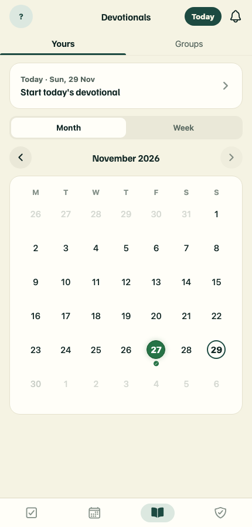 |
| web `admin-devotionals_devotionalDate` | (none) | 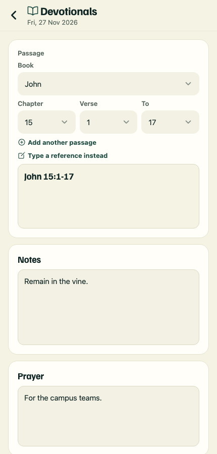 |
| web `admin-devotionals_devotionalEmptyDate` | (none) | 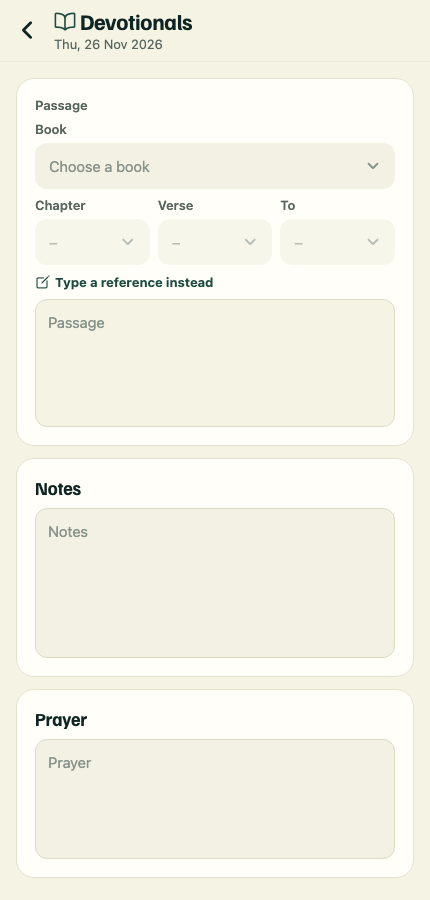 |
| web `admin-devotionals_tab_groups` | (none) | 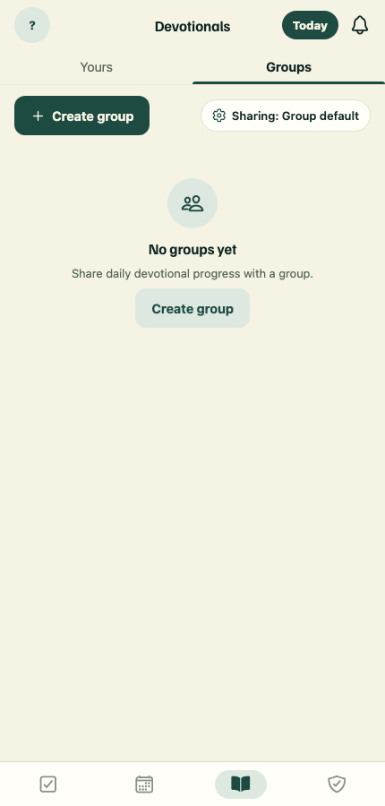 |
| web `admin-org` | (none) |  |
| web `admin-root` | (none) |  |
| web `out-devotionals` | (none) | 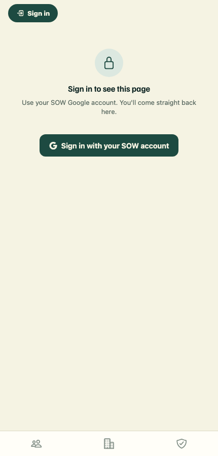 |
| web `out-devotionals_devotionalDate` | (none) | 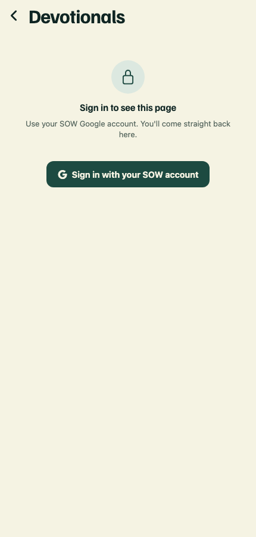 |
| web `out-devotionals_devotionalEmptyDate` | (none) |  |
| web `out-devotionals_tab_groups` | (none) |  |
| web `out-org` | (none) |  |
| web `out-root` | (none) |  |
| ios `admin-devotionals` | (none) |  |
| ios `admin-devotionals_devotionalDate` | (none) | 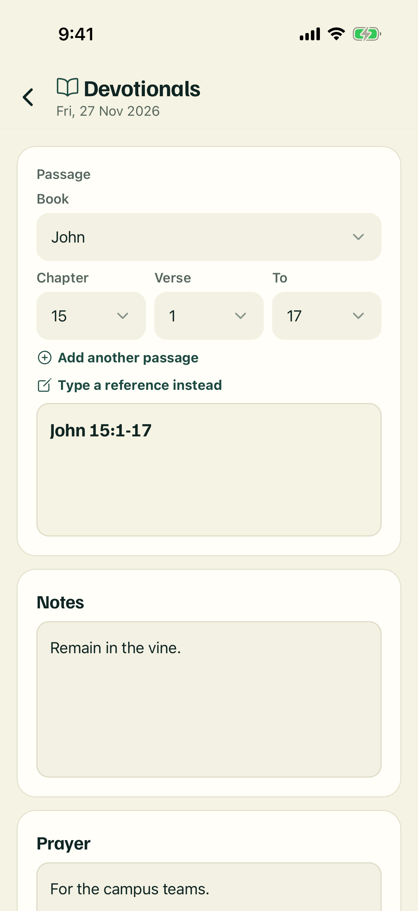 |
| ios `admin-devotionals_devotionalEmptyDate` | (none) | 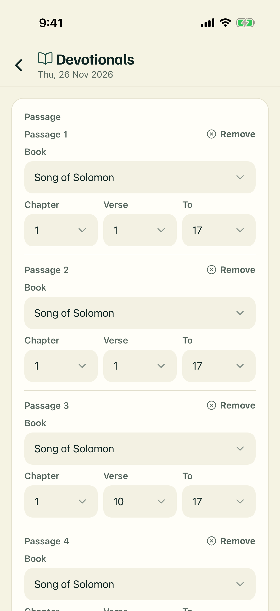 |
| ios `admin-devotionals_tab_groups` | (none) | 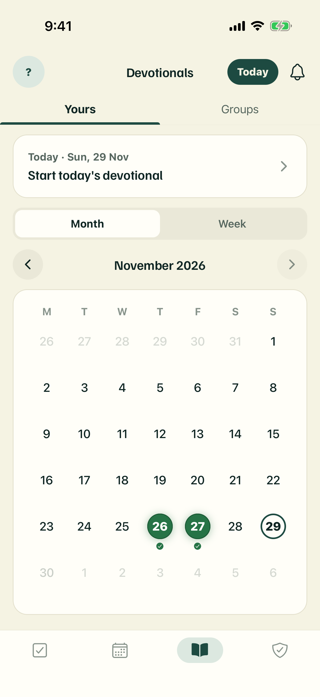 |
| ios `admin-org` | (none) | 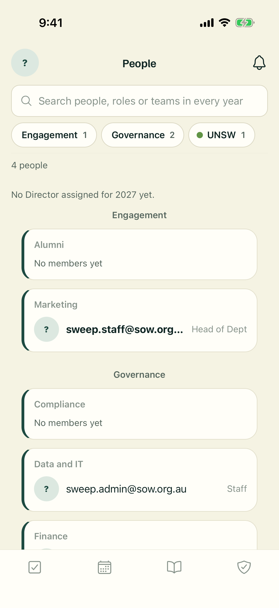 |
| ios `admin-root` | (none) | 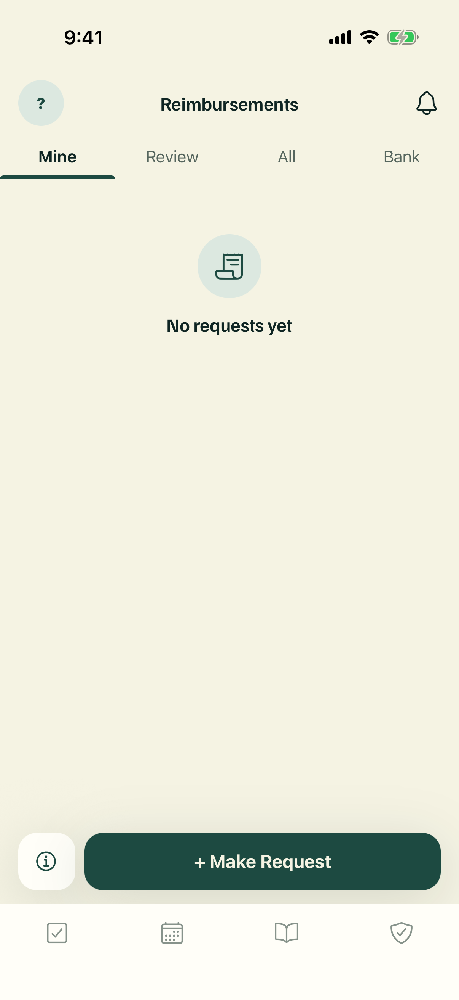 |
| ios `out-org` | (none) | 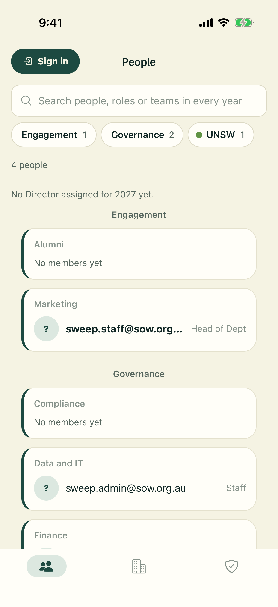 |
| ios `out-root` | (none) |  |
