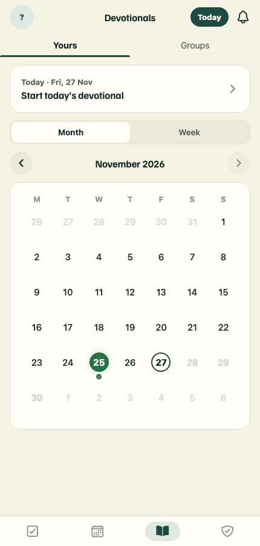
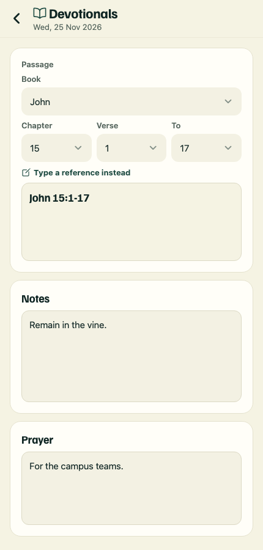
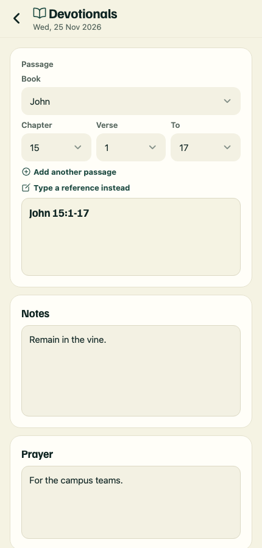
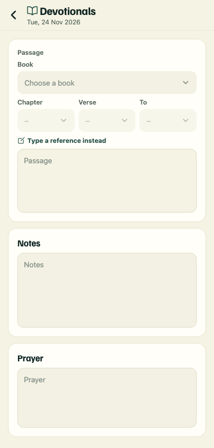
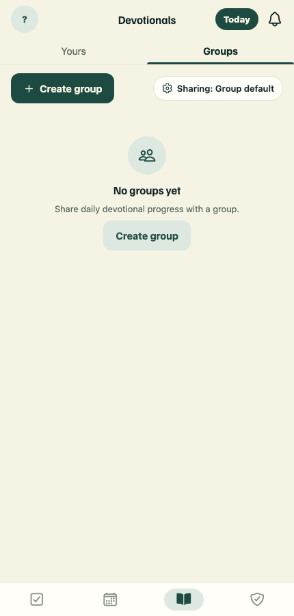
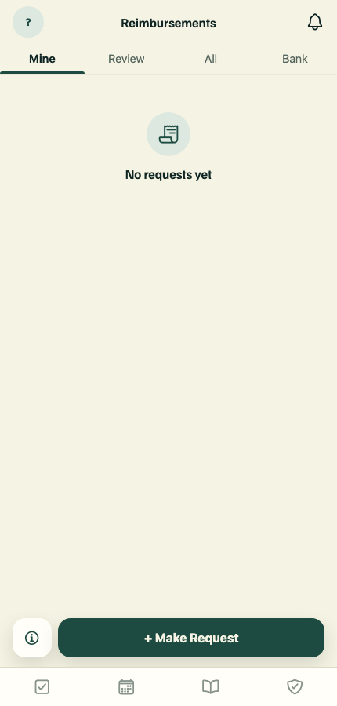
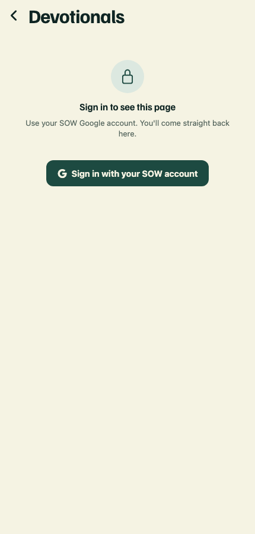

# verify: scoped

- because devotionals: shared/bible.ts
- because devotionals: shared/devotionals.ts
- because devotionals: src/components/devotionals/DevotionalEditor.tsx
- because devotionals: src/components/devotionals/PassagePicker.tsx

| Step | Result | Time | Detail |
| --- | --- | --- | --- |
| base tree | ✔ pass | 0s |  |
| native fingerprint | ✔ pass | 4s | unchanged on iOS and Android: over-the-air updates reach current builds |
| lint | ✔ pass | 116s |  |
| unused code (knip) | ✔ pass | 6s |  |
| typecheck | ✔ pass | 21s |  |
| related unit tests | ✔ pass | 20s | 1930 passed (1930) |
| verify lock | ✔ pass | 567s | took it after waiting 567s for pid 10499, fix/ios-sweep-swoop-letterbox in /Users/xtectra/GitHub/worktrees/ios-sweep-swoop, since 2026-11-27T06:14:57.322Z |
| Playwright Chromium | ✔ pass | 1s |  |
| before: local backend | ✔ pass | 20s | before functions on :3270 |
| before: web | ⚠ warning | 144s | 12 screens, 0 broken.; check passage-multi failed: ✘ TimeoutError: locator.click: Timeout 60000ms exceeded. |
| after: local backend | ✔ pass | 20s | after functions on :3270 |
| after: web | ✔ pass | 91s | 12 screens, 0 broken. Checks passed: passage-picker-close, passage-multi. |

## Screenshots

| Screen | Before | After |
| --- | --- | --- |
| web `admin-devotionals` |  |  |
| web `admin-devotionals_devotionalDate` |  |  |
| web `admin-devotionals_devotionalEmptyDate` |  |  |
| web `admin-devotionals_tab_groups` |  |  |
| web `admin-org` |  |  |
| web `admin-root` |  |  |
| web `out-devotionals` |  |  |
| web `out-devotionals_devotionalDate` |  |  |
| web `out-devotionals_devotionalEmptyDate` |  |  |
| web `out-devotionals_tab_groups` |  |  |
| web `out-org` |  |  |
| web `out-root` |  |  |
