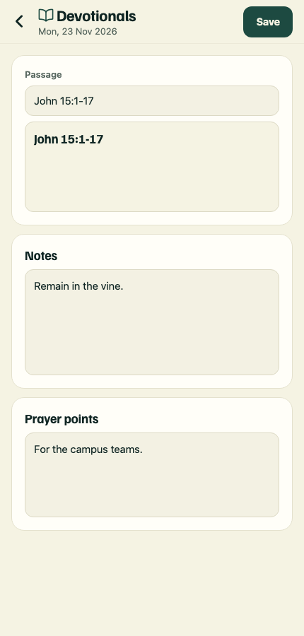
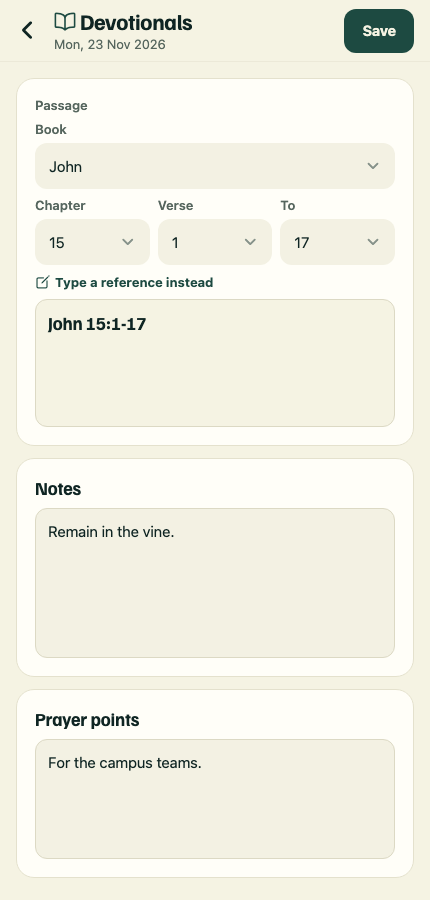
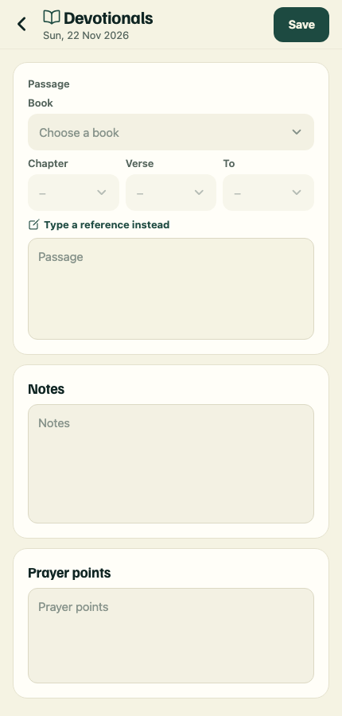
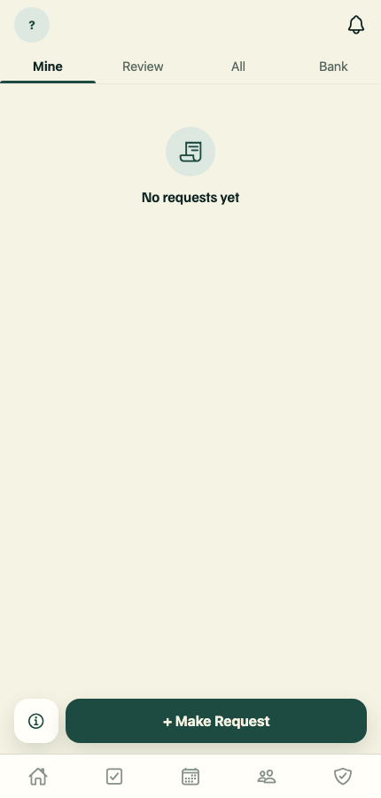
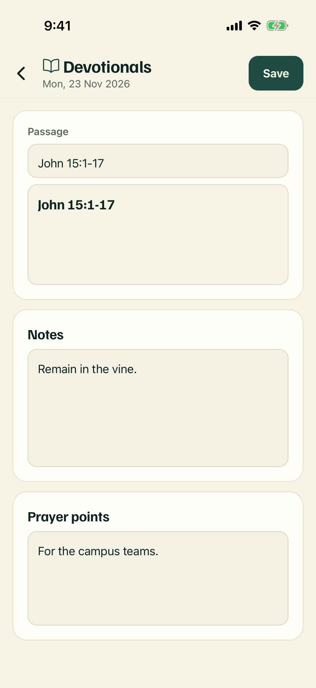

# verify: scoped

- because devotionals: shared/bible.ts
- because devotionals: src/components/devotionals/DevotionalEditor.tsx
- because devotionals: src/components/devotionals/PassagePicker.tsx

| Step | Result | Time | Detail |
| --- | --- | --- | --- |
| base tree | ✔ pass | 0s |  |
| native fingerprint | ✔ pass | 4s | unchanged on iOS and Android: over-the-air updates reach current builds |
| lint | ✔ pass | 72s |  |
| unused code (knip) | ✔ pass | 5s |  |
| typecheck | ✔ pass | 17s |  |
| related unit tests | ✔ pass | 15s | 1662 passed (1662) |
| verify lock | ✔ pass | 1546s | took it after waiting 1545s for pid 53480, feat/coins-top3 in /Users/xtectra/GitHub/worktrees/the-shed-mobile-coins-top3, since 2026-11-24T18:01:42.495Z |
| Playwright Chromium | ✔ pass | 1s |  |
| before: local backend | ✔ pass | 16s | before functions on :3270 |
| before: web | ✔ pass | 64s | 10 screens, 0 broken. |
| before: iOS reset | ✔ pass | 1s |  |
| before: iOS | ✔ pass | 71s | 7 screenshots, every one settled |
| after: local backend | ✔ pass | 16s | after functions on :3270 |
| after: web | ✔ pass | 62s | 10 screens, 0 broken. |
| after: iOS reset | ✔ pass | 1s |  |
| after: iOS | ✔ pass | 70s | 7 screenshots, every one settled |

## Screenshots

| Screen | Before | After |
| --- | --- | --- |
| web `admin-devotionals` |  |  |
| web `admin-devotionals_devotionalDate` |  |  |
| web `admin-devotionals_devotionalEmptyDate` |  |  |
| web `admin-home` |  |  |
| web `admin-root` |  |  |
| web `out-devotionals` |  |  |
| web `out-devotionals_devotionalDate` |  |  |
| web `out-devotionals_devotionalEmptyDate` |  |  |
| web `out-home` |  |  |
| web `out-root` |  |  |
| ios `admin-devotionals` |  |  |
| ios `admin-devotionals_devotionalDate` |  |  |
| ios `admin-devotionals_devotionalEmptyDate` |  |  |
| ios `admin-home` |  |  |
| ios `admin-root` |  |  |
| ios `out-home` |  |  |
| ios `out-root` |  |  |
