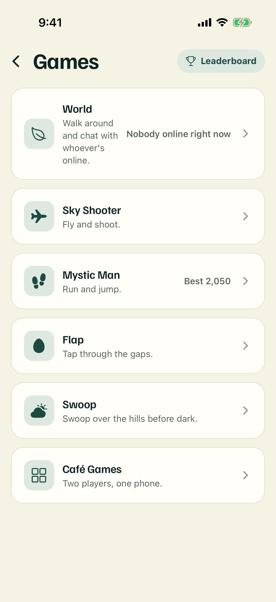
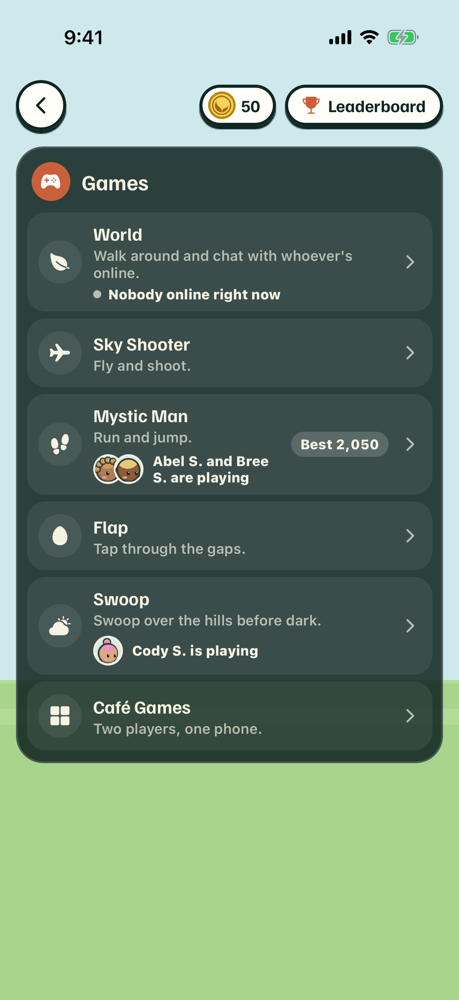
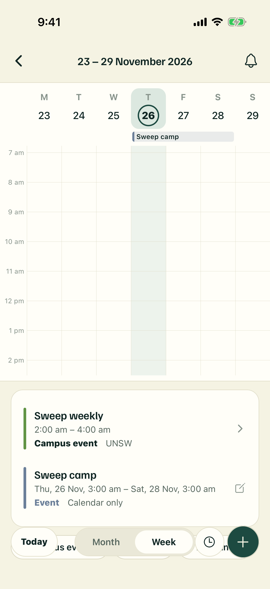
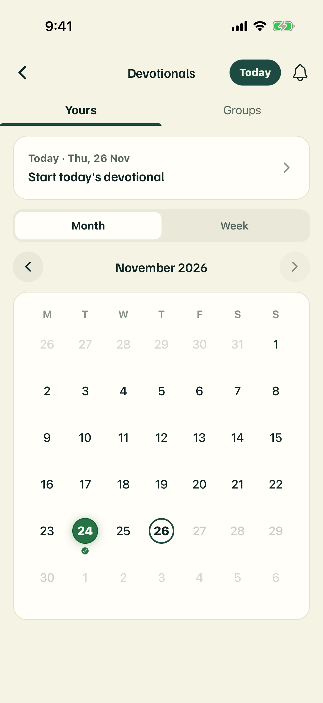
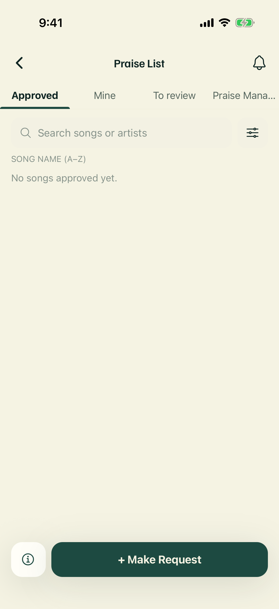
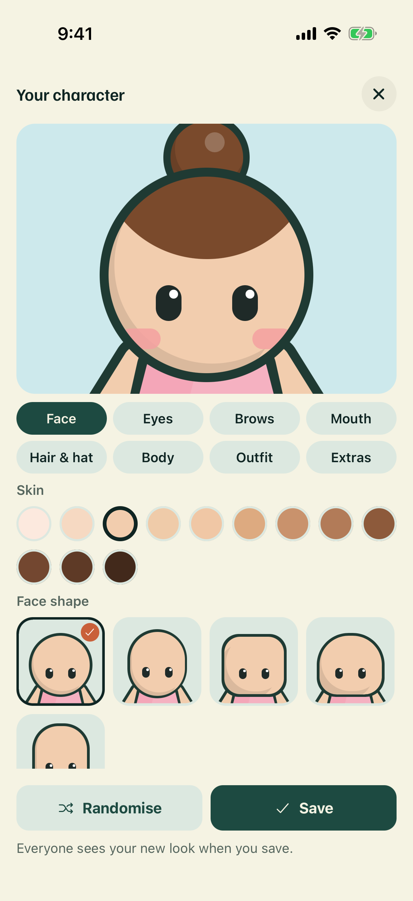
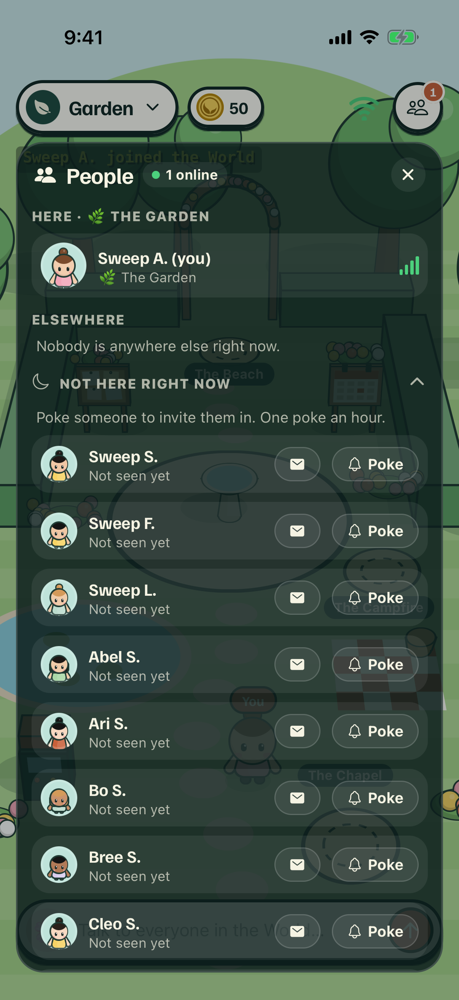
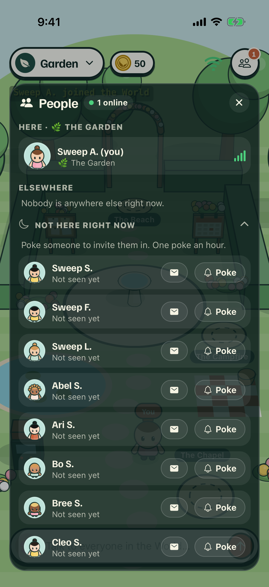

# verify: scoped

- because --only world

| Step | Result | Time | Detail |
| --- | --- | --- | --- |
| base tree | ✔ pass | 0s |  |
| native fingerprint | ✔ pass | 3s | unchanged on iOS and Android: over-the-air updates reach current builds |
| lint | ✔ pass | 82s |  |
| unused code (knip) | ✔ pass | 5s |  |
| typecheck | ✔ pass | 20s |  |
| verify lock | ✔ pass | 1497s | took it after waiting 1497s for pid 16963, HEAD in /Users/xtectra/GitHub/worktrees/the-shed-mobile-verify-pr566, since 2026-11-25T14:54:46.194Z |
| before: local backend | ✔ pass | 17s | before functions on :3270 |
| before: iOS reset | ✔ pass | 1s |  |
| before: iOS | ⚠ warning | 174s | check arcade-podium failed, see .verify/run/before/logs/check-arcade-podium-ios.log Assert that id: world-arcade is visible... FAILED Assertion is false: id: world-arcade is visible Assertion 'id: world-arcade is visible' failed. Check the UI hierarchy in debug artifacts to verify the element state and properties. |
| after: local backend | ✔ pass | 20s | after functions on :3270 |
| after: iOS reset | ✔ pass | 1s |  |
| after: iOS | ✔ pass | 195s | 12 screenshots, every one settled; checks passed: arcade-podium |

## Screenshots

| Screen | Before | After |
| --- | --- | --- |
| ios `admin-games` |  |  |
| ios `admin-home` |  |  |
| ios `admin-root` |  |  |
| ios `admin-world` |  |  |
| ios `admin-world_calendar` |  |  |
| ios `admin-world_devotionals` |  |  |
| ios `admin-world_praise` |  |  |
| ios `admin-world_sheet_arcade` |  |  |
| ios `admin-world_sheet_character` |  |  |
| ios `admin-world_sheet_poke` |  |  |
| ios `out-home` |  |  |
| ios `out-root` |  |  |
