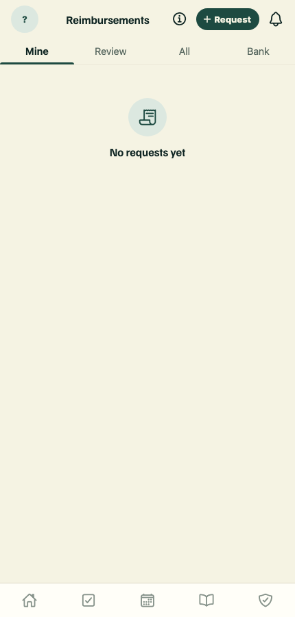
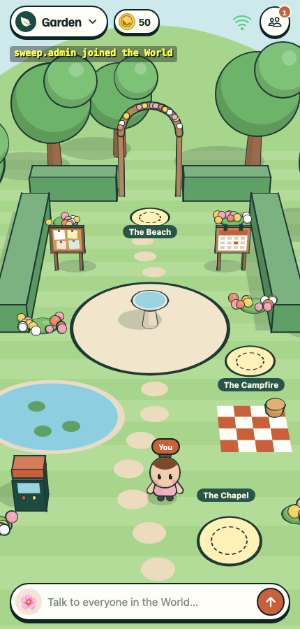
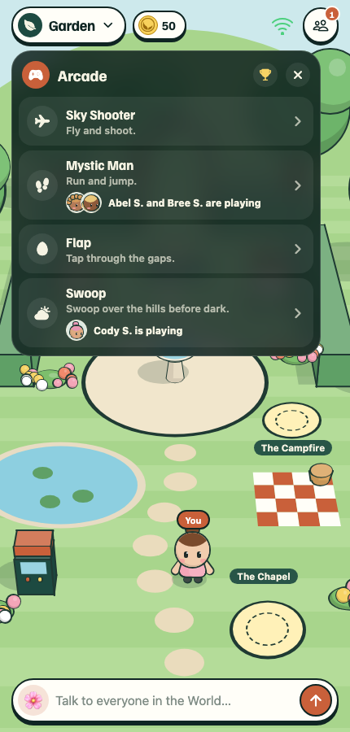
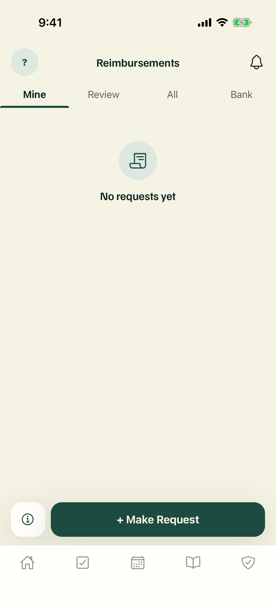

# verify: scoped

- because --only /world?sheet=arcade

| Step | Result | Time | Detail |
| --- | --- | --- | --- |
| base tree | ✔ pass | 0s |  |
| native fingerprint | ✔ pass | 3s | unchanged on iOS and Android: over-the-air updates reach current builds |
| lint | ✔ pass | 78s |  |
| unused code (knip) | ✔ pass | 5s |  |
| typecheck | ✔ pass | 19s |  |
| verify lock | ✔ pass | 12s | took it after waiting 12s for pid 24958, fix/passage-picker-close-main in /Users/xtectra/GitHub/worktrees/the-shed-mobile-passage-picker-close, since 2026-11-25T09:41:21.226Z |
| Playwright Chromium | ✔ pass | 1s |  |
| before: local backend | ✔ pass | 17s | before functions on :3270 |
| before: web | ✔ pass | 70s | 6 screens, 0 broken. |
| before: iOS reset | ✔ pass | 2s |  |
| before: iOS | ✔ pass | 80s | 5 screenshots, every one settled |
| after: local backend | ✔ pass | 17s | after functions on :3270 |
| after: web | ✔ pass | 61s | 6 screens, 0 broken. |
| after: iOS reset | ✔ pass | 1s |  |
| after: iOS | ✔ pass | 76s | 5 screenshots, every one settled |

## Screenshots

| Screen | Before | After |
| --- | --- | --- |
| web `admin-home` |  |  |
| web `admin-root` |  |  |
| web `admin-world_sheet_arcade` |  |  |
| web `out-home` |  |  |
| web `out-root` |  |  |
| web `out-world_sheet_arcade` |  |  |
| ios `admin-home` |  |  |
| ios `admin-root` |  |  |
| ios `admin-world_sheet_arcade` |  |  |
| ios `out-home` |  |  |
| ios `out-root` |  |  |
