# verify: scoped

- because attendance: convex/eventGuests.ts
- because attendance: src/app/attendance/event/[eventId].tsx
- because attendance: src/components/AttendanceRow.tsx
- because attendance: src/lib/rollCallColumns.ts

| Step | Result | Time | Detail |
| --- | --- | --- | --- |
| base tree | ✔ pass | 0s |  |
| native fingerprint | ✔ pass | 4s | unchanged on iOS and Android: over-the-air updates reach current builds |
| lint | ✔ pass | 42s |  |
| unused code (knip) | ✔ pass | 4s |  |
| typecheck | ✔ pass | 13s |  |
| related unit tests | ✔ pass | 11s | 1391 passed (1391) |
| Playwright Chromium | ✔ pass | 1s |  |
| before: local backend | ✔ pass | 17s | before functions on :3296 |
| before: web | ✔ pass | 89s | 14 screens, 0 broken. |
| before: iOS reset | ✔ pass | 2s |  |
| before: iOS | ✔ pass | 106s | 9 screenshots, every one settled |
| after: local backend | ✔ pass | 23s | after functions on :3296 |
| after: web | ✔ pass | 87s | 14 screens, 0 broken. |
| after: iOS reset | ✔ pass | 2s |  |
| after: iOS | ✔ pass | 75s | 9 screenshots, every one settled |

## Screenshots

| Screen | Before | After |
| --- | --- | --- |
| web `admin-attendance` | 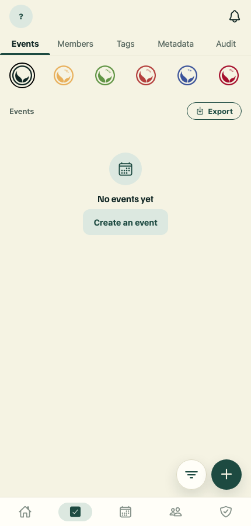 |  |
| web `admin-attendance_event_eventId` | 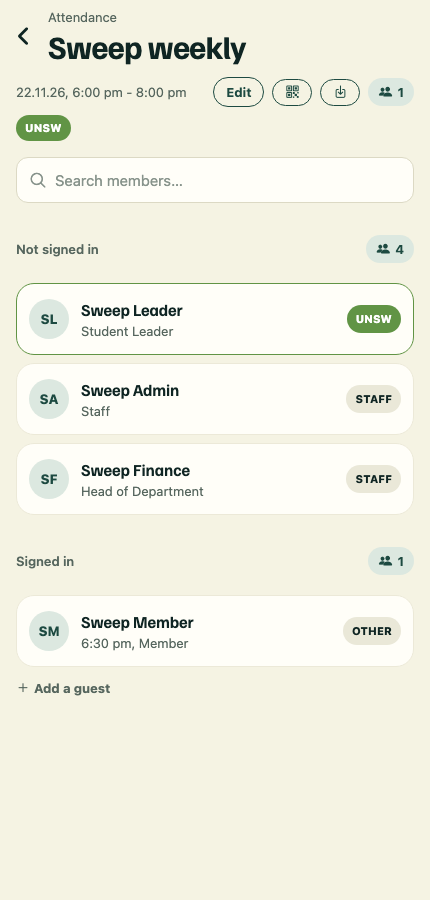 | 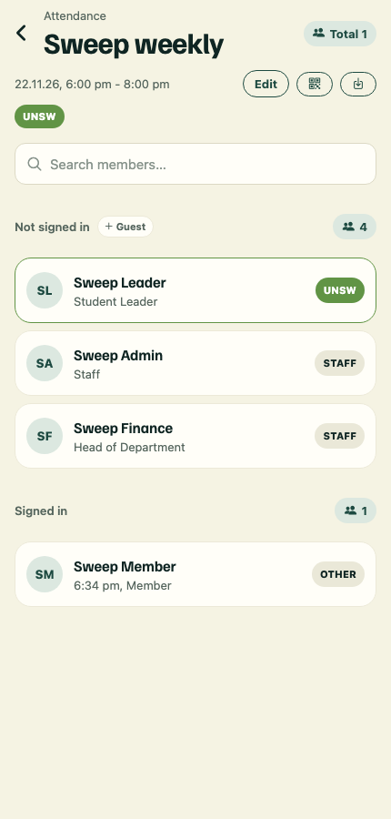 |
| web `admin-attendance_member_member_3A_memberId` | 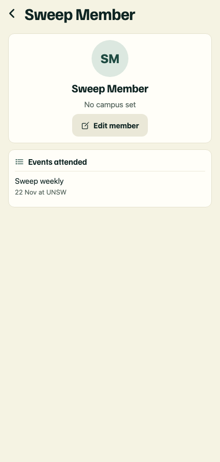 |  |
| web `admin-attendance_merges` |  | 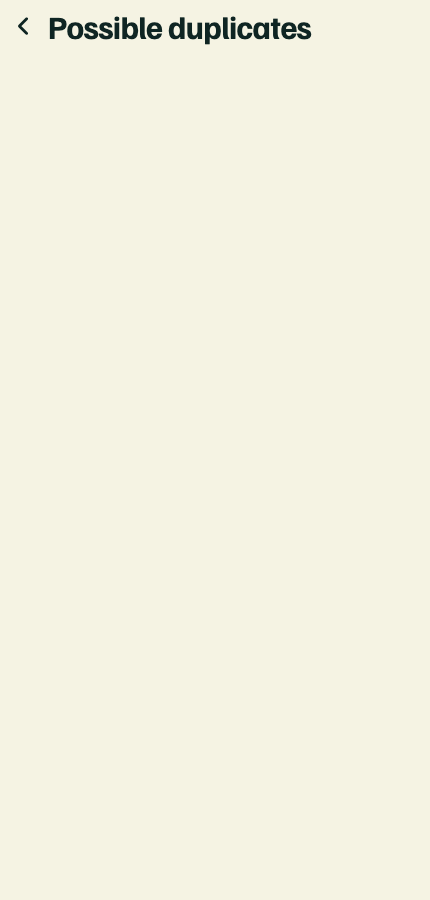 |
| web `admin-checkin_checkInToken` |  | 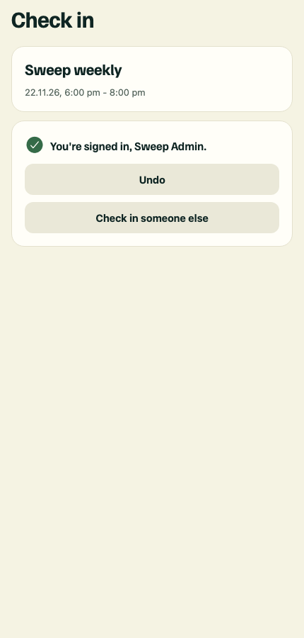 |
| web `admin-home` |  |  |
| web `admin-root` |  |  |
| web `out-attendance` |  |  |
| web `out-attendance_event_eventId` | 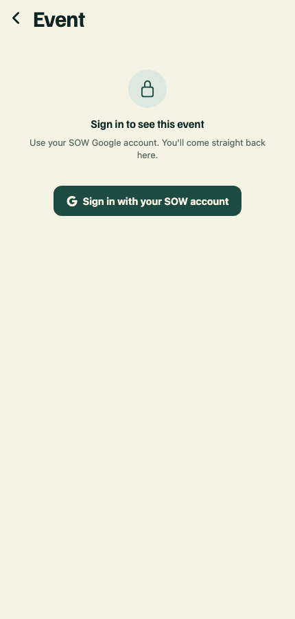 |  |
| web `out-attendance_member_member_3A_memberId` | 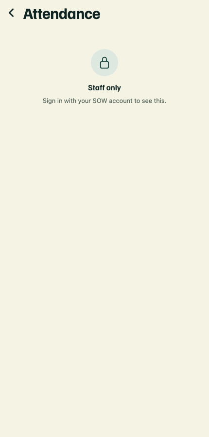 |  |
| web `out-attendance_merges` | 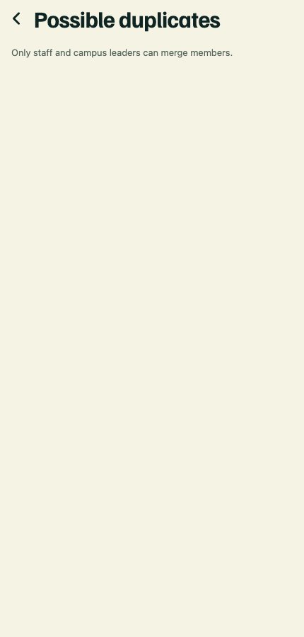 |  |
| web `out-checkin_checkInToken` | 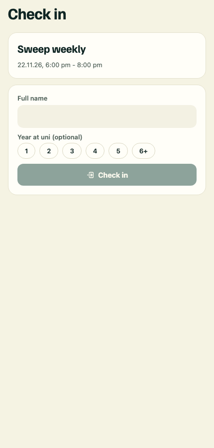 |  |
| web `out-home` |  |  |
| web `out-root` |  |  |
| ios `admin-attendance` | 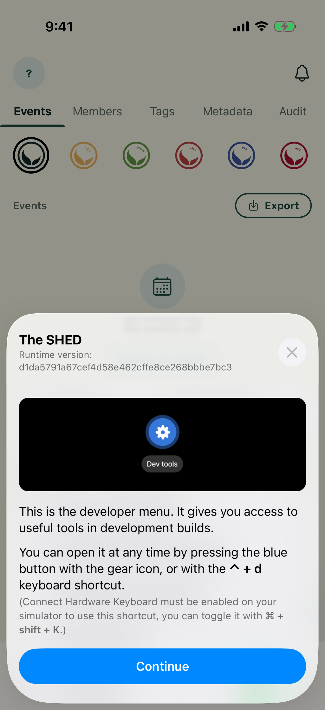 |  |
| ios `admin-attendance_event_eventId` | 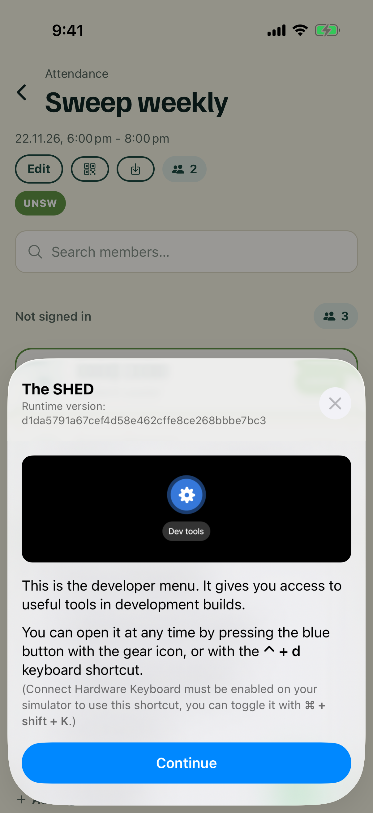 | 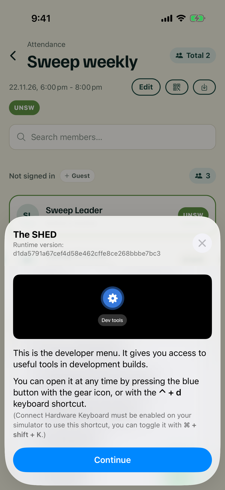 |
| ios `admin-attendance_member_member_3A_memberId` |  | 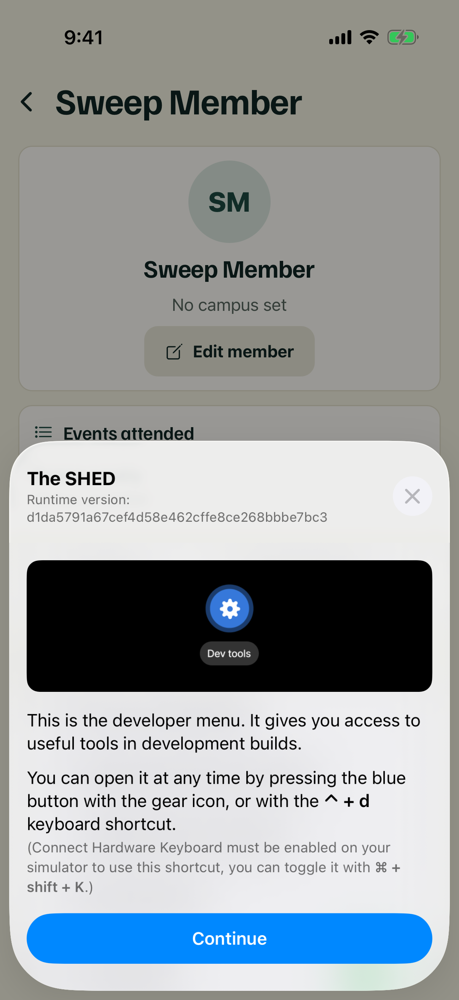 |
| ios `admin-attendance_merges` | 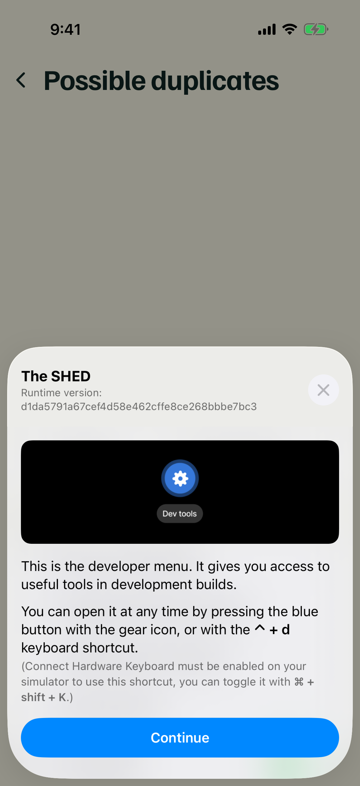 |  |
| ios `admin-checkin_checkInToken` |  | 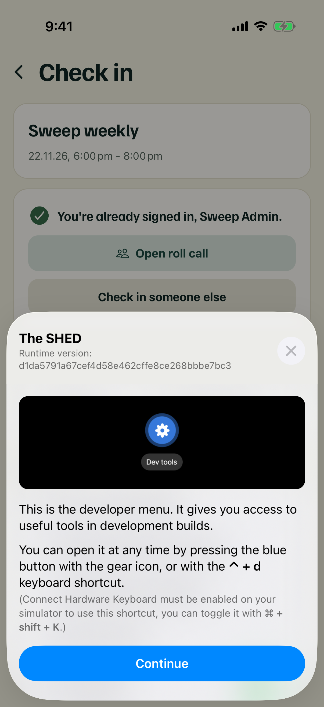 |
| ios `admin-home` |  | 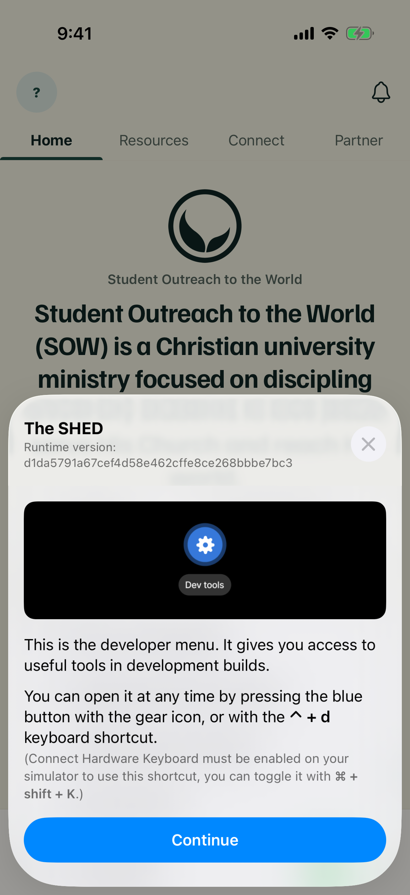 |
| ios `admin-root` |  | 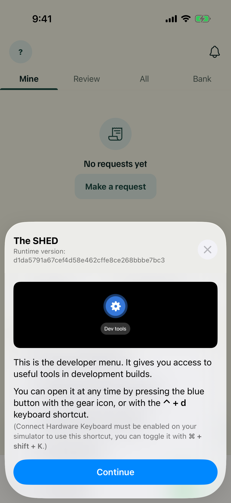 |
| ios `out-home` |  | 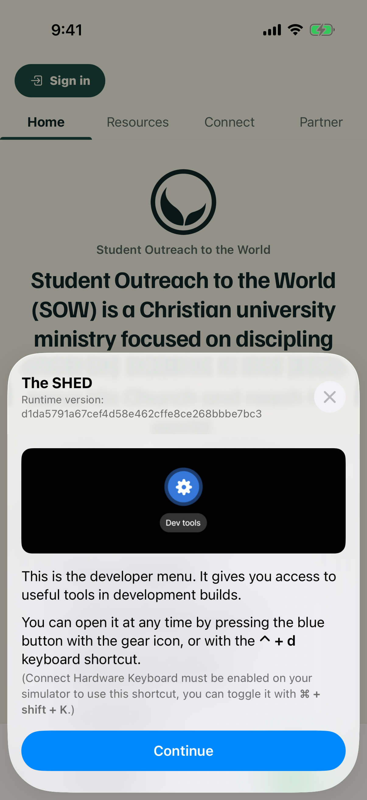 |
| ios `out-root` |  |  |
