# verify: scoped

- because world: src/world/CharacterEditor.tsx
- because world: src/world/Person.tsx
- because world: src/world/bodywear.ts
- because world: src/world/headwear.ts
- because world: src/world/previewMotion.ts

| Step | Result | Time | Detail |
| --- | --- | --- | --- |
| base tree | ✔ pass | 0s |  |
| native fingerprint | ✔ pass | 4s | unchanged on iOS and Android: over-the-air updates reach current builds |
| lint | ✔ pass | 49s |  |
| unused code (knip) | ✔ pass | 7s |  |
| typecheck | ✔ pass | 125s |  |
| related unit tests | ✔ pass | 1s | 52 passed (52) |
| verify lock | ✔ pass | 0s | free, taken at once |
| Playwright Chromium | ✔ pass | 4s |  |
| before: local backend | ✔ pass | 66s | before functions on :3270 |
| before: web | ⚠ warning | 1119s | 20 screens, 1 broken. admin   /                                                    BROKEN         page error: still changing after 15s |
| after: local backend | ✔ pass | 53s | after functions on :3270 |
| after: web | ✔ pass | 221s | 20 screens, 0 broken. Checks passed: chapel-pews, arcade-podium. |

## Contact Sheets

### Outfits

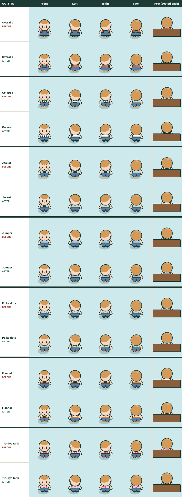

### Hats

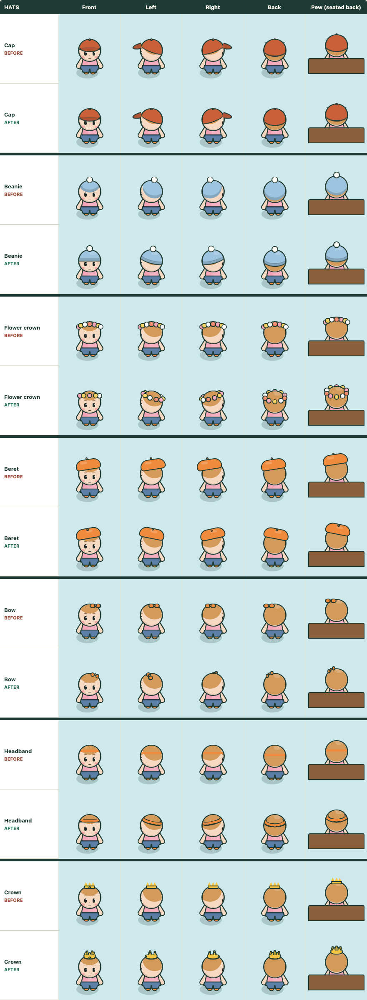

### Accessories

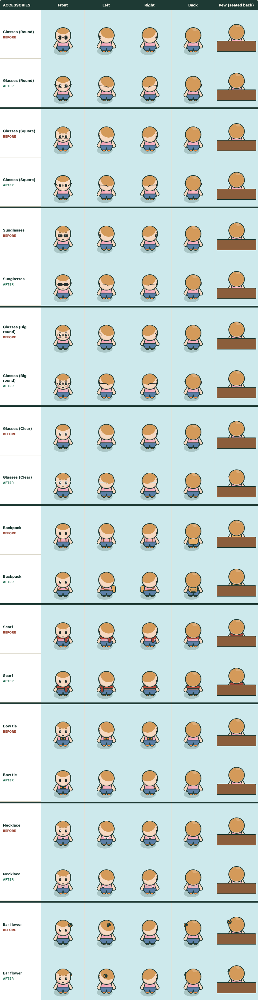

### Hair

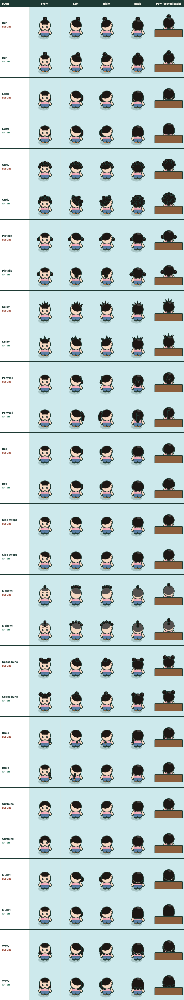

## Screenshots

| Screen | Before | After |
| --- | --- | --- |
| web `admin-games` | 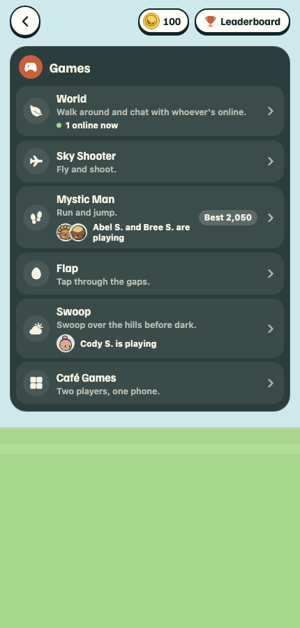 |  |
| web `admin-home` | 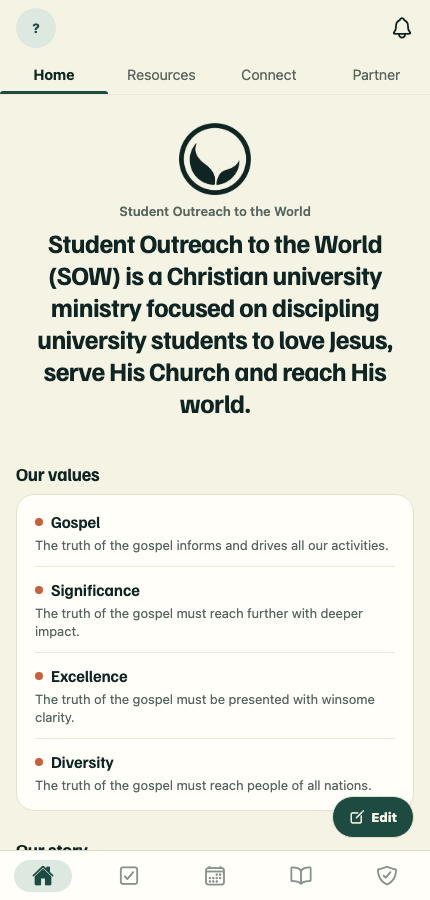 |  |
| web `admin-root` | 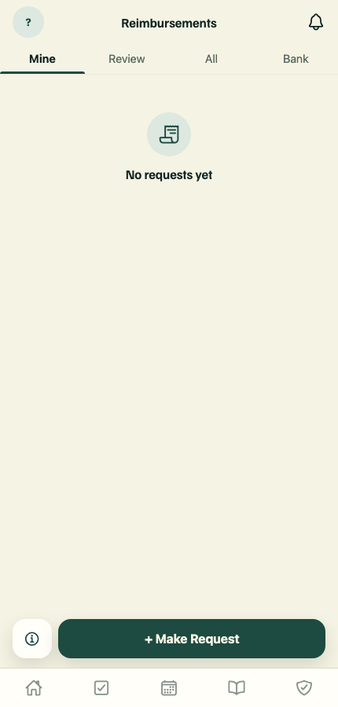 |  |
| web `admin-world` | 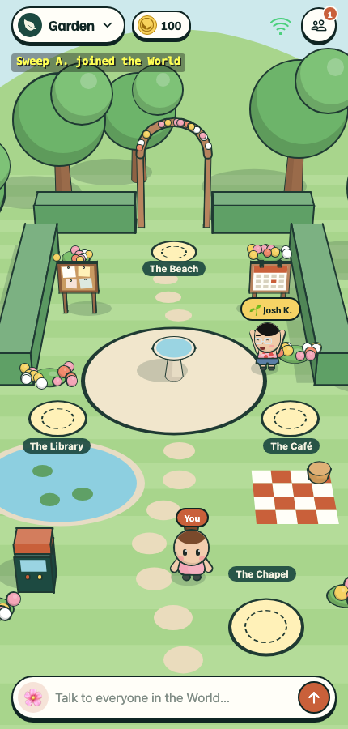 |  |
| web `admin-world_calendar` | 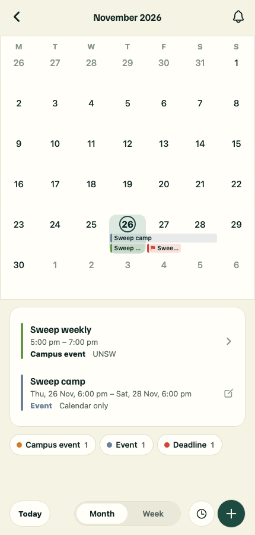 |  |
| web `admin-world_devotionals` | 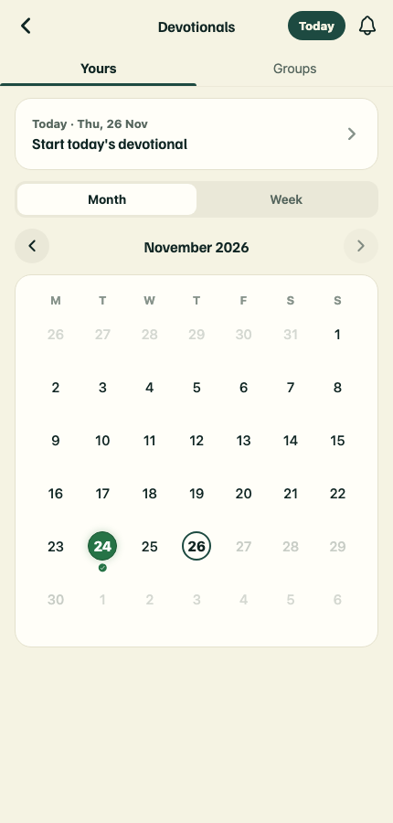 |  |
| web `admin-world_praise` | 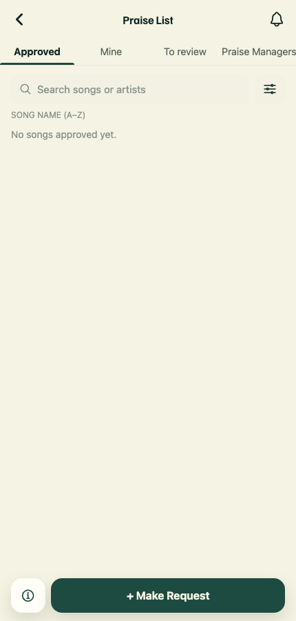 |  |
| web `admin-world_sheet_arcade` |  | 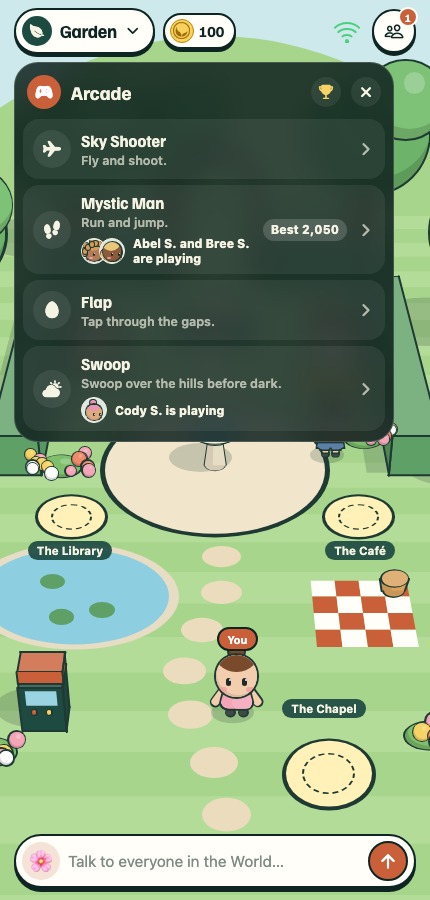 |
| web `admin-world_sheet_character` |  | 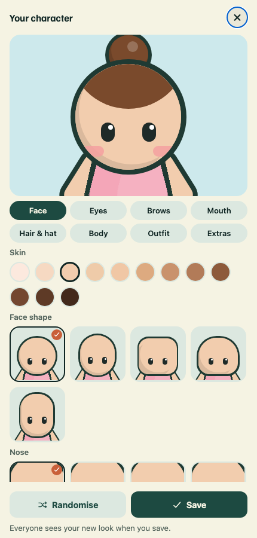 |
| web `admin-world_sheet_poke` | 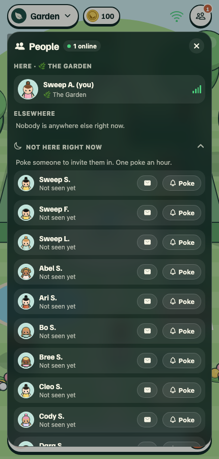 | 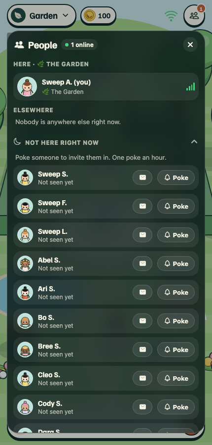 |
| web `out-games` | 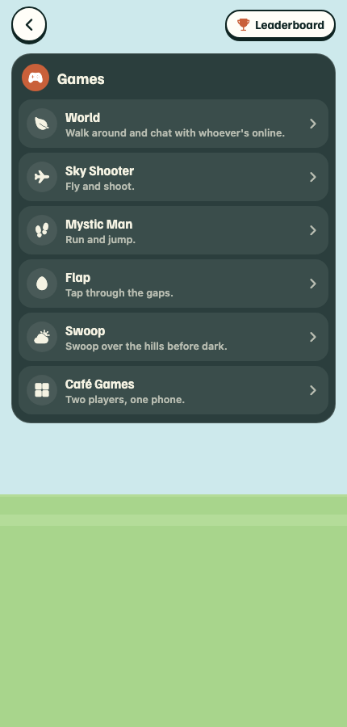 |  |
| web `out-home` |  |  |
| web `out-root` |  |  |
| web `out-world` |  |  |
| web `out-world_calendar` | 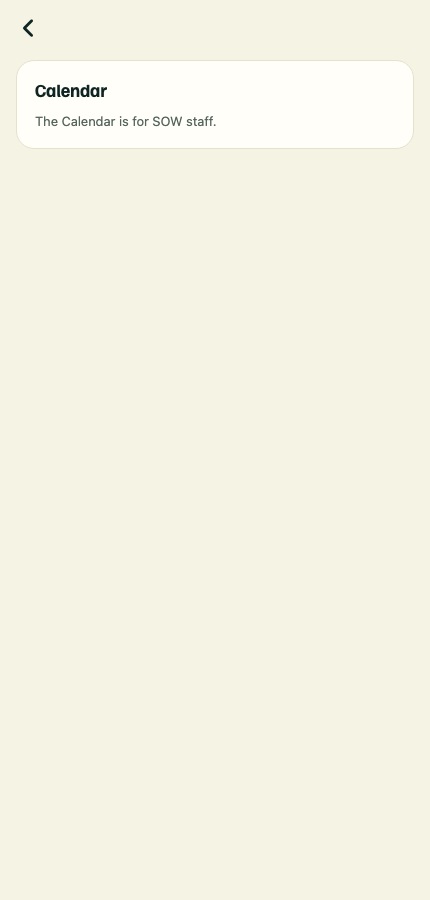 |  |
| web `out-world_devotionals` | 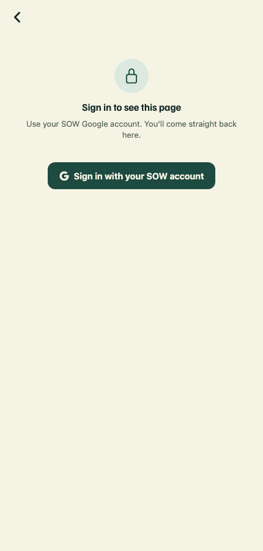 |  |
| web `out-world_praise` |  |  |
| web `out-world_sheet_arcade` | 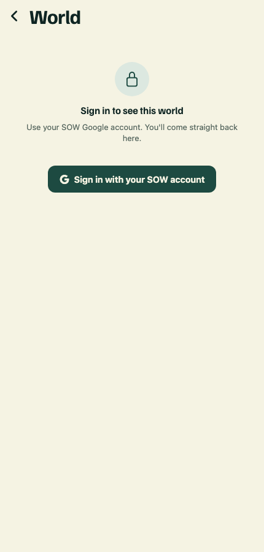 |  |
| web `out-world_sheet_character` |  |  |
| web `out-world_sheet_poke` |  |  |
