# verify: scoped

- because --only games

| Step | Result | Time | Detail |
| --- | --- | --- | --- |
| base tree | ✔ pass | 0s |  |
| native fingerprint | ✔ pass | 4s | unchanged on iOS and Android: over-the-air updates reach current builds |
| lint | ✔ pass | 62s |  |
| unused code (knip) | ✔ pass | 5s |  |
| typecheck | ✔ pass | 17s |  |
| Playwright Chromium | ✔ pass | 1s |  |
| before: local backend | ✔ pass | 18s | before functions on :3270 |
| before: web | ⚠ warning | 94s | 16 screens, 12 broken. out     /games                                               BROKEN, 1 console error(s) out     /games/shooter                                       BROKEN, 1 console error(s) out     /games/runner                                        BROKEN, 1 console error(s) out     /games/flappy                                        BROKEN, 1 console error(s) out     /games/leaderboar |
| before: iOS reset | ✔ pass | 3s |  |
| before: iOS | ✔ pass | 114s | 10 screenshots, every one settled |
| after: local backend | ✔ pass | 21s | after functions on :3270 |
| after: web | ✔ pass | 103s | 16 screens, 0 broken. |
| after: iOS reset | ✔ pass | 1s |  |
| after: iOS | ✔ pass | 102s | 10 screenshots, every one settled |

## Screenshots

| Screen | Before | After |
| --- | --- | --- |
| web `admin-games` |  | 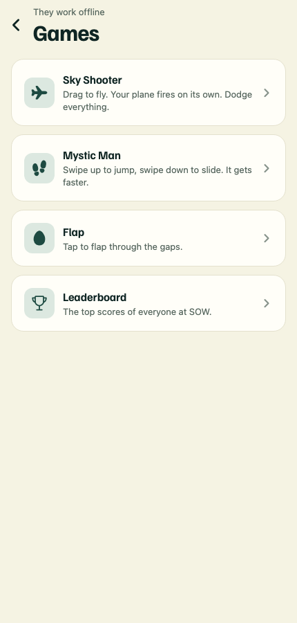 |
| web `admin-games_flappy` |  |  |
| web `admin-games_leaderboard` |  | 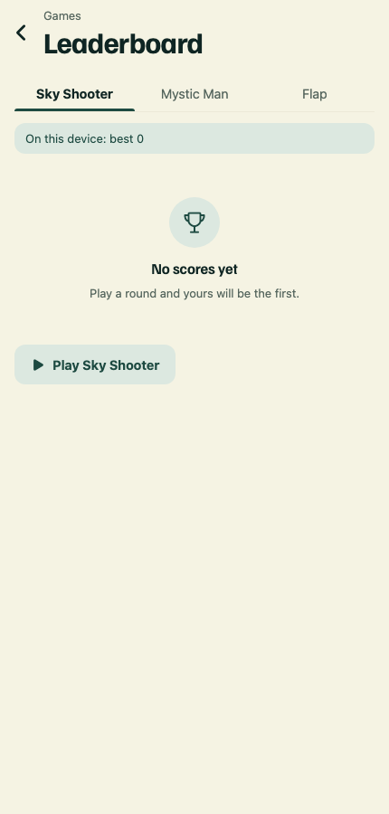 |
| web `admin-games_leaderboard_game_runner` |  | 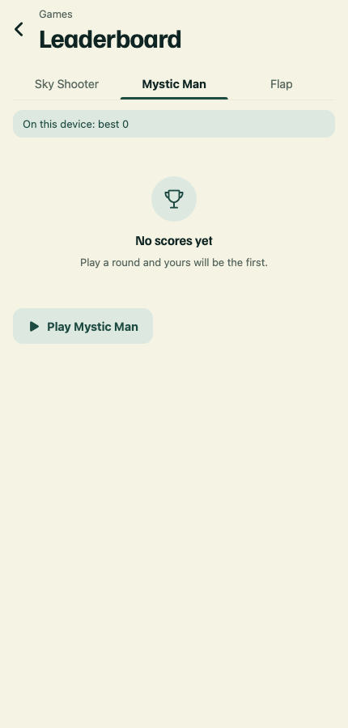 |
| web `admin-games_runner` |  | 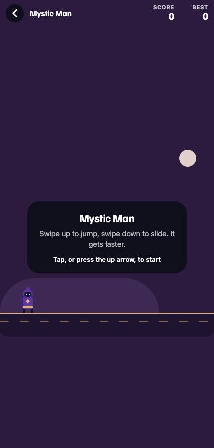 |
| web `admin-games_shooter` |  | 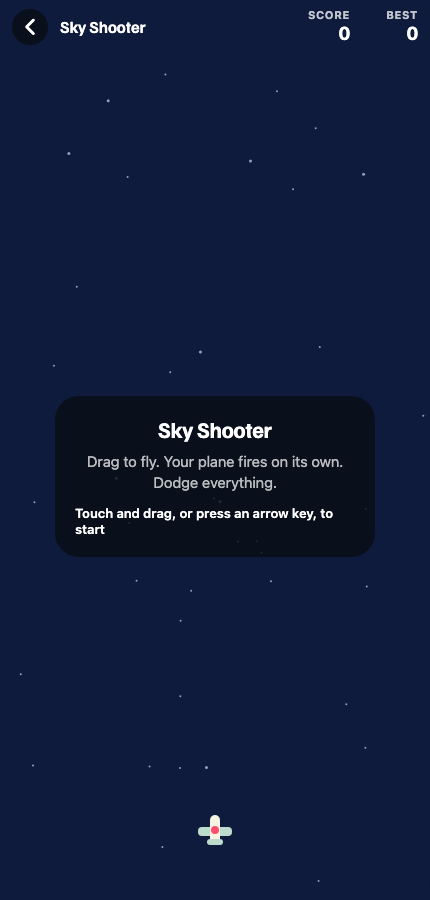 |
| web `admin-home` |  |  |
| web `admin-root` |  |  |
| web `out-games` |  |  |
| web `out-games_flappy` |  | 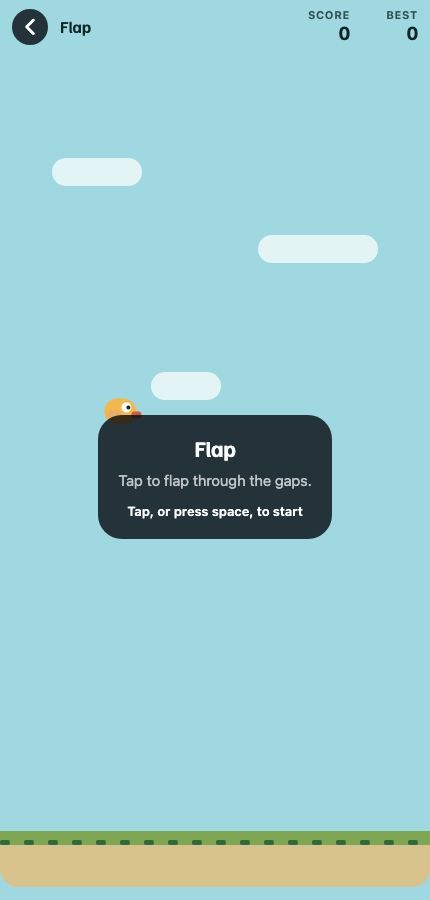 |
| web `out-games_leaderboard` |  | 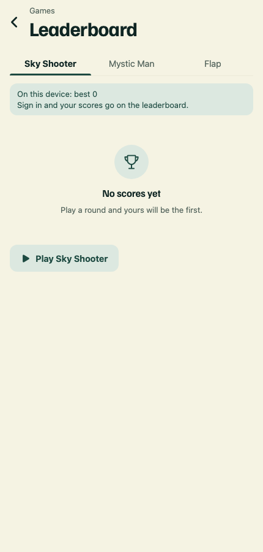 |
| web `out-games_leaderboard_game_runner` |  | 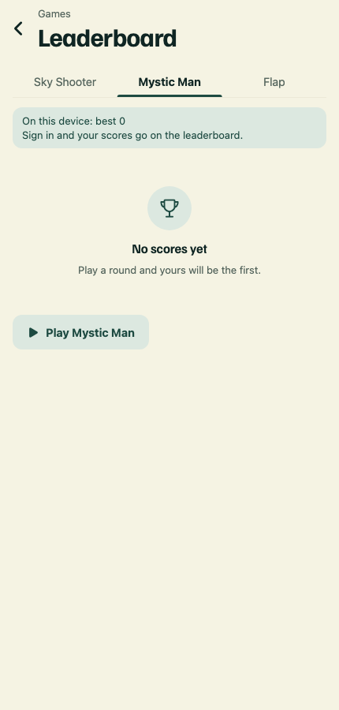 |
| web `out-games_runner` |  |  |
| web `out-games_shooter` |  |  |
| web `out-home` |  |  |
| web `out-root` |  |  |
| ios `admin-games` |  | 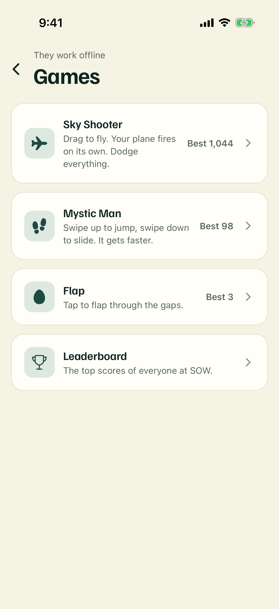 |
| ios `admin-games_flappy` |  | 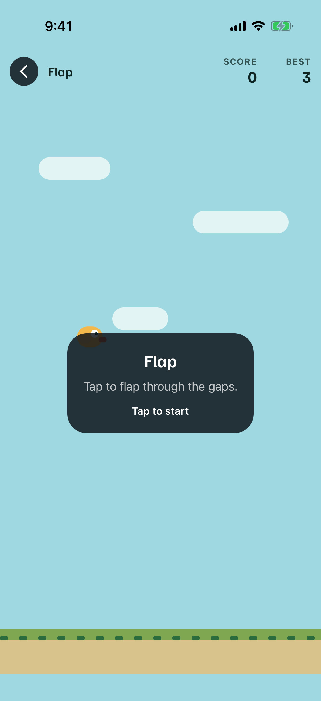 |
| ios `admin-games_leaderboard` |  | 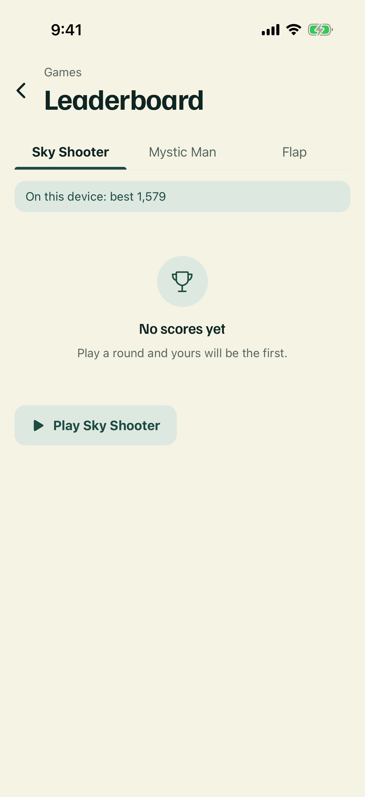 |
| ios `admin-games_leaderboard_game_runner` |  |  |
| ios `admin-games_runner` |  | 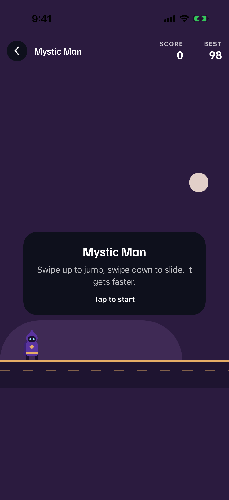 |
| ios `admin-games_shooter` |  | 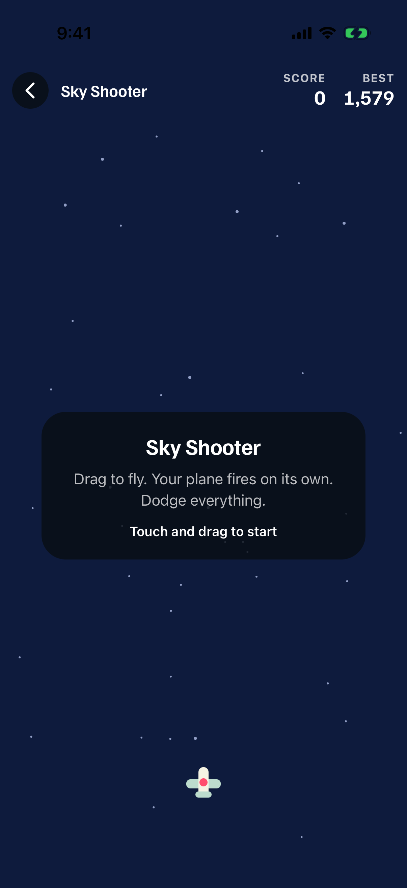 |
| ios `admin-home` |  | 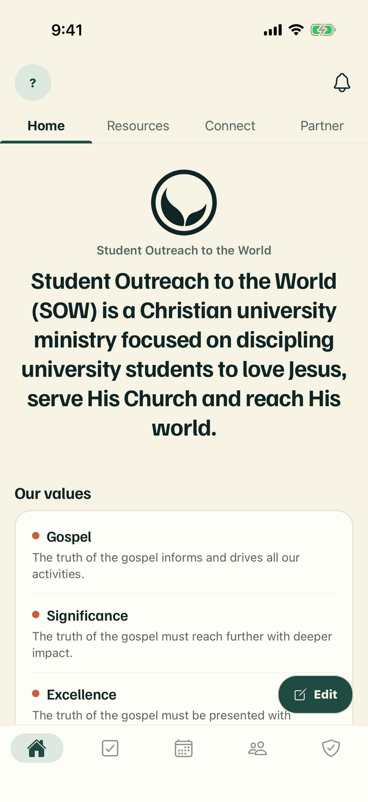 |
| ios `admin-root` | 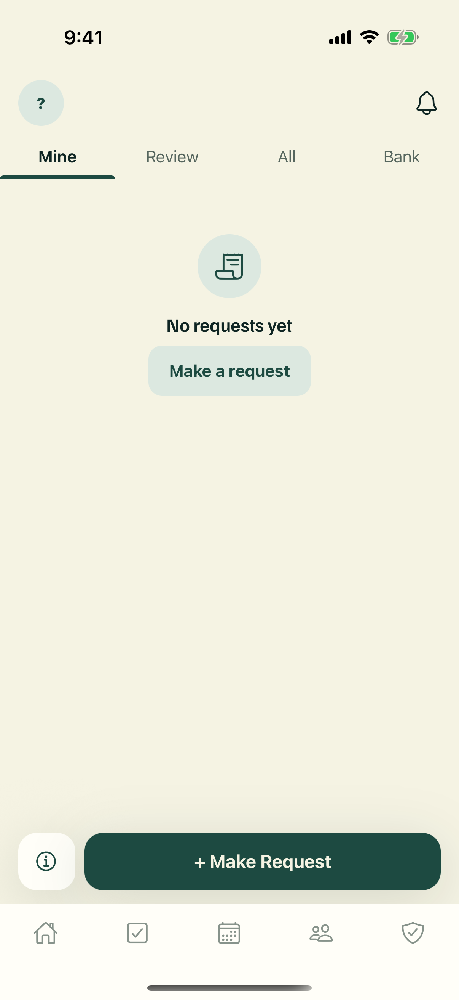 |  |
| ios `out-home` | 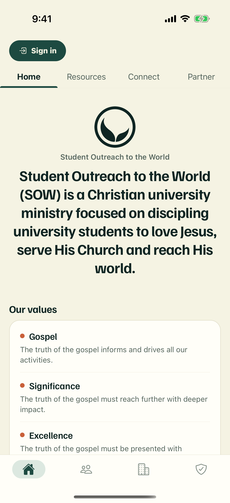 |  |
| ios `out-root` |  |  |
