# verify: web only (head 019cd0bb)

Sweep signed out + admin on world and smoke routes (20 screens ok); character-camera check passed.

## Screenshots

| Screen | Before | After |
| --- | --- | --- |
| web `admin-games` | (none) | 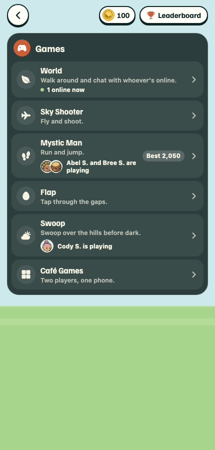 |
| web `admin-org` | (none) |  |
| web `admin-root` | (none) |  |
| web `admin-world` | (none) | 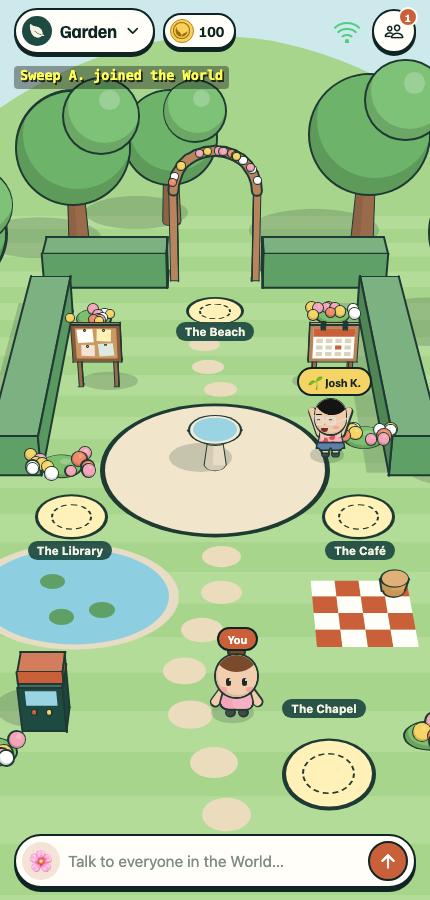 |
| web `admin-world_calendar` | (none) | 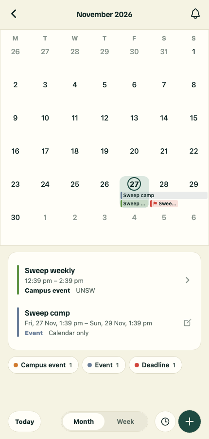 |
| web `admin-world_devotionals` | (none) | 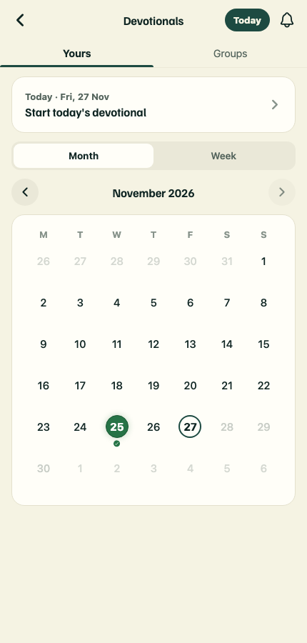 |
| web `admin-world_praise` | (none) | 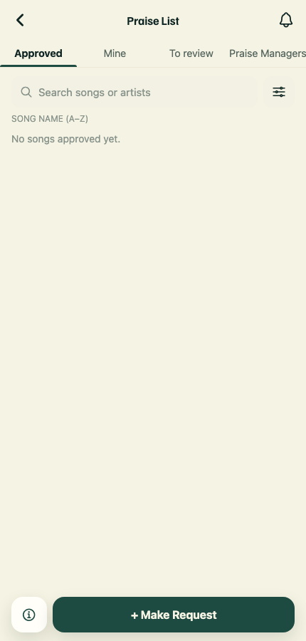 |
| web `admin-world_sheet_arcade` | (none) | 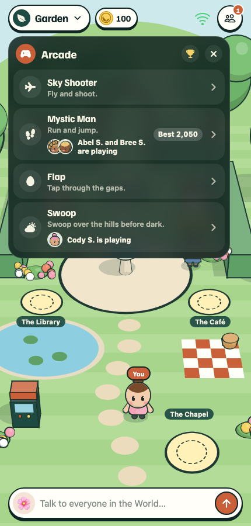 |
| web `admin-world_sheet_character` | (none) |  |
| web `admin-world_sheet_poke` | (none) | 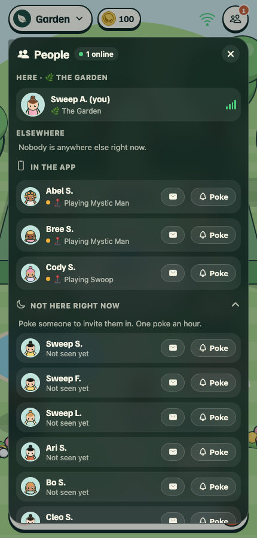 |
| web `camera-body` | (none) | 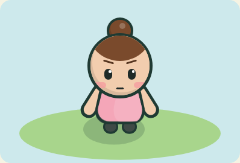 |
| web `camera-brows` | (none) | 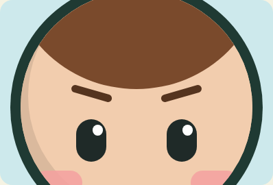 |
| web `camera-extras` | (none) | 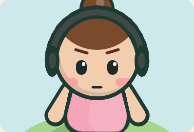 |
| web `camera-eyes` | (none) | 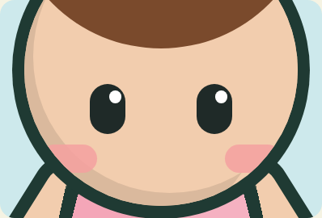 |
| web `camera-face` | (none) | 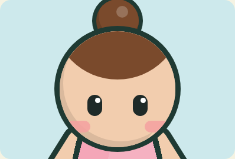 |
| web `camera-hair` | (none) | 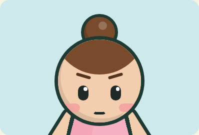 |
| web `camera-mouth` | (none) | 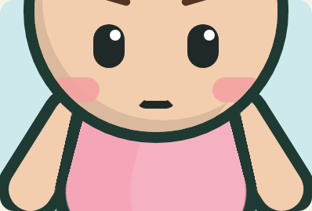 |
| web `camera-outfit` | (none) | 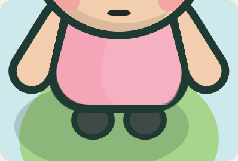 |
| web `editor-body` | (none) | 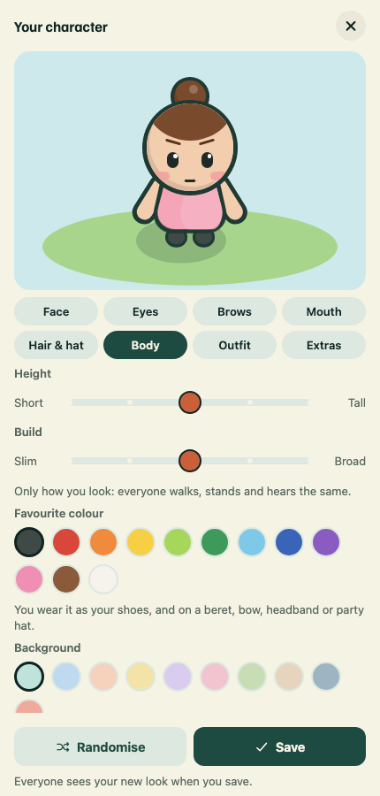 |
| web `editor-brows` | (none) | 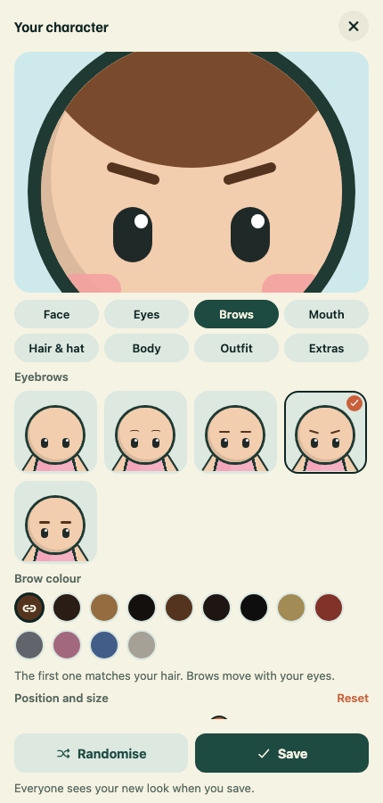 |
| web `editor-extras` | (none) | 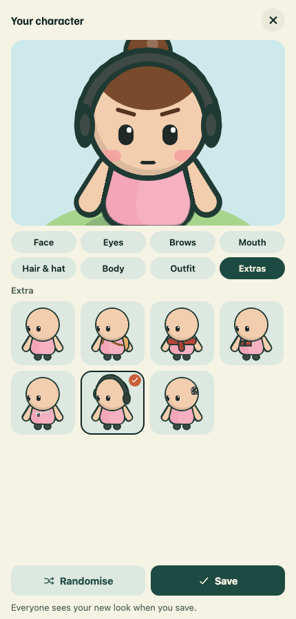 |
| web `editor-eyes` | (none) | 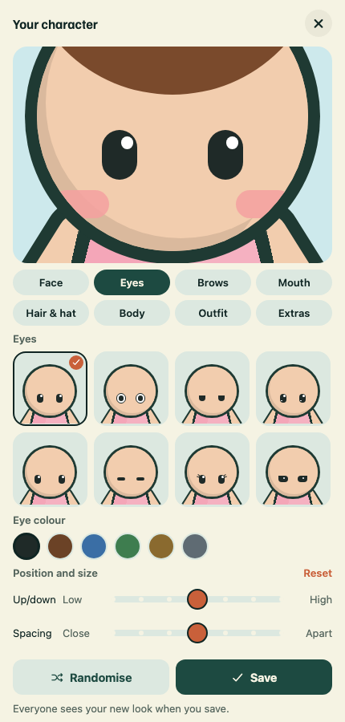 |
| web `editor-face` | (none) | 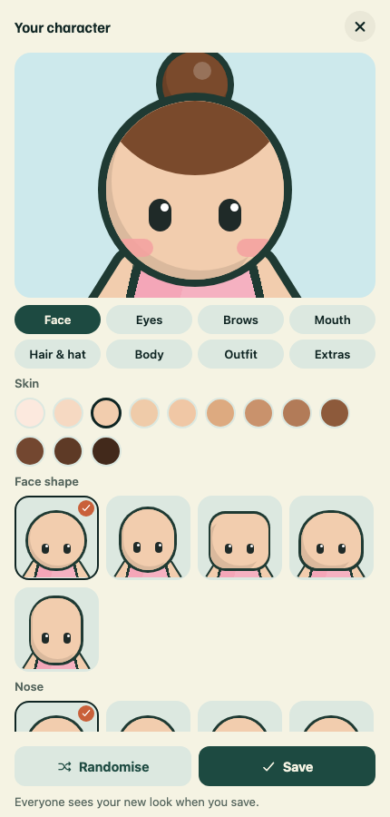 |
| web `editor-hair` | (none) | 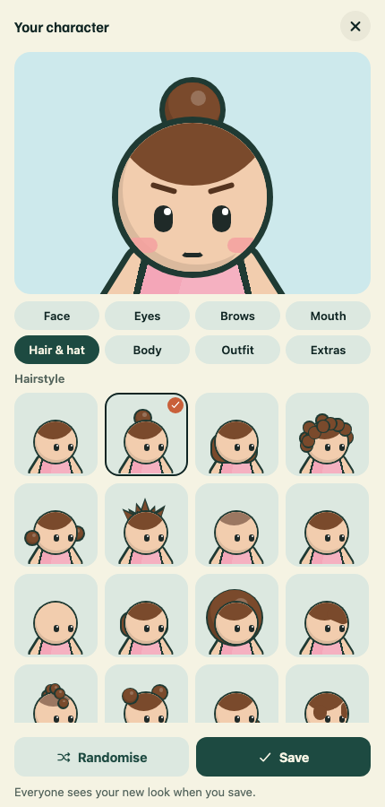 |
| web `editor-mouth` | (none) | 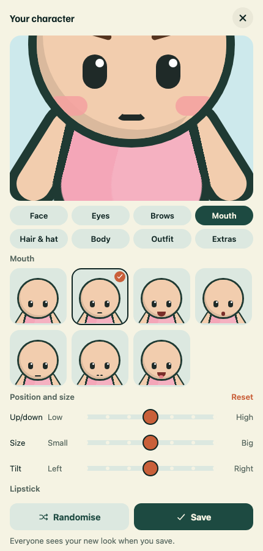 |
| web `editor-outfit` | (none) | 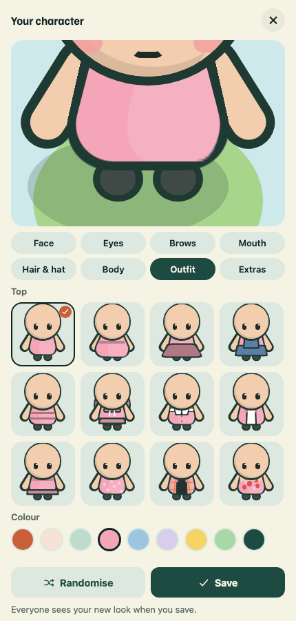 |
| web `out-games` | (none) |  |
| web `out-org` | (none) |  |
| web `out-root` | (none) |  |
| web `out-world` | (none) |  |
| web `out-world_calendar` | (none) |  |
| web `out-world_devotionals` | (none) |  |
| web `out-world_praise` | (none) |  |
| web `out-world_sheet_arcade` | (none) | 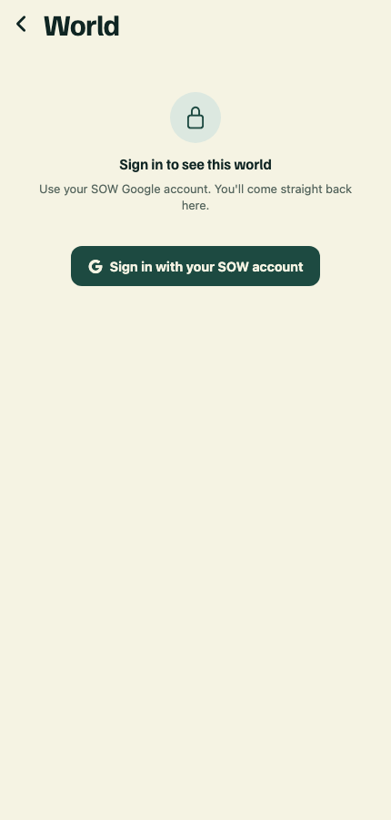 |
| web `out-world_sheet_character` | (none) |  |
| web `out-world_sheet_poke` | (none) |  |
