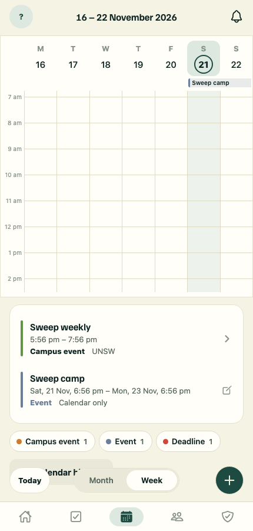
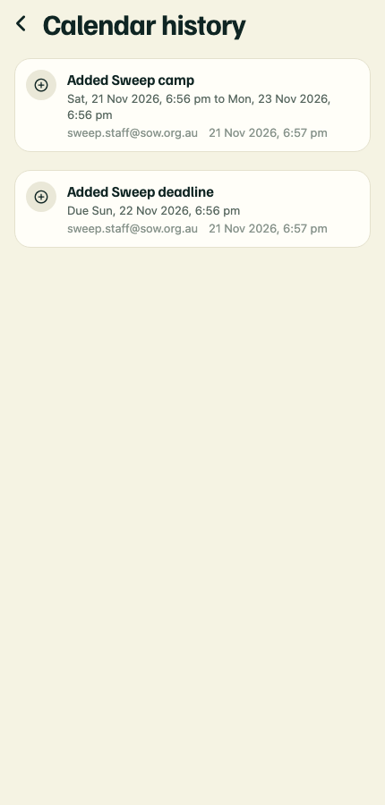
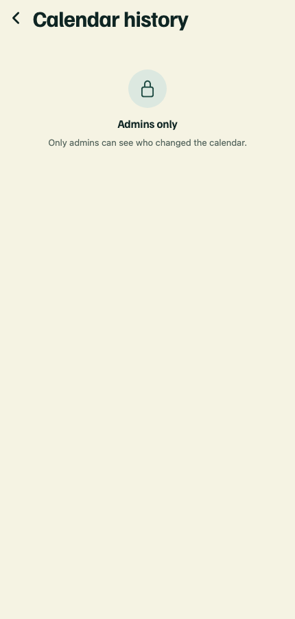
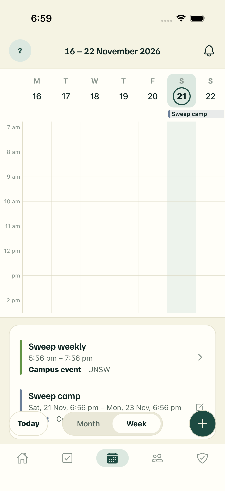
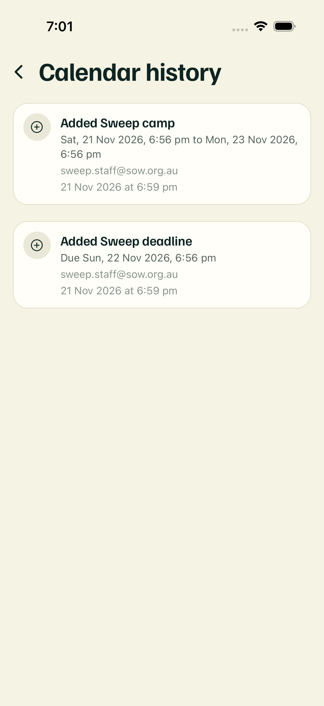
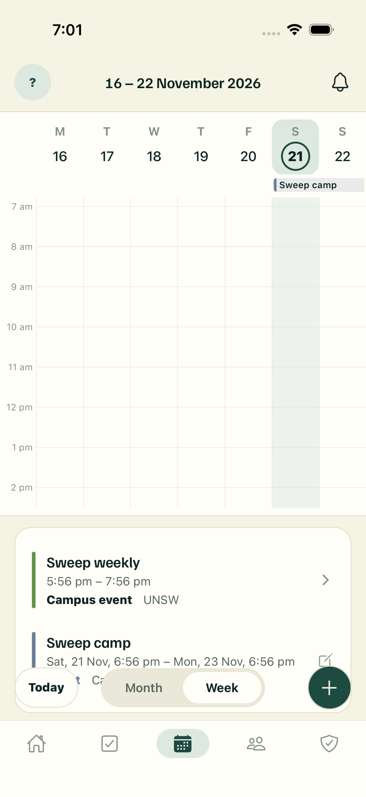
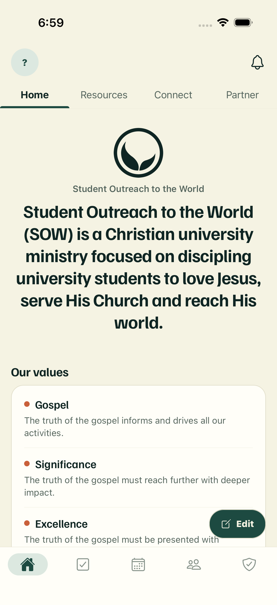
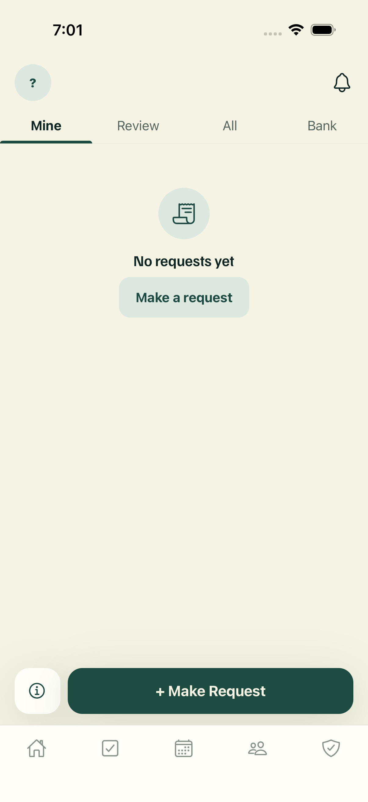
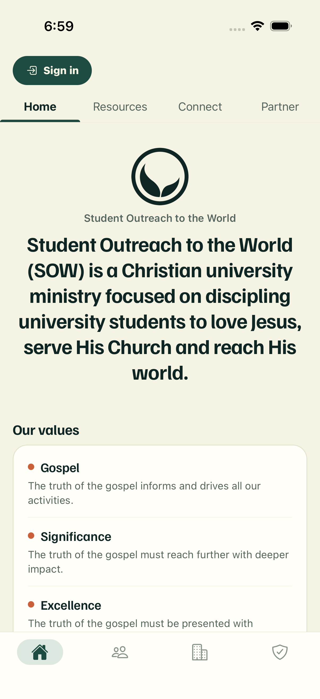
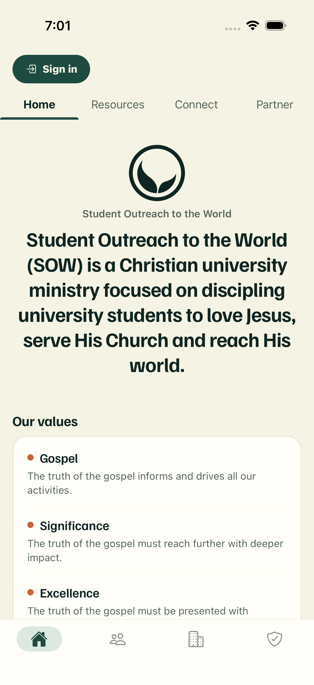

# verify: scoped

- because calendar: src/app/(tabs)/calendar.tsx

| Step | Result | Time | Detail |
| --- | --- | --- | --- |
| base tree | ✔ pass | 0s |  |
| native fingerprint | ✔ pass | 3s | unchanged on iOS and Android: over-the-air updates reach current builds |
| lint | ✔ pass | 39s |  |
| typecheck | ✔ pass | 12s |  |
| related unit tests | ✔ pass | 2s |  |
| Playwright Chromium | ✔ pass | 1s |  |
| before: local backend | ✔ pass | 14s | before functions on :3270 |
| before: web | ✔ pass | 60s | 10 screens, 0 broken. |
| before: iOS reset | ✔ pass | 1s |  |
| before: iOS | ✔ pass | 76s | 7 screenshots |
| after: local backend | ✔ pass | 15s | after functions on :3270 |
| after: web | ✔ pass | 60s | 10 screens, 0 broken. |
| after: iOS reset | ✔ pass | 1s |  |
| after: iOS | ✔ pass | 66s | 7 screenshots |

## Screenshots

| Screen | Before | After |
| --- | --- | --- |
| web `admin-calendar` |  |  |
| web `admin-calendar_history` |  |  |
| web `admin-calendar_view_week` |  |  |
| web `admin-home` |  |  |
| web `admin-root` |  |  |
| web `out-calendar` |  |  |
| web `out-calendar_history` |  |  |
| web `out-calendar_view_week` |  |  |
| web `out-home` |  |  |
| web `out-root` |  |  |
| ios `admin-calendar` |  |  |
| ios `admin-calendar_history` |  |  |
| ios `admin-calendar_view_week` |  |  |
| ios `admin-home` |  |  |
| ios `admin-root` |  |  |
| ios `out-home` |  |  |
| ios `out-root` |  |  |
