# verify: scoped

- because world: convex/world.ts
- because world: shared/animals.ts
- because devotionals: shared/devotionalGroups.ts
- because world: shared/farm.ts
- because world: shared/world.ts
- because world: src/world/ChatBar.tsx
- because world: src/world/ChatLog.tsx
- because world: src/world/Farm.tsx
- because world: src/world/Garden.tsx
- because world: src/world/Person.tsx
- because world: src/world/WorldScreen.tsx
- because world: src/world/palette.ts
- because world: src/worldColours.ts

| Step | Result | Time | Detail |
| --- | --- | --- | --- |
| base tree | ✔ pass | 0s |  |
| native fingerprint | ✔ pass | 4s | unchanged on iOS and Android: over-the-air updates reach current builds |
| lint | ✔ pass | 51s |  |
| unused code (knip) | ✔ pass | 4s |  |
| typecheck | ✔ pass | 13s |  |
| related unit tests | ✔ pass | 9s | 2182 passed (2182) |
| verify lock | ✔ pass | 14s | took it after waiting 14s for pid 87028, feat/arcade-v2 in /Users/daniel.kim/GitHub/worktrees/shed-arcade-v2, since 2026-11-26T02:30:26.883Z |
| Playwright Chromium | ✔ pass | 1s |  |
| before: local backend | ✔ pass | 16s | before functions on :3270 |
| before: web | ✔ pass | 146s | 28 screens, 0 broken. Checks passed: chapel-pews, arcade-podium, passage-picker-close. |
| after: local backend | ✔ pass | 16s | after functions on :3270 |
| after: web | ✔ pass | 145s | 28 screens, 0 broken. Checks passed: chapel-pews, arcade-podium, passage-picker-close. |

## Screenshots

| Screen | Before | After |
| --- | --- | --- |
| web `admin-devotionals` |  | 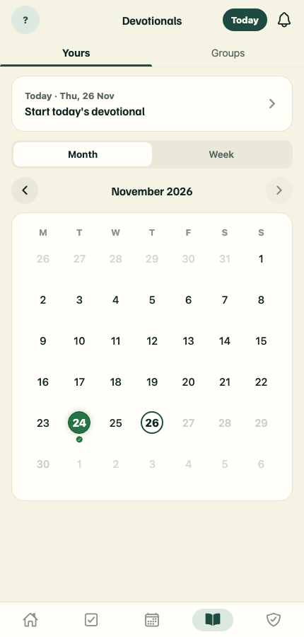 |
| web `admin-devotionals_devotionalDate` | 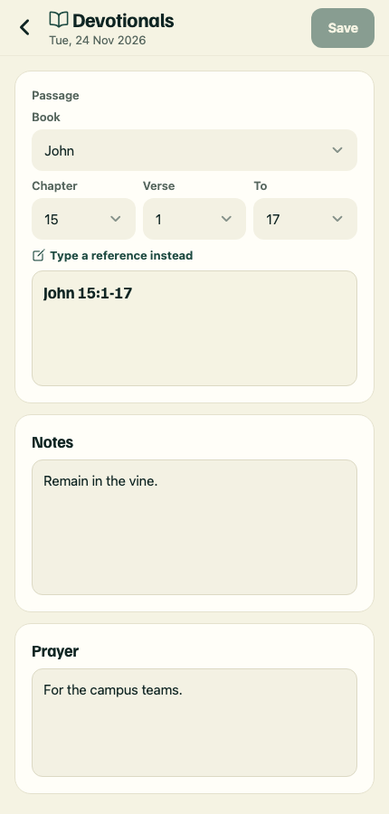 |  |
| web `admin-devotionals_devotionalEmptyDate` | 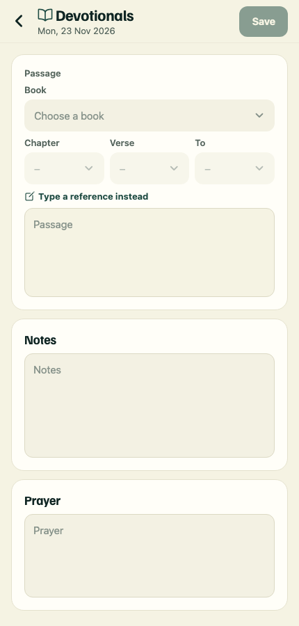 |  |
| web `admin-devotionals_tab_groups` | 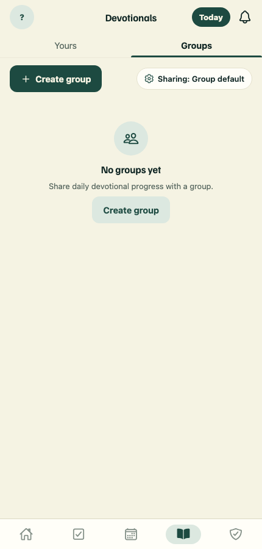 |  |
| web `admin-games` |  | 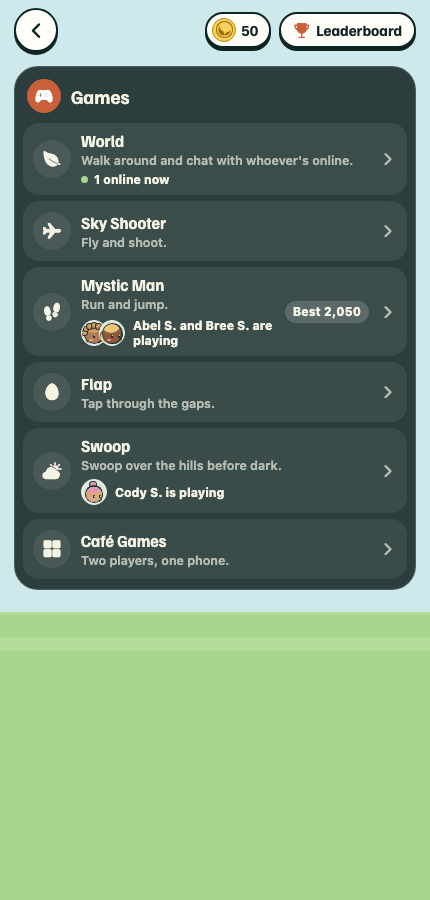 |
| web `admin-home` |  |  |
| web `admin-root` | 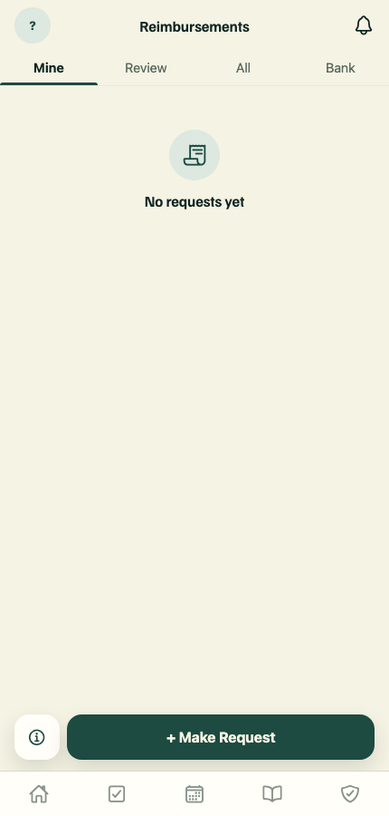 |  |
| web `admin-world` | 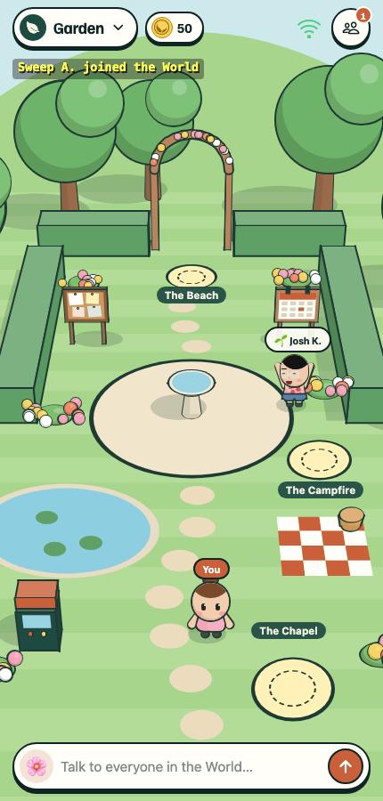 | 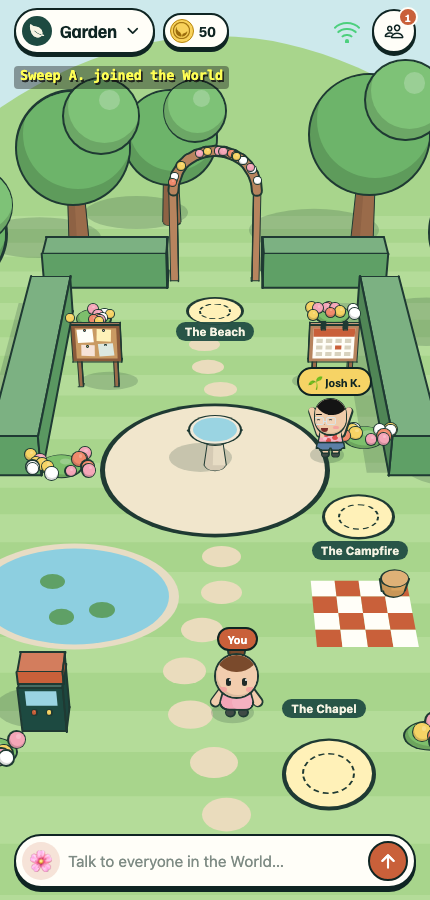 |
| web `admin-world_calendar` |  | 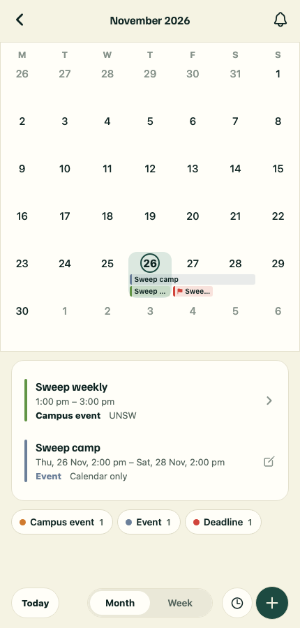 |
| web `admin-world_devotionals` | 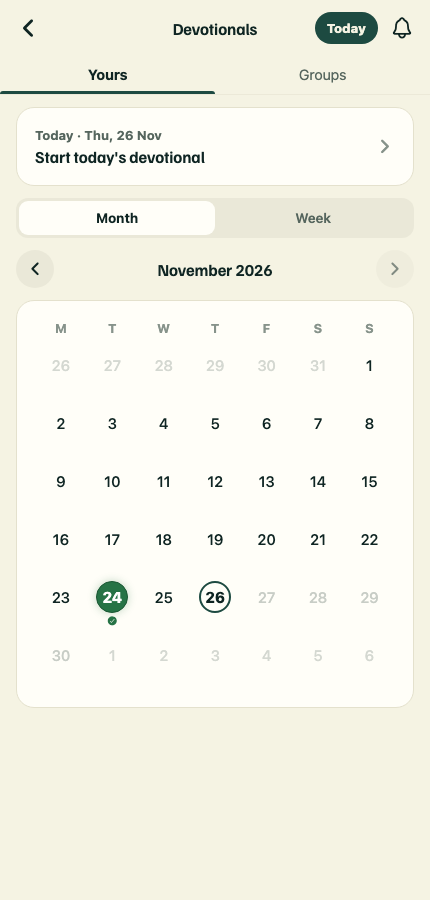 |  |
| web `admin-world_praise` | 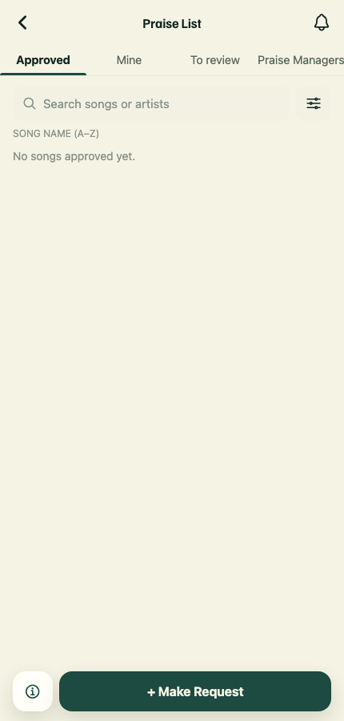 |  |
| web `admin-world_sheet_arcade` |  | 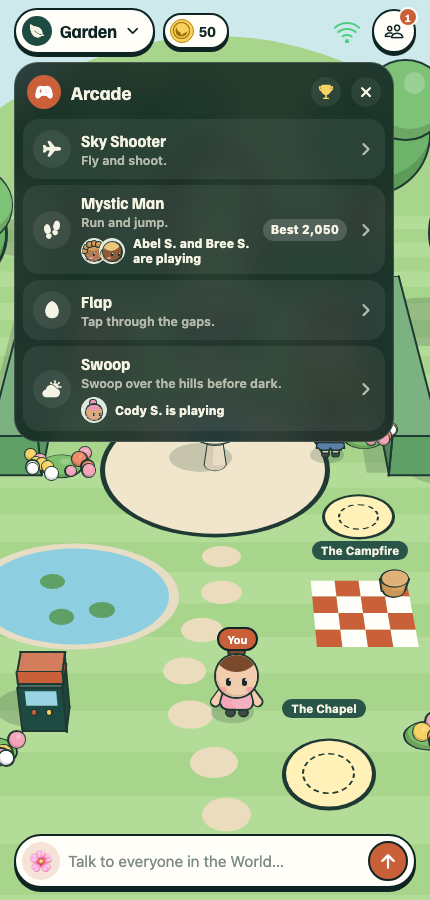 |
| web `admin-world_sheet_character` |  | 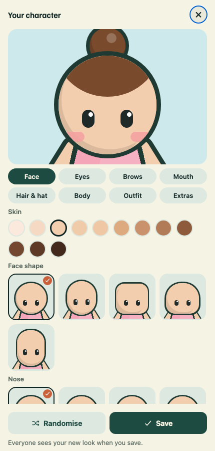 |
| web `admin-world_sheet_poke` |  | 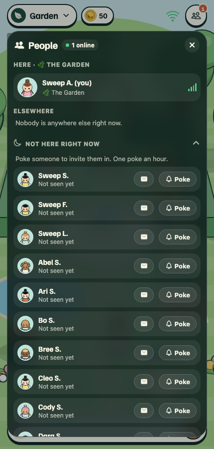 |
| web `out-devotionals` |  |  |
| web `out-devotionals_devotionalDate` | 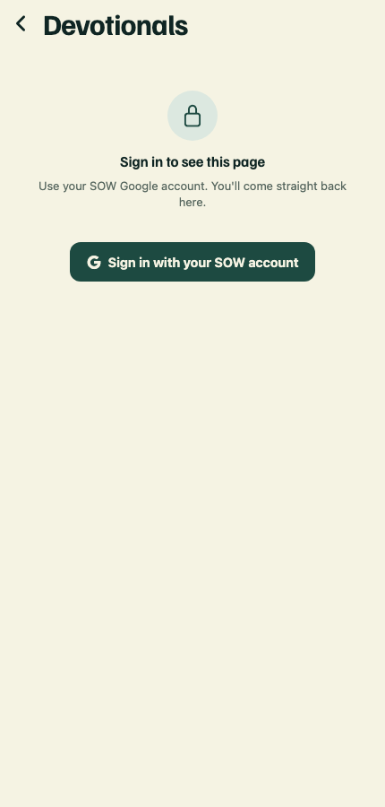 |  |
| web `out-devotionals_devotionalEmptyDate` |  |  |
| web `out-devotionals_tab_groups` |  |  |
| web `out-games` | 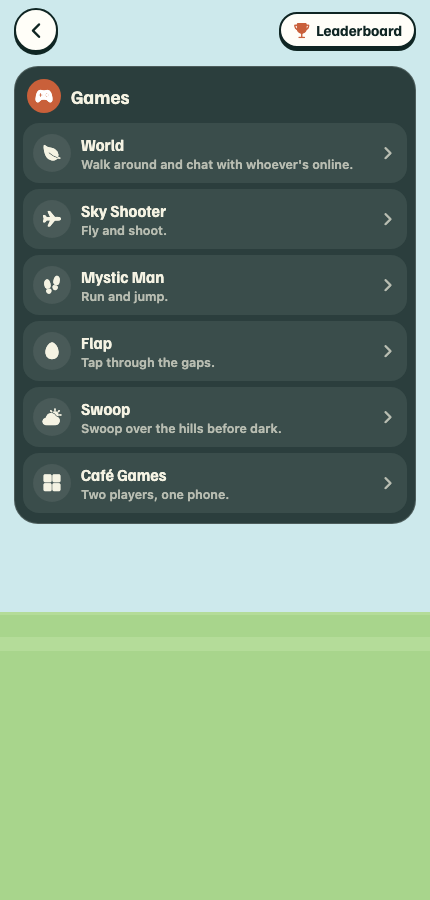 |  |
| web `out-home` |  |  |
| web `out-root` |  |  |
| web `out-world` | 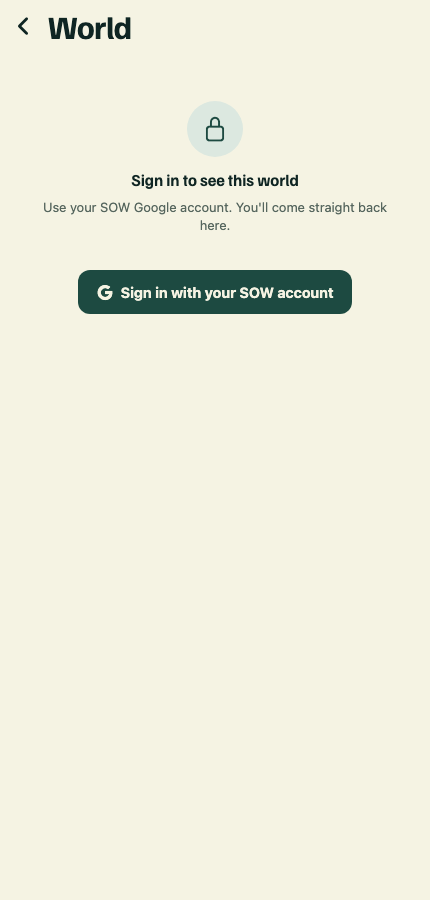 |  |
| web `out-world_calendar` | 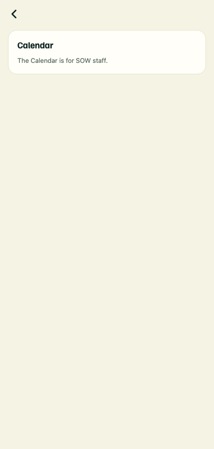 |  |
| web `out-world_devotionals` |  |  |
| web `out-world_praise` |  |  |
| web `out-world_sheet_arcade` |  |  |
| web `out-world_sheet_character` |  |  |
| web `out-world_sheet_poke` |  |  |
