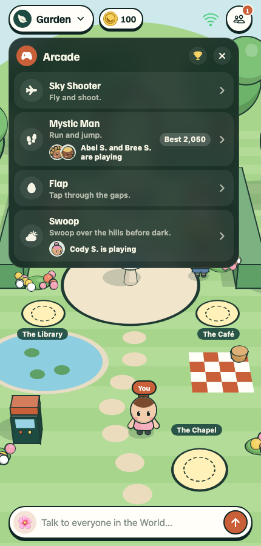
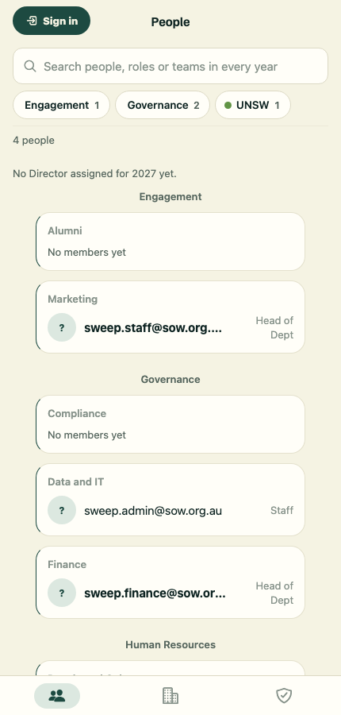
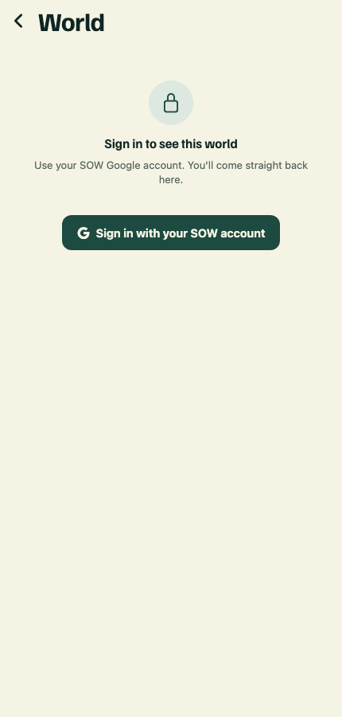

# verify: scoped

- because --only /world?sheet=arcade

| Step | Result | Time | Detail |
| --- | --- | --- | --- |
| base tree | ✔ pass | 1s |  |
| native fingerprint | ✔ pass | 19s | unchanged on iOS and Android: over-the-air updates reach current builds |
| verify lock | ✔ pass | 0s | skipped: web-only run on its own ports, outside the simulator lock |
| Playwright Chromium | ✔ pass | 3s |  |
| before: local backend | ✔ pass | 66s | before functions on :4731 |
| before: web | ⚠ warning | 519s | 6 screens, 0 broken.; check arcade-podium failed: ✘ walking away closes the games as you set off (took 791ms) |
| after: local backend | ✔ pass | 34s | after functions on :4731 |
| after: web | ✔ pass | 93s | 6 screens, 0 broken. Checks passed: arcade-podium. |

## Screenshots

| Screen | Before | After |
| --- | --- | --- |
| web `admin-org` |  |  |
| web `admin-root` |  |  |
| web `admin-world_sheet_arcade` |  |  |
| web `out-org` |  |  |
| web `out-root` |  |  |
| web `out-world_sheet_arcade` |  |  |
