# verify: scoped

- because world: convex/world.ts
- because world: convex/worldData.ts
- because world: shared/world.ts
- because world: src/world/Garden.tsx
- because world: src/world/WorldScreen.tsx
- because world: src/world/blend.ts
- because world: src/world/gait.ts
- because world: src/world/myPose.ts
- because world: src/world/useWorld.ts

| Step | Result | Time | Detail |
| --- | --- | --- | --- |
| base tree | ✔ pass | 0s |  |
| native fingerprint | ✔ pass | 4s | unchanged on iOS and Android: over-the-air updates reach current builds |
| lint | ✔ pass | 85s |  |
| unused code (knip) | ✔ pass | 5s |  |
| typecheck | ✔ pass | 20s |  |
| related unit tests | ✔ pass | 17s | 2025 passed (2025) |
| verify lock | ✔ pass | 4200s | took it after waiting 4199s for pid 86509, HEAD in /Users/xtectra/GitHub/worktrees/the-shed-mobile-verify-pr560, since 2026-11-25T15:47:47.302Z |
| Playwright Chromium | ✔ pass | 1s |  |
| before: local backend | ✔ pass | 17s | before functions on :3270 |
| before: web | ⚠ warning | 168s | 18 screens, 0 broken.; check chapel-pews failed: ✘ TimeoutError: locator.waitFor: Timeout 60000ms exceeded. |
| before: iOS reset | ✔ pass | 1s |  |
| before: iOS | ⚠ warning | 161s | check chapel-pews failed, see .verify/run/before/logs/check-chapel-pews-ios.log Assert that id: world-title is visible... COMPLETED Run flow when "Go to The Chapel" is visible... Run flow when "Go to The Chapel" is visible... COMPLETED Assert that "Lectern.*" is visible... COMPLETED |
| after: local backend | ✔ pass | 16s | after functions on :3270 |
| after: web | ✔ pass | 122s | 18 screens, 0 broken. Checks passed: chapel-pews. |
| after: iOS reset | ✔ pass | 1s |  |
| after: iOS | ✔ pass | 166s | 11 screenshots, every one settled; checks passed: chapel-pews |

## Screenshots

| Screen | Before | After |
| --- | --- | --- |
| web `admin-games` |  | 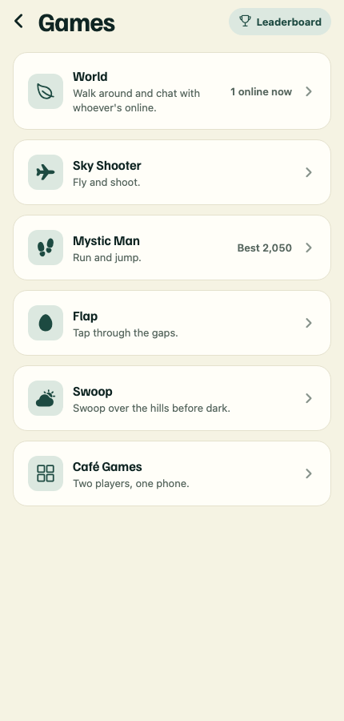 |
| web `admin-home` |  |  |
| web `admin-root` | 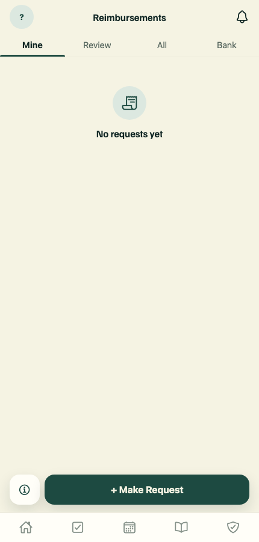 |  |
| web `admin-world` |  | 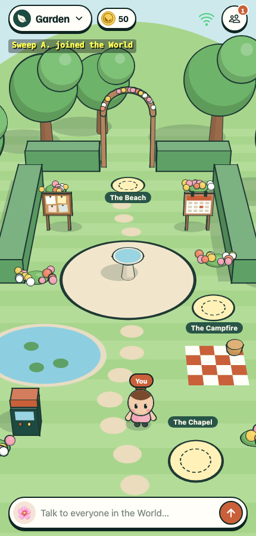 |
| web `admin-world_calendar` |  | 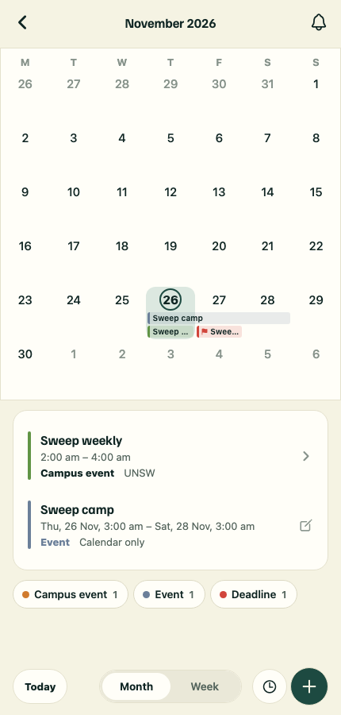 |
| web `admin-world_devotionals` | 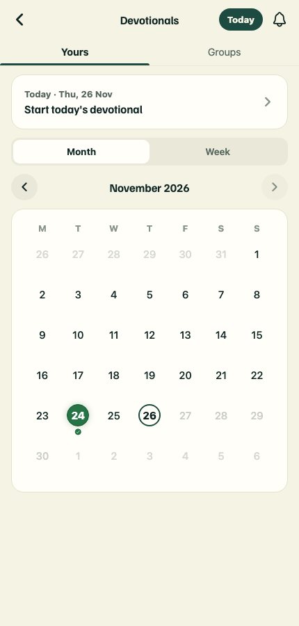 |  |
| web `admin-world_praise` |  |  |
| web `admin-world_sheet_character` | 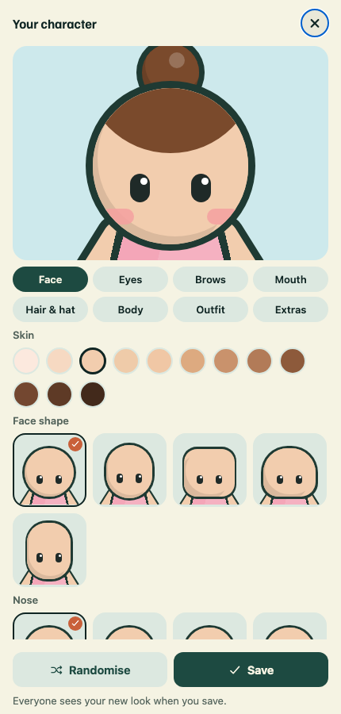 |  |
| web `admin-world_sheet_poke` | 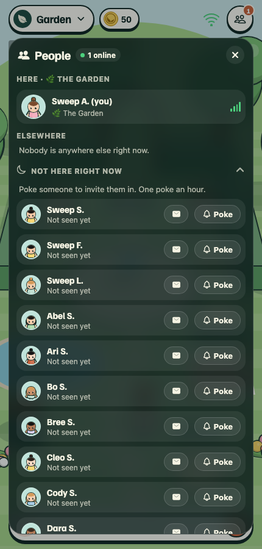 |  |
| web `out-games` | 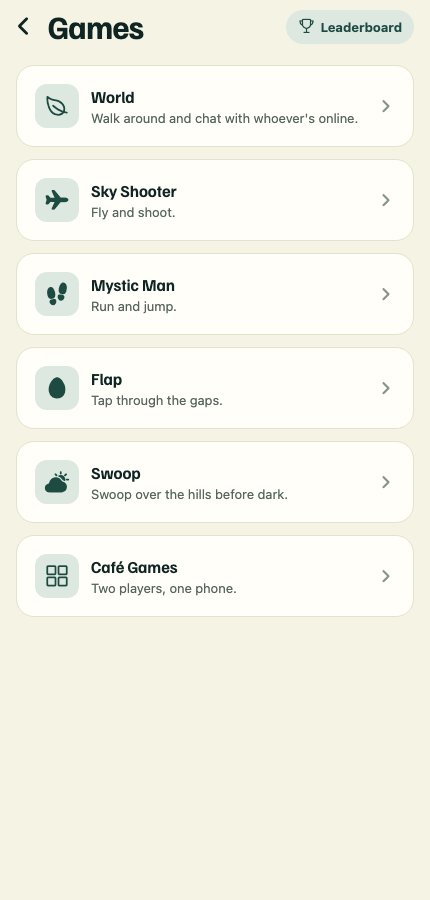 |  |
| web `out-home` |  |  |
| web `out-root` |  |  |
| web `out-world` |  |  |
| web `out-world_calendar` |  |  |
| web `out-world_devotionals` |  |  |
| web `out-world_praise` |  |  |
| web `out-world_sheet_character` |  |  |
| web `out-world_sheet_poke` |  |  |
| ios `admin-games` |  | 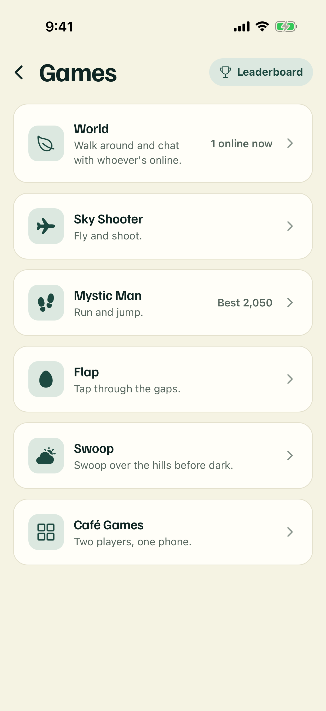 |
| ios `admin-home` | 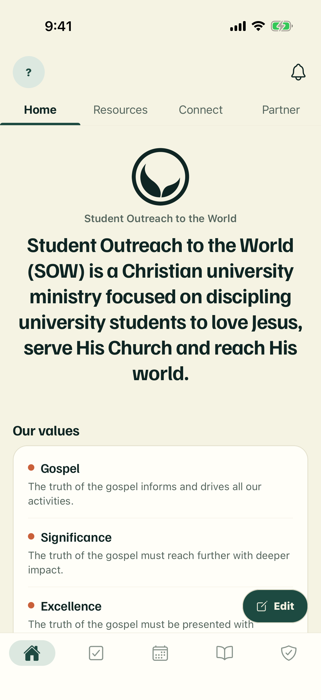 |  |
| ios `admin-root` |  |  |
| ios `admin-world` | 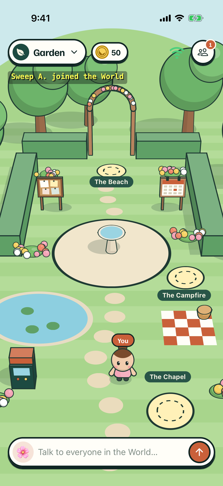 | 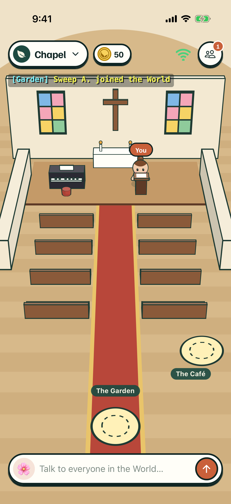 |
| ios `admin-world_calendar` | 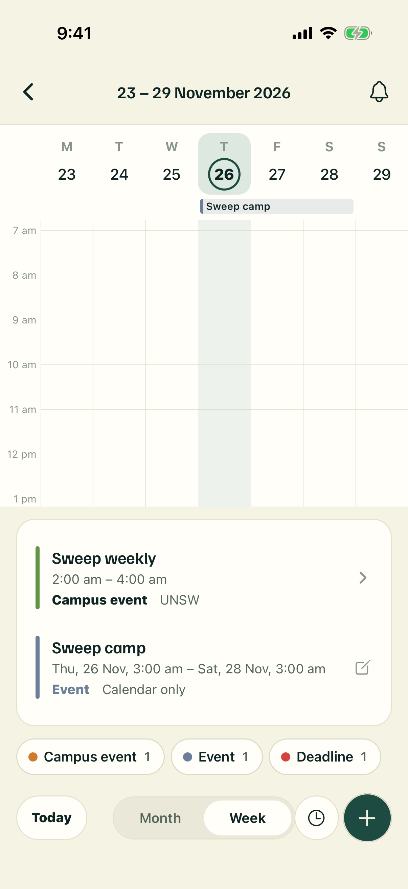 | 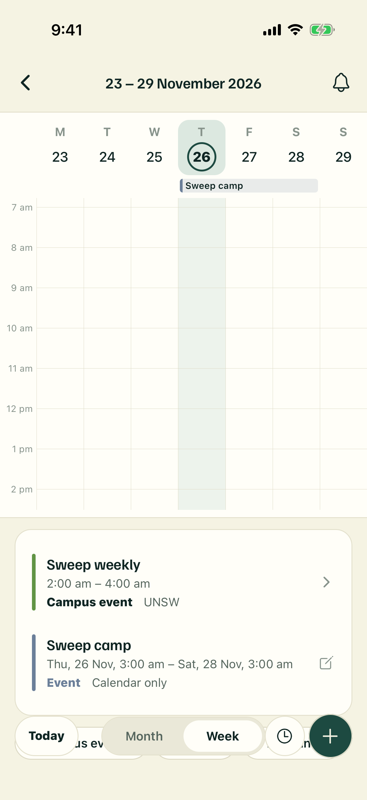 |
| ios `admin-world_devotionals` |  | 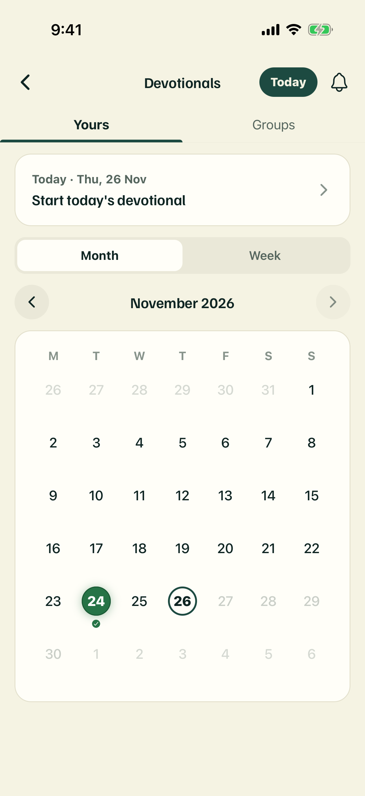 |
| ios `admin-world_praise` | 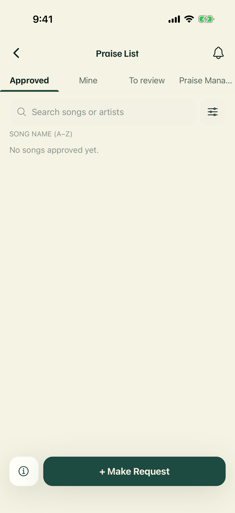 |  |
| ios `admin-world_sheet_character` | 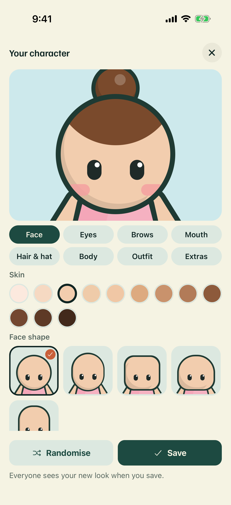 |  |
| ios `admin-world_sheet_poke` | 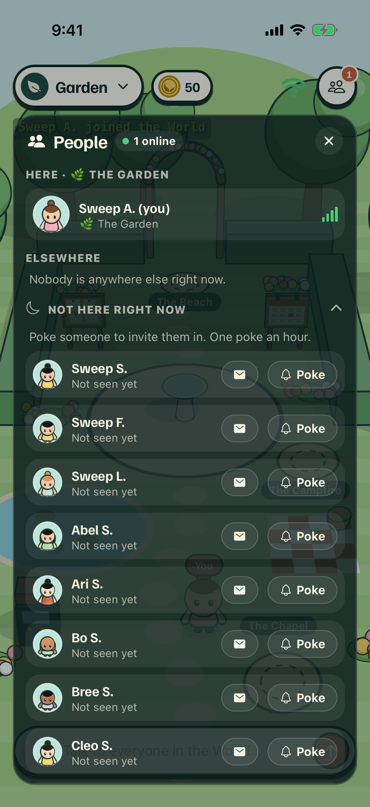 | 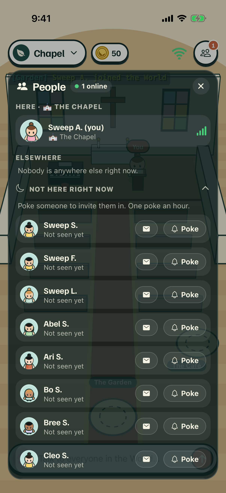 |
| ios `out-home` |  |  |
| ios `out-root` |  |  |
