# verify: scoped

- because world: convex/world.ts
- because world: src/app/world.tsx
- because world: src/world/People.tsx
- because world: src/world/WorldScreen.tsx
- because world: src/world/useWorld.ts

| Step | Result | Time | Detail |
| --- | --- | --- | --- |
| base tree | ✔ pass | 0s |  |
| native fingerprint | ✔ pass | 4s | unchanged on iOS and Android: over-the-air updates reach current builds |
| lint | ✔ pass | 79s |  |
| unused code (knip) | ✔ pass | 5s |  |
| typecheck | ✔ pass | 19s |  |
| related unit tests | ✔ pass | 18s | 1849 passed (1849) |
| verify lock | ✔ pass | 0s | free, taken at once |
| Playwright Chromium | ✔ pass | 1s |  |
| before: local backend | ✔ pass | 22s | before functions on :3270 |
| before: web | ✔ pass | 159s | 20 screens, 0 broken. Checks passed: chapel-pews, arcade-podium. |
| before: iOS reset | ✔ pass | 2s |  |
| before: iOS | ✔ pass | 243s | 12 screenshots, every one settled; checks passed: chapel-pews, arcade-podium |
| after: local backend | ✔ pass | 24s | after functions on :3270 |
| after: web | ✔ pass | 218s | 20 screens, 0 broken. Checks passed: chapel-pews, arcade-podium. |
| after: iOS reset | ✔ pass | 1s |  |
| after: iOS | ✔ pass | 234s | 12 screenshots, every one settled; checks passed: chapel-pews, arcade-podium |

## Screenshots

| Screen | Before | After |
| --- | --- | --- |
| web `admin-games` | 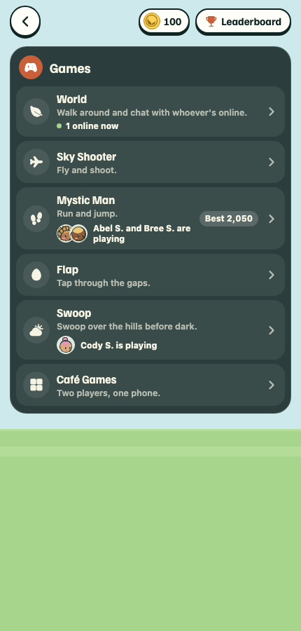 |  |
| web `admin-home` | 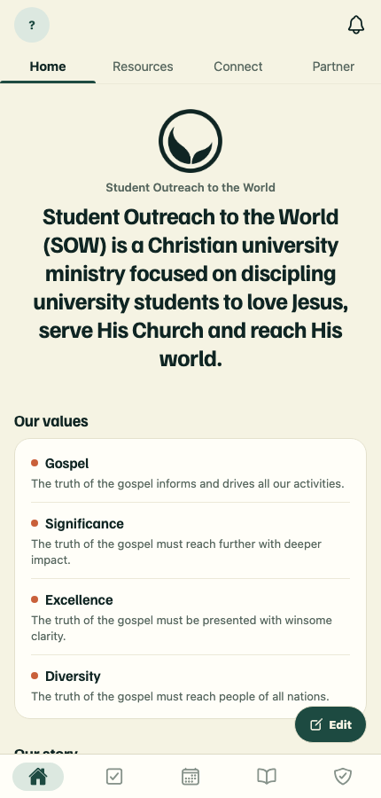 |  |
| web `admin-root` | 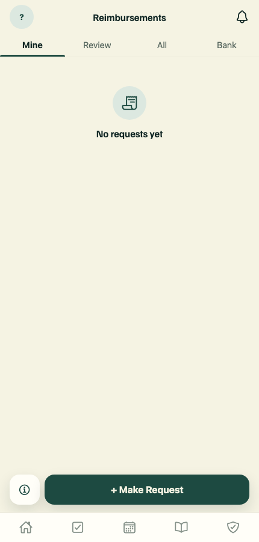 |  |
| web `admin-world` |  | 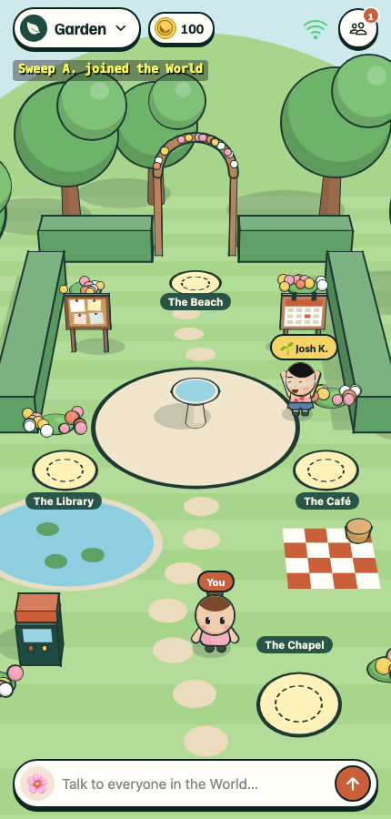 |
| web `admin-world_calendar` |  | 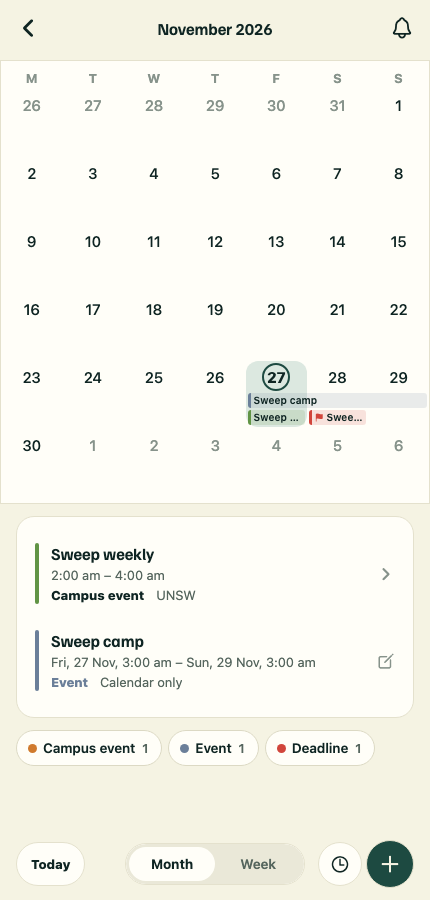 |
| web `admin-world_devotionals` | 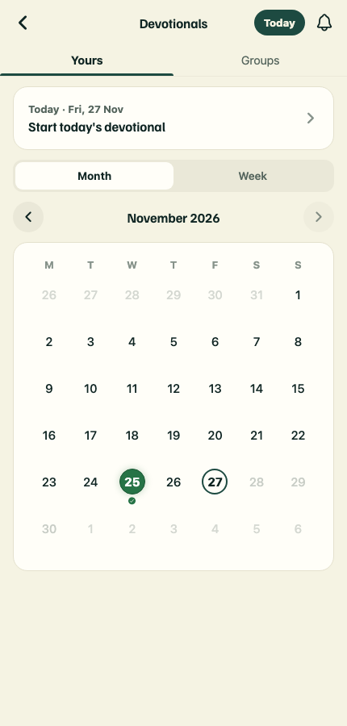 |  |
| web `admin-world_praise` |  |  |
| web `admin-world_sheet_arcade` | 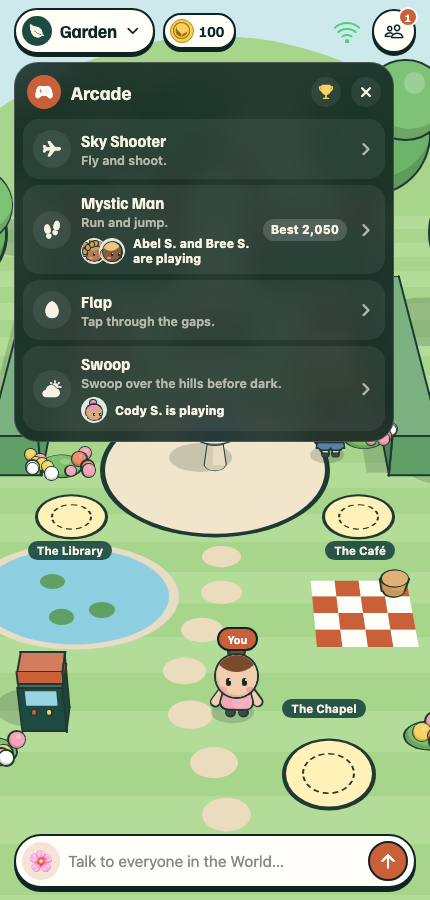 |  |
| web `admin-world_sheet_character` |  | 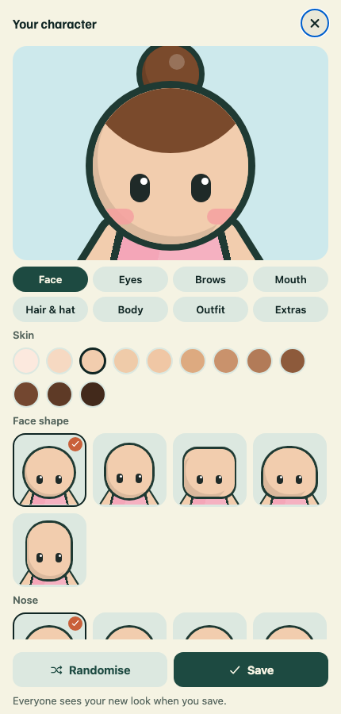 |
| web `admin-world_sheet_poke` | 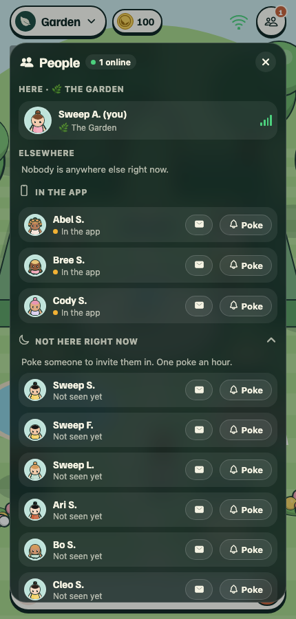 | 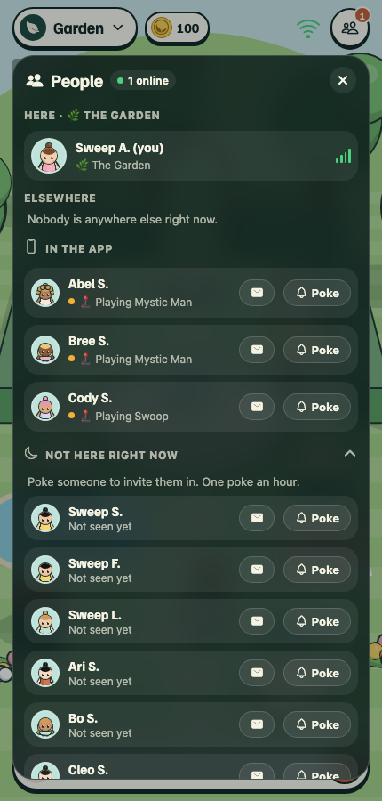 |
| web `out-games` |  | 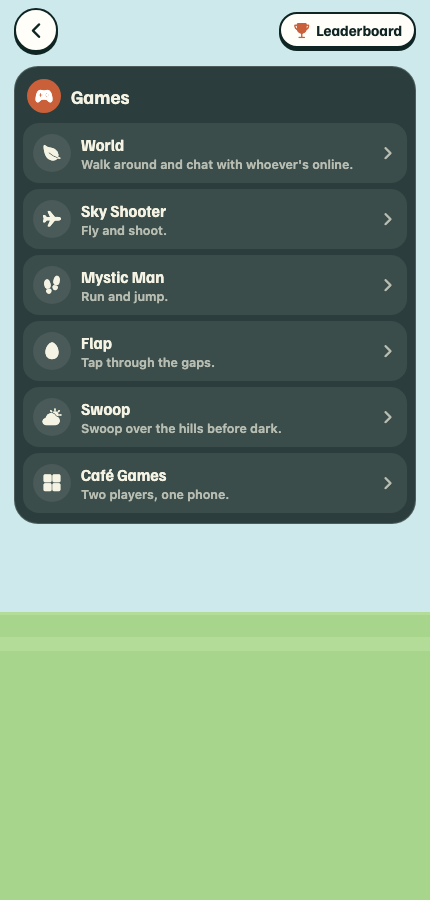 |
| web `out-home` |  |  |
| web `out-root` |  |  |
| web `out-world` |  |  |
| web `out-world_calendar` |  |  |
| web `out-world_devotionals` | 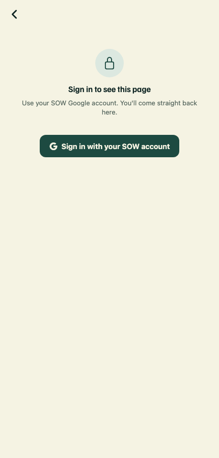 |  |
| web `out-world_praise` |  |  |
| web `out-world_sheet_arcade` |  |  |
| web `out-world_sheet_character` |  |  |
| web `out-world_sheet_poke` |  |  |
| ios `admin-games` | 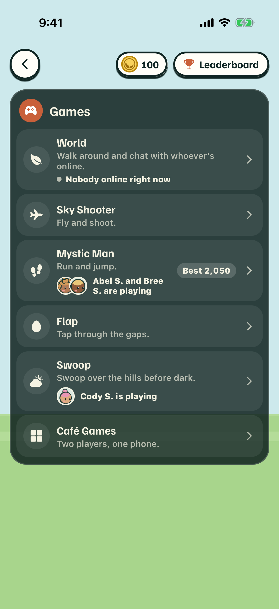 | 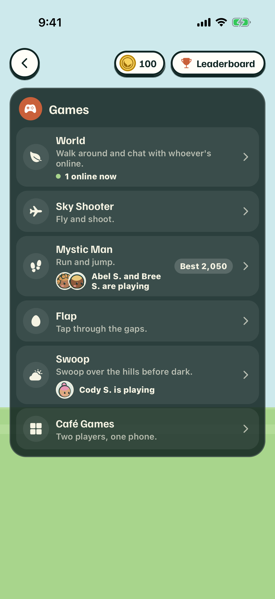 |
| ios `admin-home` |  | 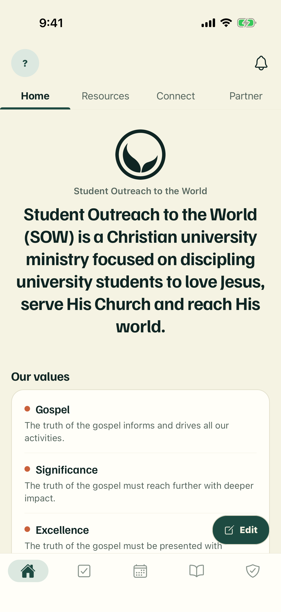 |
| ios `admin-root` |  |  |
| ios `admin-world` |  | 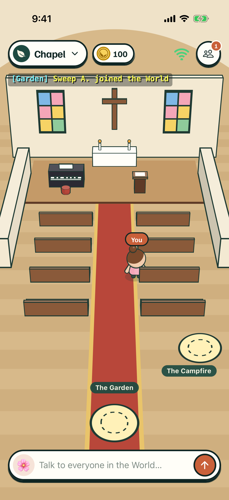 |
| ios `admin-world_calendar` |  | 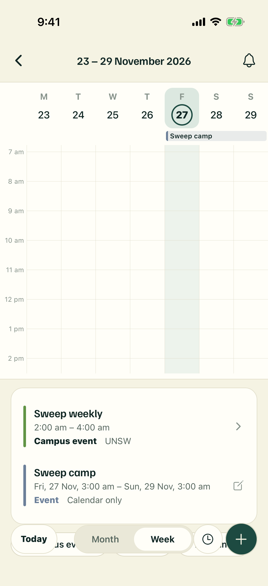 |
| ios `admin-world_devotionals` | 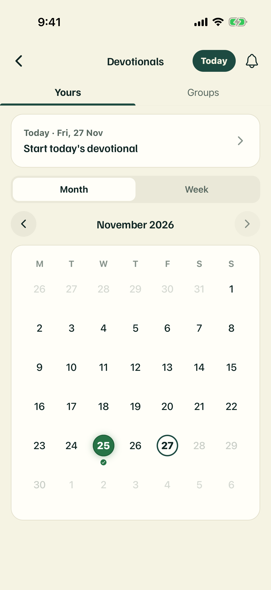 |  |
| ios `admin-world_praise` | 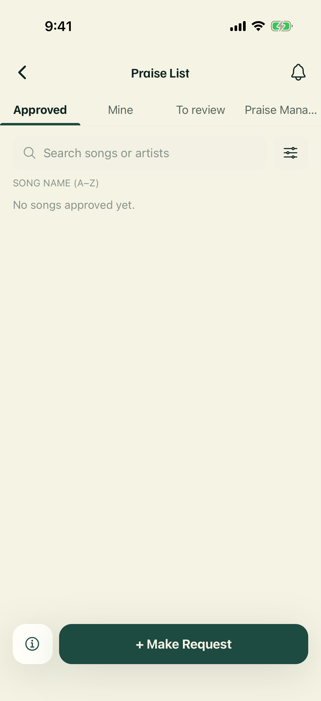 |  |
| ios `admin-world_sheet_arcade` | 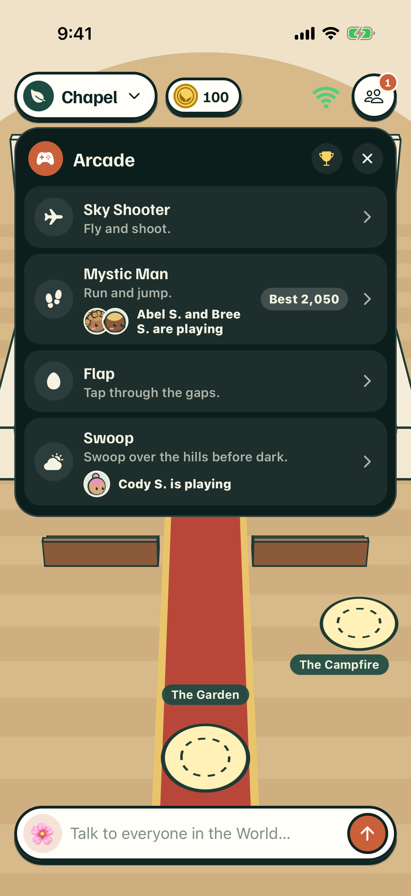 |  |
| ios `admin-world_sheet_character` | 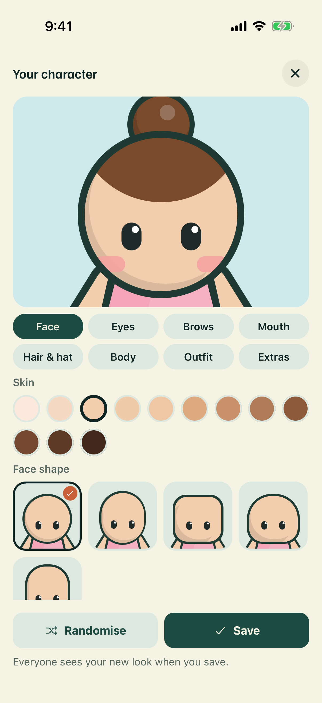 |  |
| ios `admin-world_sheet_poke` | 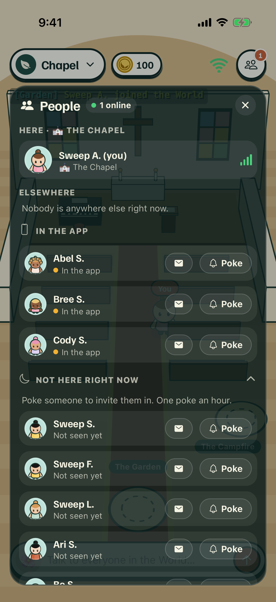 | 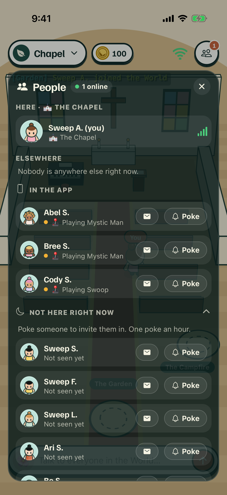 |
| ios `out-home` |  |  |
| ios `out-root` |  |  |
