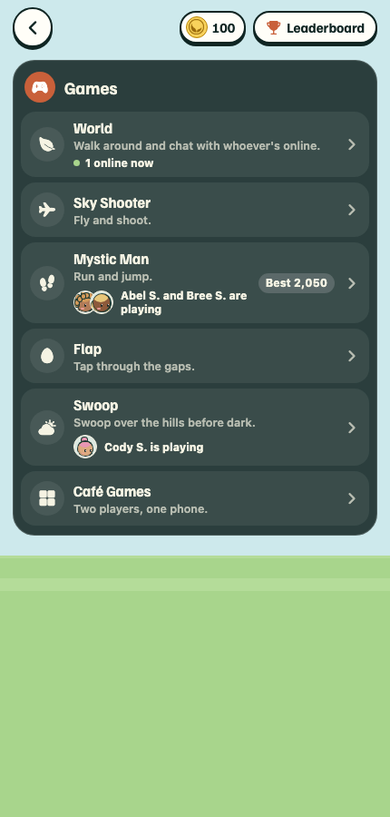
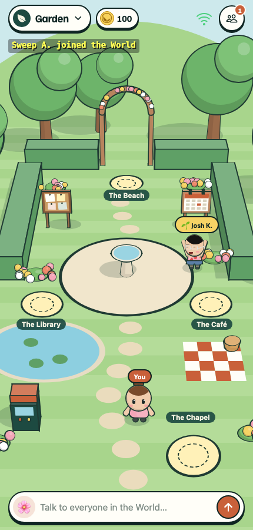
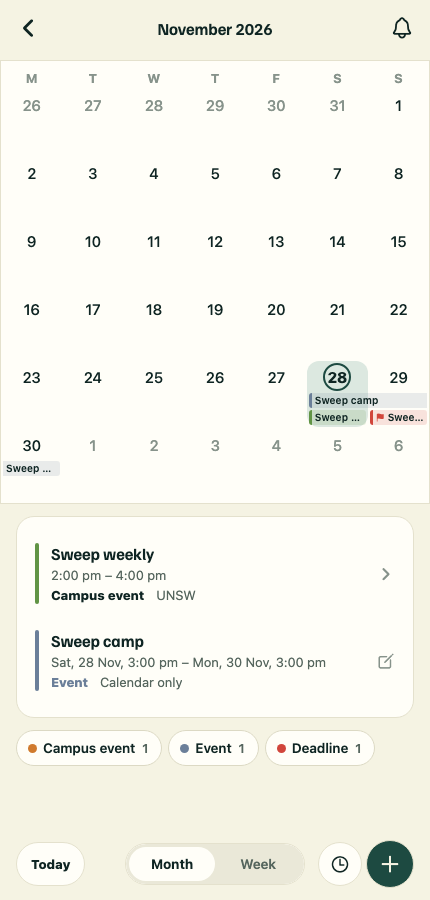
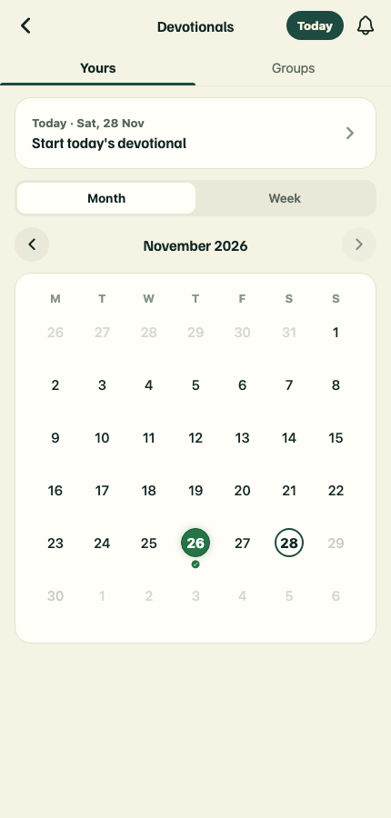
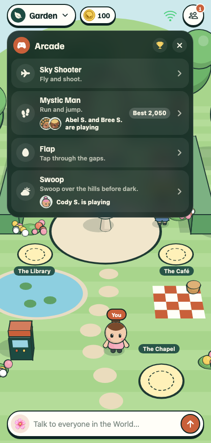
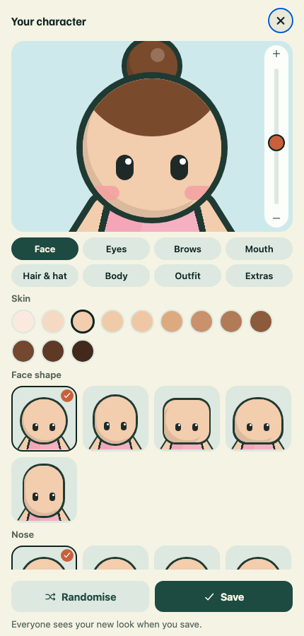
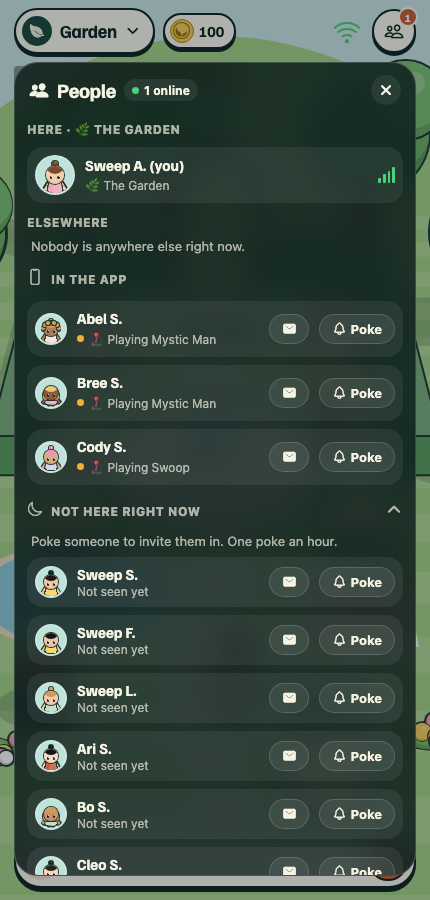
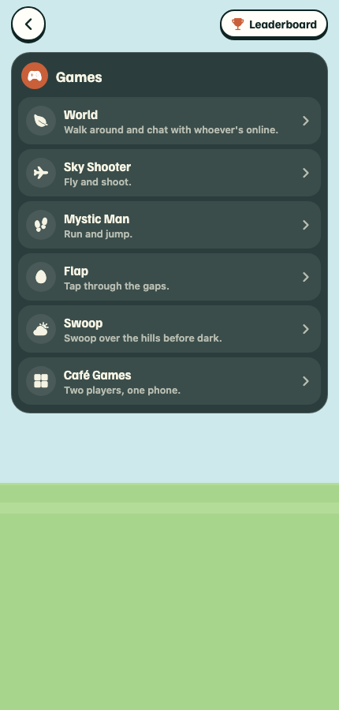

# verify: scoped

- because world: src/world/BackyardGuide.tsx
- because world: src/world/ChatBar.tsx
- because world: src/world/Farm.tsx
- because world: src/world/NoticeBoard.tsx
- because world: src/world/Shop.tsx
- because world: src/world/WorldScreen.tsx
- because world: src/world/backyardTips.ts
- because world: src/world/shopTabs.ts

| Step | Result | Time | Detail |
| --- | --- | --- | --- |
| base tree | ✔ pass | 0s |  |
| native fingerprint | ✔ pass | 4s | unchanged on iOS and Android: over-the-air updates reach current builds |
| lint | ✔ pass | 103s |  |
| unused code (knip) | ✔ pass | 5s |  |
| typecheck | ✔ pass | 22s |  |
| related unit tests | ✔ pass | 1s | 4 passed (4) |
| verify lock | ✔ pass | 0s | free, taken at once |
| Playwright Chromium | ✔ pass | 1s |  |
| before: local backend | ✔ pass | 21s | before functions on :3270 |
| before: web | ⚠ warning | 261s | 20 screens, 0 broken, still moving: admin-world, admin-world_sheet_poke, admin-world_sheet_arcade.; check farm-help-notices failed: ✘ a new notice's editor still says "Everyone in the World sees it." ✘ the notice being edited still shows below the editor ✘ the edit's editor still says "Everyone in the World sees it." ✘ the Animals and feed tab has no grain ✘ the Animals and feed tab has no hay ✘ t |
| after: local backend | ✔ pass | 21s | after functions on :3270 |
| after: web | ✔ pass | 553s | 20 screens, 0 broken, still moving: admin-world, admin-world_sheet_poke, admin-world_sheet_arcade. Checks passed: farm-help-notices, chapel-pews, arcade-podium, rps-ask, backyard-chat, outfits, eye-shapes, character-camera, steps-drag, mahjong, world-fullscreen, home-furniture. |

## Screenshots

| Screen | Before | After |
| --- | --- | --- |
| web `admin-games` |  |  |
| web `admin-org` |  |  |
| web `admin-root` |  |  |
| web `admin-world` |  |  |
| web `admin-world_calendar` |  |  |
| web `admin-world_devotionals` |  |  |
| web `admin-world_praise` |  |  |
| web `admin-world_sheet_arcade` |  |  |
| web `admin-world_sheet_character` |  |  |
| web `admin-world_sheet_poke` |  |  |
| web `out-games` |  |  |
| web `out-org` |  |  |
| web `out-root` |  |  |
| web `out-world` |  |  |
| web `out-world_calendar` |  |  |
| web `out-world_devotionals` |  |  |
| web `out-world_praise` |  |  |
| web `out-world_sheet_arcade` |  |  |
| web `out-world_sheet_character` |  |  |
| web `out-world_sheet_poke` |  |  |
