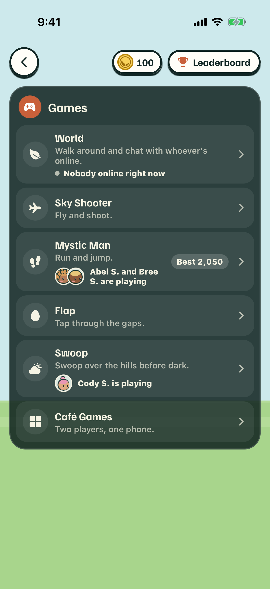
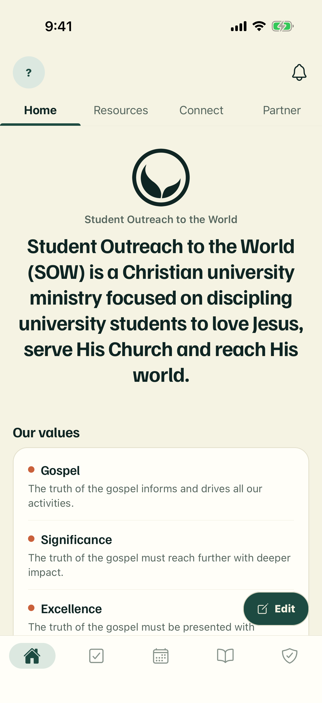
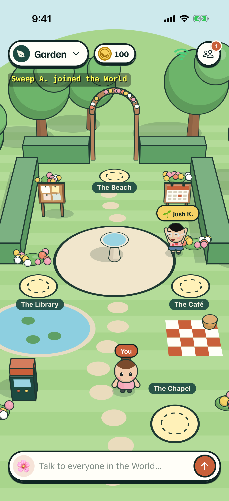
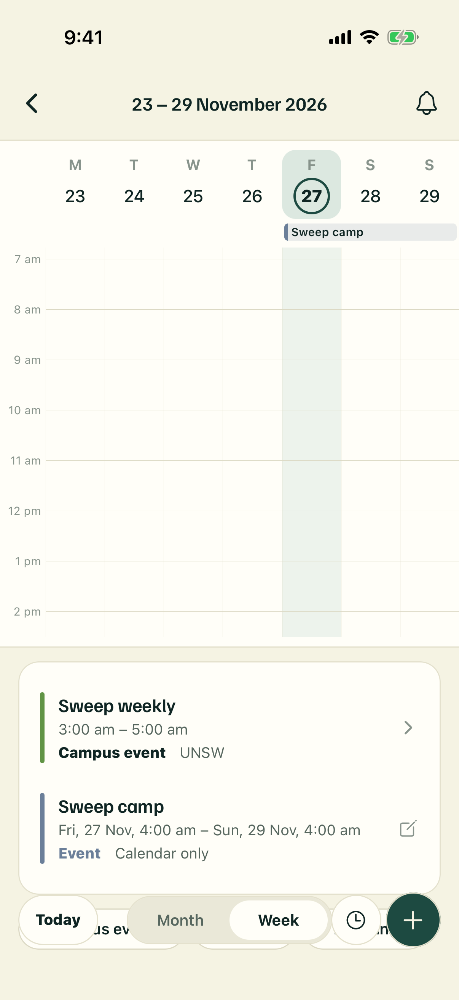
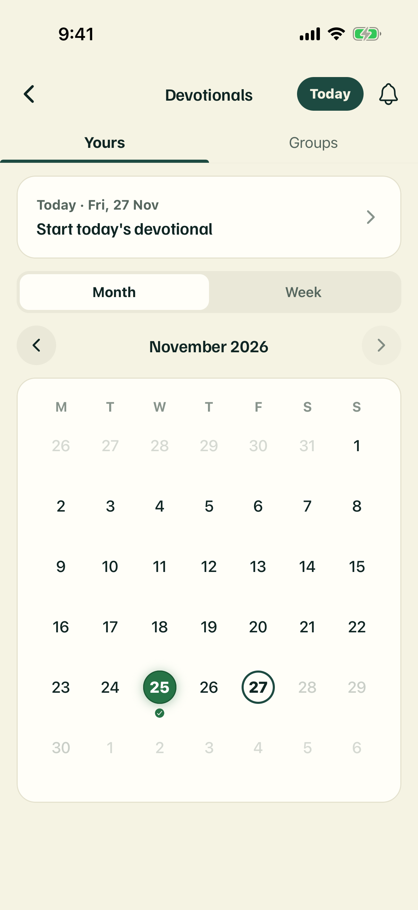
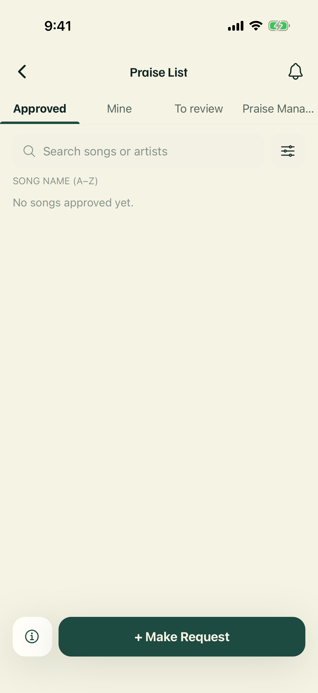
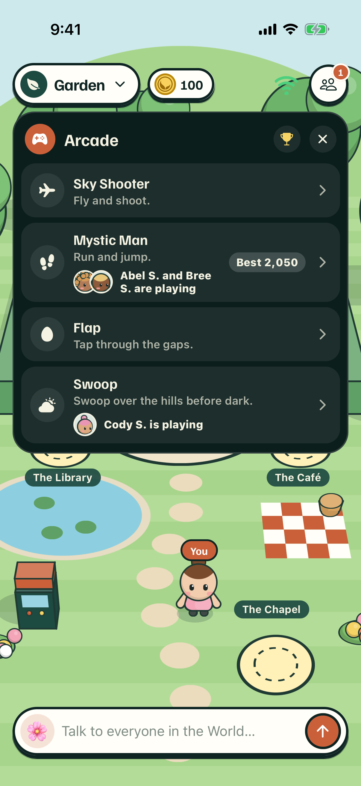
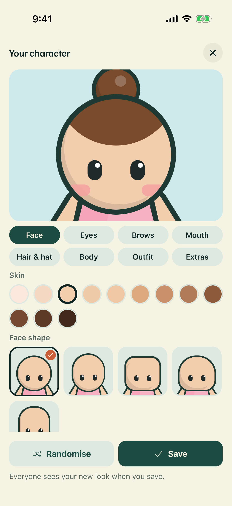
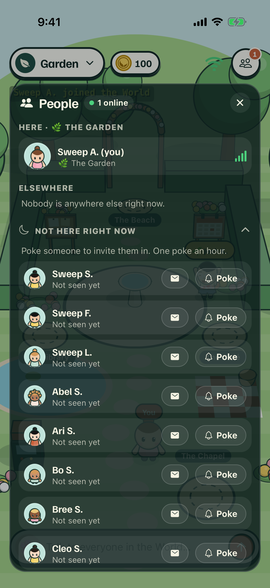

# verify: scoped

- because --only world

| Step | Result | Time | Detail |
| --- | --- | --- | --- |
| base tree | ✔ pass | 0s |  |
| native fingerprint | ✔ pass | 6s | unchanged on iOS and Android: over-the-air updates reach current builds |
| lint | ✔ pass | 107s |  |
| unused code (knip) | ✔ pass | 7s |  |
| typecheck | ✔ pass | 27s |  |
| verify lock | ✔ pass | 0s | free, taken at once |
| after: local backend | ✔ pass | 22s | after functions on :3270 |
| after: iOS reset | ✔ pass | 2s |  |
| after: iOS | ✔ pass | 274s | 12 screenshots, every one settled; checks passed: arcade-podium, chapel-pews |

## Screenshots

| Screen | Before | After |
| --- | --- | --- |
| ios `admin-games` | (none) |  |
| ios `admin-home` | (none) |  |
| ios `admin-root` | (none) |  |
| ios `admin-world` | (none) |  |
| ios `admin-world_calendar` | (none) |  |
| ios `admin-world_devotionals` | (none) |  |
| ios `admin-world_praise` | (none) |  |
| ios `admin-world_sheet_arcade` | (none) |  |
| ios `admin-world_sheet_character` | (none) |  |
| ios `admin-world_sheet_poke` | (none) |  |
| ios `out-home` | (none) |  |
| ios `out-root` | (none) |  |
