# verify: static

- because every changed file is static

| Step | Result | Time | Detail |
| --- | --- | --- | --- |
| base tree | ✔ pass | 0s |  |
| native fingerprint | ✔ pass | 7s | unchanged on iOS and Android: over-the-air updates reach current builds |
| lint | ✔ pass | 239s |  |
| unused code (knip) | ✔ pass | 11s |  |
| typecheck | ✔ pass | 54s |  |
| unit tests | ✔ pass | 94s |  |

## Targeted screen runs (by hand; the static tier runs no screens)

- iOS, on ec2900b7, through `~/agent-ops/verify-lock.sh`: home-furniture (201 s), chapel-pews (206 s, starting from home so its Garden detour ran) and backyard-chat (289 s) passed, on a private local Convex backend seeded by `scripts/sweep-seed.mjs`, the way verify runs its checks.
- Web: steps-drag failed 3/3 on main with `net::ERR_ABORTED` and passes on ec2900b7; these are its screenshots. Main has no before screenshot because the check never got to the editor.

## Screenshots

| Screen | Before | After |
| --- | --- | --- |
| web `check-steps-drag-body` | (none) | 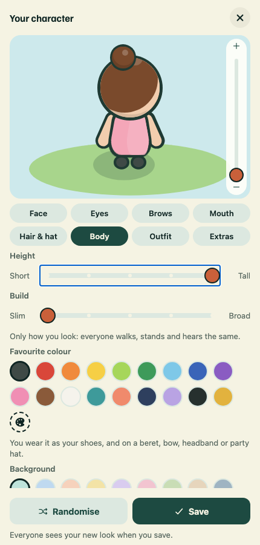 |
| web `check-steps-drag-eyes` | (none) | 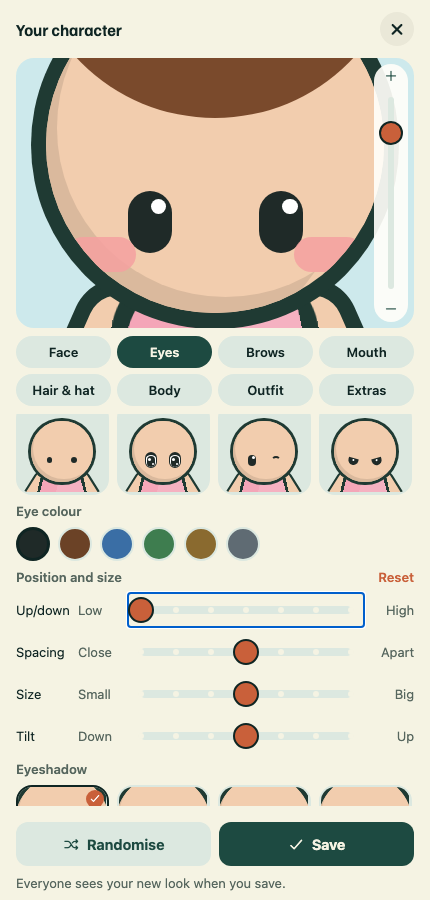 |
| ios `check-backyard-chat-arrived` | (none) | 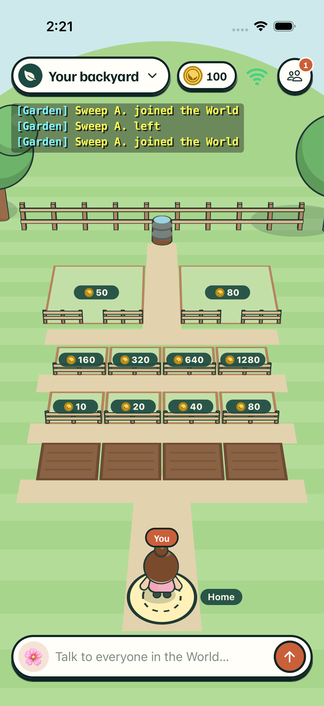 |
| ios `check-backyard-chat-back` | (none) | 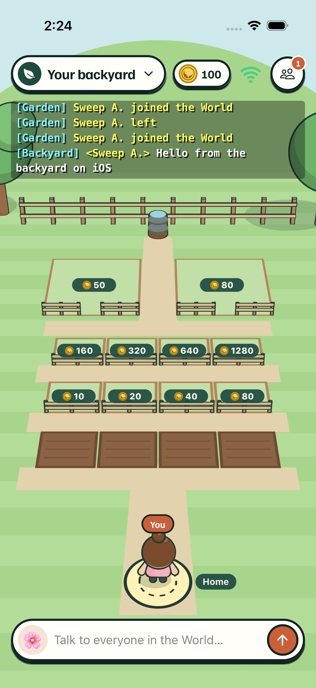 |
| ios `check-backyard-chat-garden` | (none) | 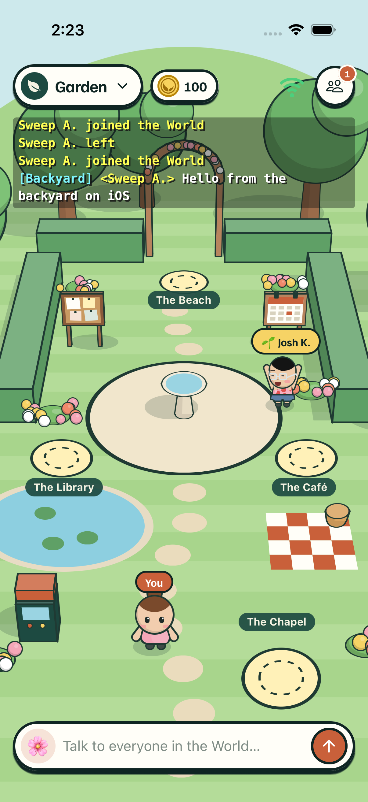 |
| ios `check-backyard-chat-said` | (none) | 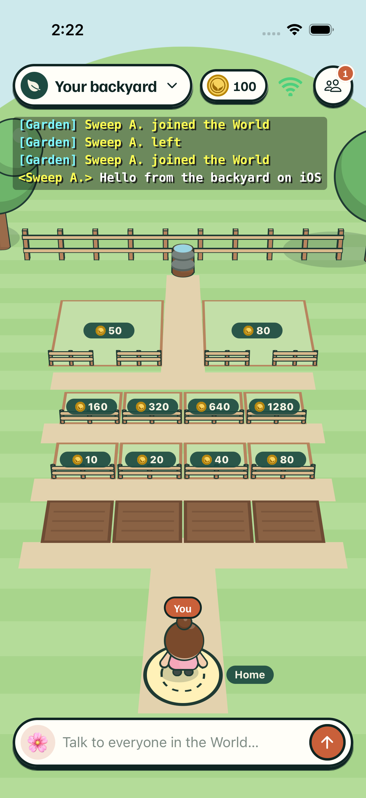 |
| ios `check-chapel-arrived` | (none) | 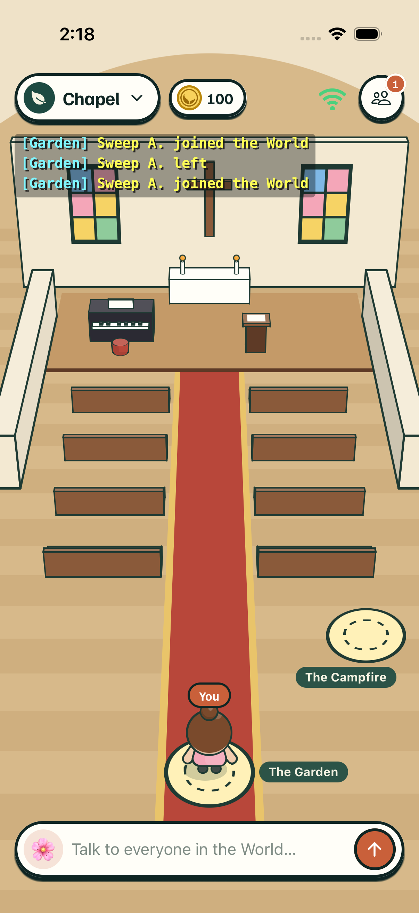 |
| ios `check-chapel-lectern-again` | (none) | 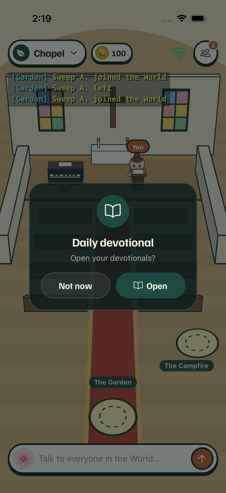 |
| ios `check-chapel-lectern` | (none) | 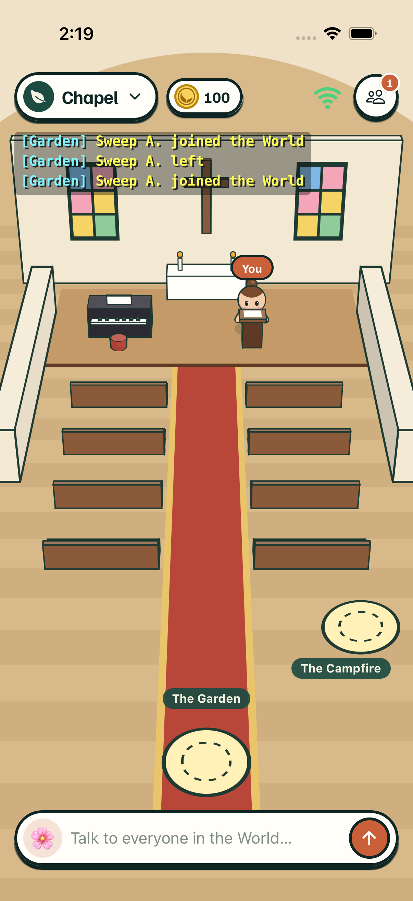 |
| ios `check-chapel-pew-seated` | (none) | 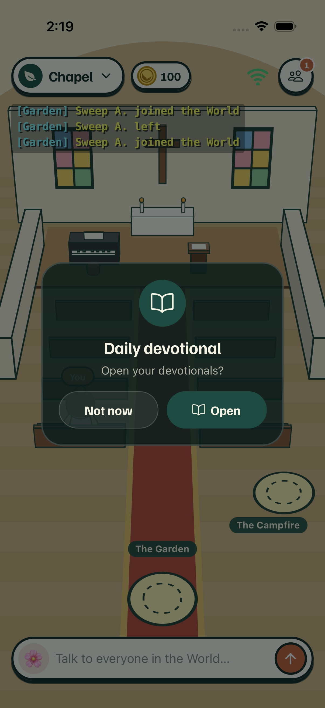 |
| ios `check-home-arrived` | (none) | 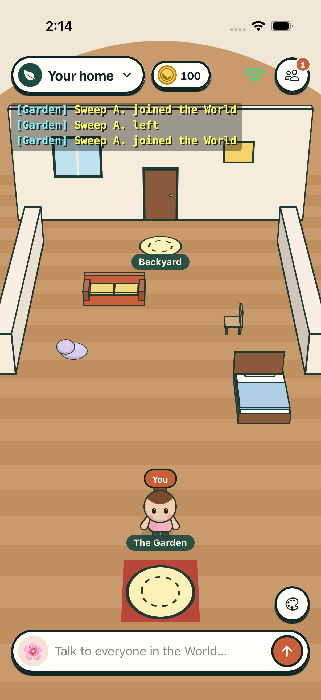 |
| ios `check-home-sit-beanbag` | (none) | 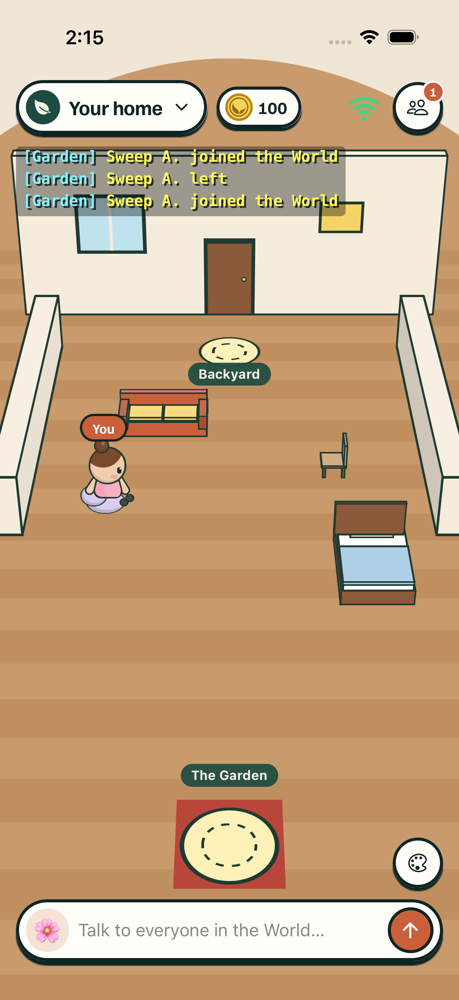 |
| ios `check-home-sit-bed` | (none) | 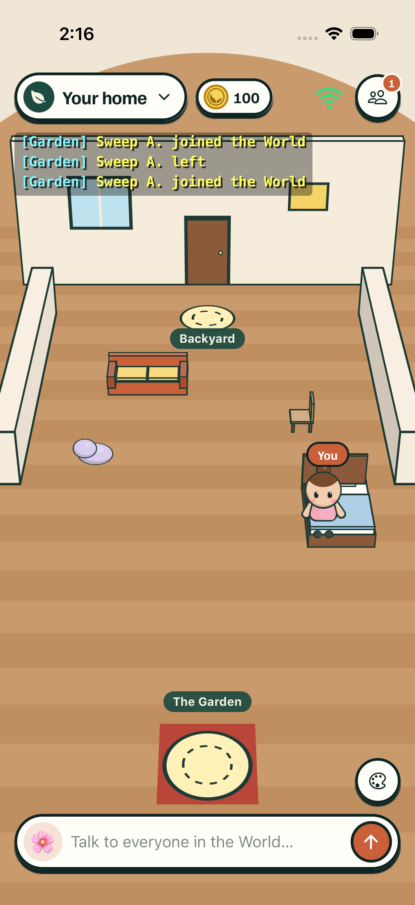 |
| ios `check-home-sit-chair` | (none) | 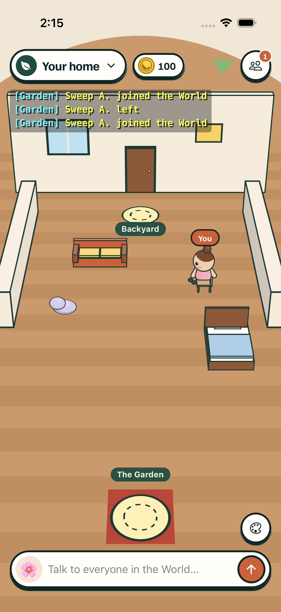 |
| ios `check-home-sit-sofa` | (none) | 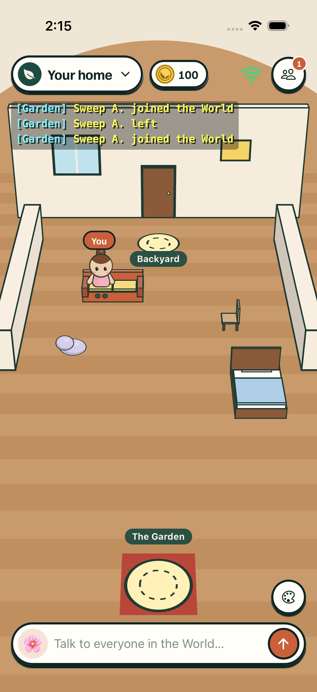 |
| ios `check-home-stood-up` | (none) | 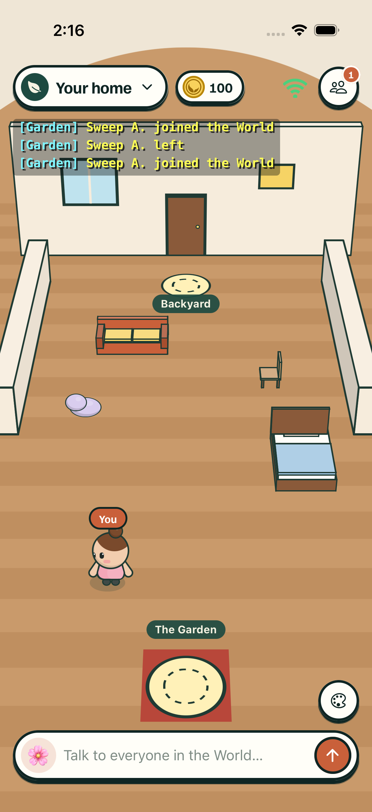 |
