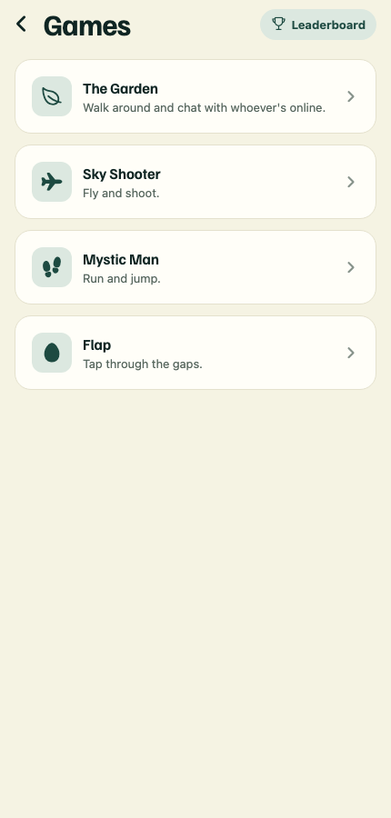

# verify: scoped

- because world: src/world/Person.tsx

| Step | Result | Time | Detail |
| --- | --- | --- | --- |
| base tree | ✔ pass | 0s |  |
| native fingerprint | ✔ pass | 7s | unchanged on iOS and Android: over-the-air updates reach current builds |
| lint | ✔ pass | 136s |  |
| unused code (knip) | ✔ pass | 8s |  |
| typecheck | ✔ pass | 46s |  |
| related unit tests | ✔ pass | 3s |  |
| verify lock | ✔ pass | 1135s | took it after waiting 1135s for pid 99779, feat/mystic-man-combos in /Users/xtectra/GitHub/worktrees/the-shed-mobile-mystic-combos, since 2026-11-23T20:18:12.615Z |
| Playwright Chromium | ✔ pass | 1s |  |
| before: local backend | ✔ pass | 19s | before functions on :3270 |
| before: web | ✔ pass | 119s | 8 screens, 0 broken. |
| before: iOS reset | ✔ pass | 3s |  |
| before: iOS | ⚠ warning | 0s | port 8092 is in use by pid 55026, which this script didn't start |
| after: local backend | ✔ pass | 38s | after functions on :3270 |
| after: web | ✔ pass | 80s | 8 screens, 0 broken. |
| after: iOS reset | ✔ pass | 2s |  |
| after: iOS | ✔ pass | 131s | 6 screenshots, every one settled |

## Screenshots

| Screen | Before | After |
| --- | --- | --- |
| web `admin-games` |  |  |
| web `admin-home` |  |  |
| web `admin-root` |  |  |
| web `admin-world` |  |  |
| web `out-games` |  |  |
| web `out-home` |  |  |
| web `out-root` |  |  |
| web `out-world` |  |  |
| ios `admin-games` | (none) |  |
| ios `admin-home` | (none) |  |
| ios `admin-root` | (none) |  |
| ios `admin-world` | (none) |  |
| ios `out-home` | (none) |  |
| ios `out-root` | (none) |  |
