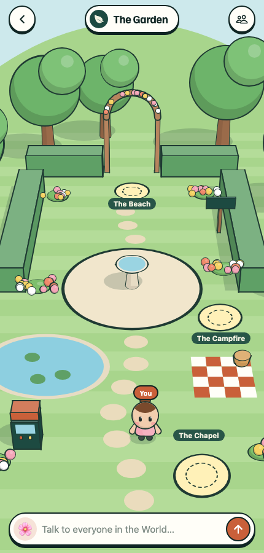
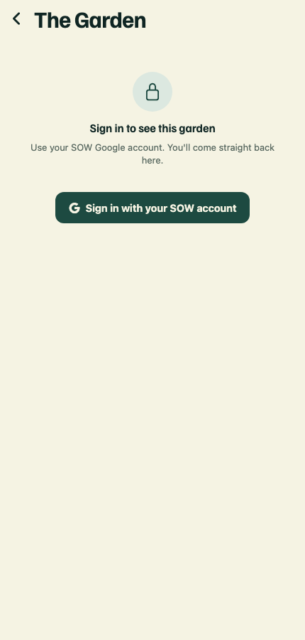
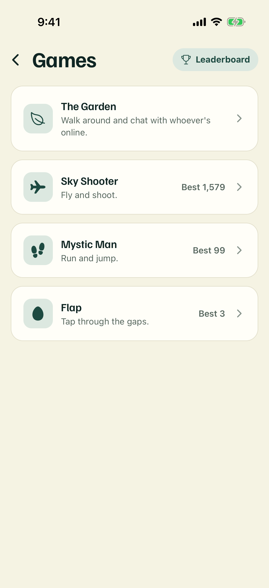
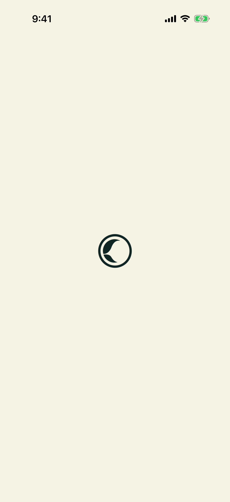
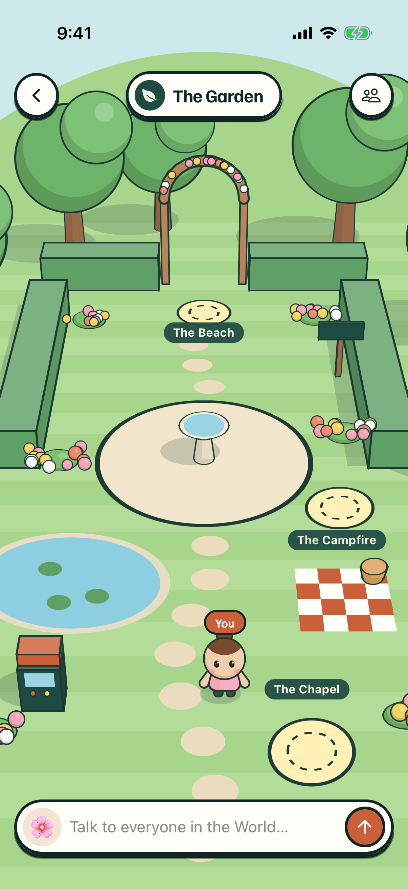

# verify: scoped

- because world: src/world/Person.tsx

| Step | Result | Time | Detail |
| --- | --- | --- | --- |
| base tree | ✔ pass | 1s |  |
| native fingerprint | ✔ pass | 22s | unchanged on iOS and Android: over-the-air updates reach current builds |
| lint | ✔ pass | 368s |  |
| unused code (knip) | ✔ pass | 25s |  |
| typecheck | ✔ pass | 71s |  |
| related unit tests | ✔ pass | 8s |  |
| verify lock | ✔ pass | 434s | took it after waiting 434s for pid 70876, HEAD in /Users/xtectra/GitHub/worktrees/the-shed-mobile-nightly-2026-11-24, since 2026-11-23T16:03:50.816Z |
| Playwright Chromium | ✔ pass | 3s |  |
| before: local backend | ✔ pass | 41s | before functions on :3270 |
| before: web | ✔ pass | 151s | 8 screens, 0 broken. |
| before: iOS reset | ✔ pass | 30s |  |
| before: iOS | ✔ pass | 155s | 6 screenshots; still moving after 10 frames: admin-world |
| after: local backend | ✔ pass | 84s | after functions on :3270 |
| after: web | ✔ pass | 152s | 8 screens, 0 broken. |
| after: iOS reset | ✔ pass | 47s |  |
| after: iOS | ✔ pass | 107s | 6 screenshots, every one settled |

## Screenshots

| Screen | Before | After |
| --- | --- | --- |
| web `admin-games` |  |  |
| web `admin-home` |  |  |
| web `admin-root` |  |  |
| web `admin-world` |  |  |
| web `out-games` |  |  |
| web `out-home` |  |  |
| web `out-root` |  |  |
| web `out-world` |  |  |
| ios `admin-games` |  |  |
| ios `admin-home` |  |  |
| ios `admin-root` |  |  |
| ios `admin-world` |  |  |
| ios `out-home` |  |  |
| ios `out-root` |  |  |
