# verify: scoped

- because world: convex/world.ts
- because world: convex/worldData.ts
- because world: shared/world.ts
- because world: src/world/Garden.tsx
- because world: src/world/WorldScreen.tsx
- because world: src/world/gait.ts
- because world: src/world/useWorld.ts

| Step | Result | Time | Detail |
| --- | --- | --- | --- |
| base tree | ✔ pass | 1s |  |
| native fingerprint | ✔ pass | 12s | unchanged on iOS and Android: over-the-air updates reach current builds |
| lint | ✔ pass | 234s |  |
| unused code (knip) | ✔ pass | 7s |  |
| typecheck | ✔ pass | 57s |  |
| related unit tests | ✔ pass | 28s | 1792 passed (1792) |
| verify lock | ✔ pass | 547s | took it after waiting 547s for pid 2032, feat/coins-top3-backfill in /Users/xtectra/GitHub/worktrees/the-shed-mobile-coins-backfill, since 2026-11-25T03:41:30.733Z |
| Playwright Chromium | ✔ pass | 1s |  |
| before: local backend | ✔ pass | 21s | before functions on :3270 |
| before: web | ⚠ warning | 395s | 16 screens, 1 broken. admin   /world?sheet=poke                                    BROKEN         page error: navigation: TimeoutError: page.goto: Timeout 30000ms exceeded. |
| before: iOS reset | ✔ pass | 4s |  |
| before: iOS | ✔ pass | 238s | 10 screenshots; still moving after 10 frames: admin-world |
| after: local backend | ✔ pass | 33s | after functions on :3270 |
| after: web | ✔ pass | 249s | 16 screens, 0 broken. |
| after: iOS reset | ✔ pass | 3s |  |
| after: iOS | ✔ pass | 314s | 10 screenshots; still moving after 10 frames: admin-world |

## Screenshots

| Screen | Before | After |
| --- | --- | --- |
| web `admin-games` |  | 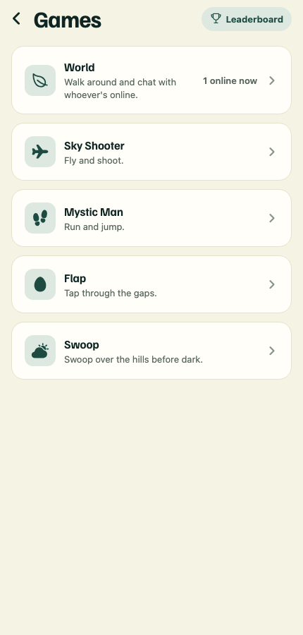 |
| web `admin-home` |  |  |
| web `admin-root` | 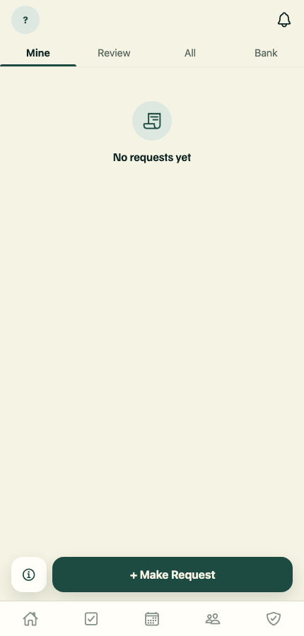 |  |
| web `admin-world` |  | 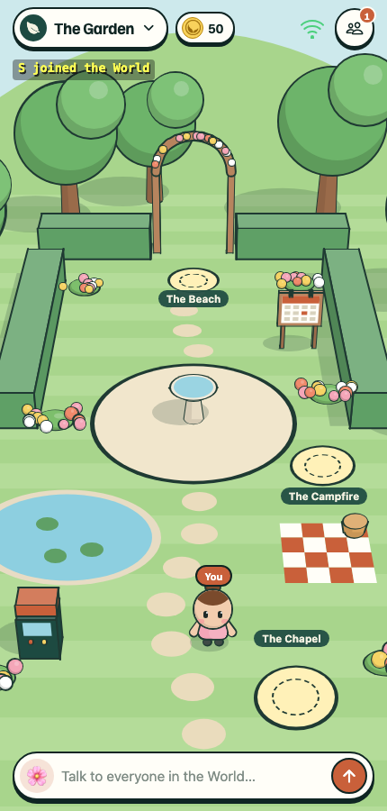 |
| web `admin-world_calendar` | 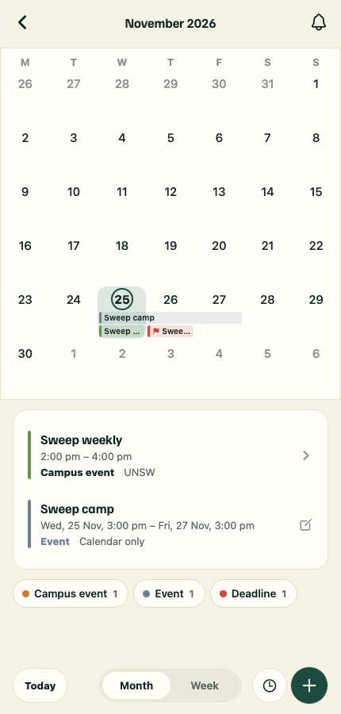 |  |
| web `admin-world_praise` | 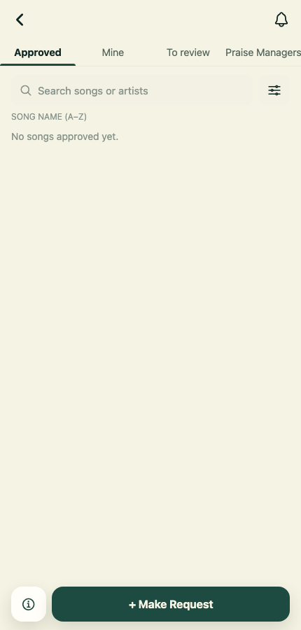 |  |
| web `admin-world_sheet_character` | 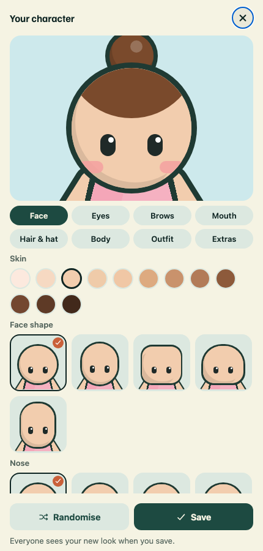 |  |
| web `admin-world_sheet_poke` |  | 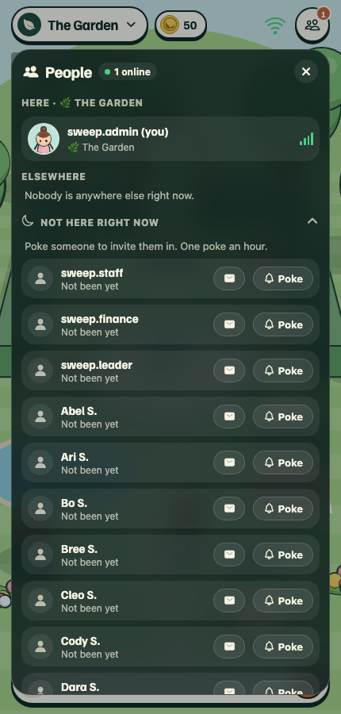 |
| web `out-games` |  | 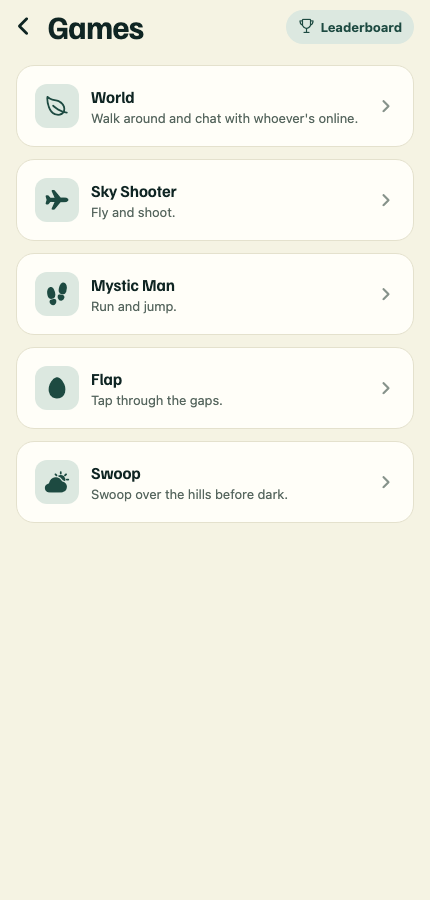 |
| web `out-home` |  |  |
| web `out-root` |  |  |
| web `out-world` |  |  |
| web `out-world_calendar` |  |  |
| web `out-world_praise` |  |  |
| web `out-world_sheet_character` |  |  |
| web `out-world_sheet_poke` |  |  |
| ios `admin-games` | 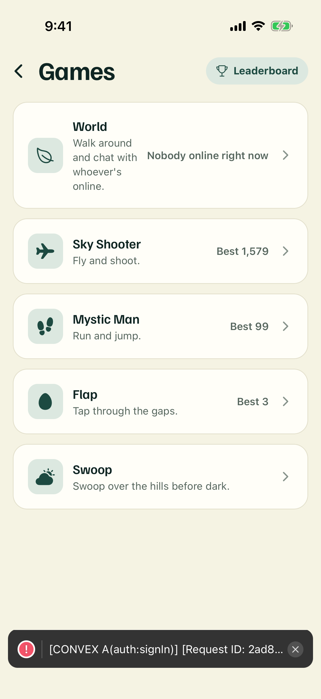 | 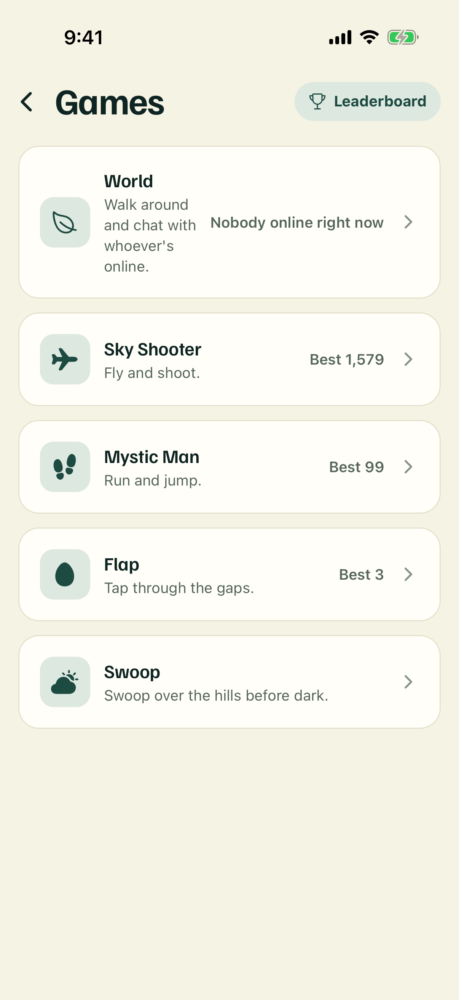 |
| ios `admin-home` | 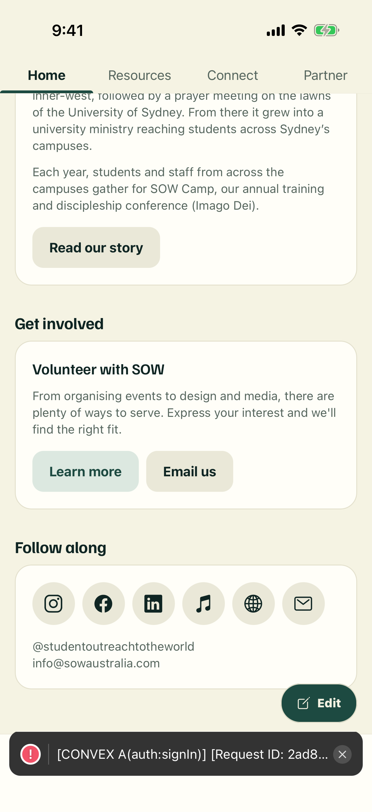 |  |
| ios `admin-root` | 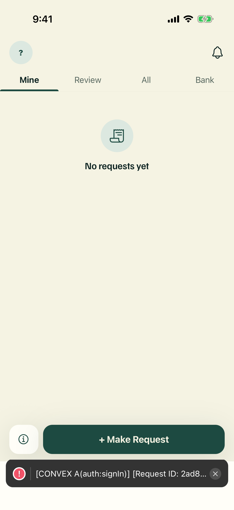 | 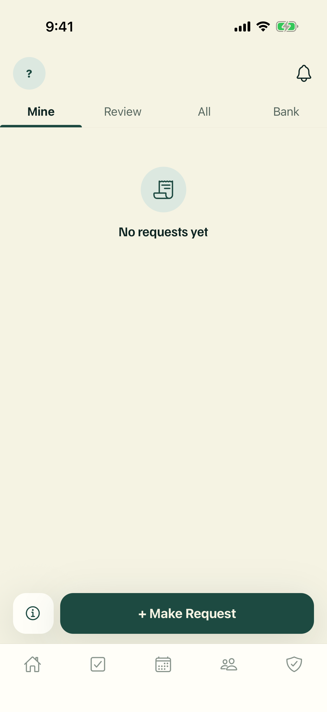 |
| ios `admin-world` | 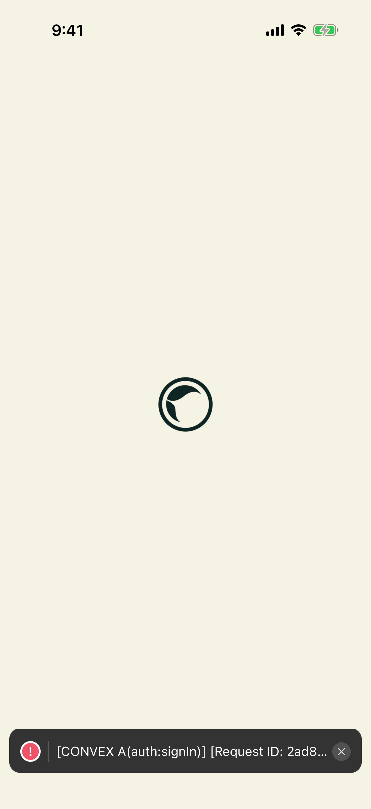 |  |
| ios `admin-world_calendar` | 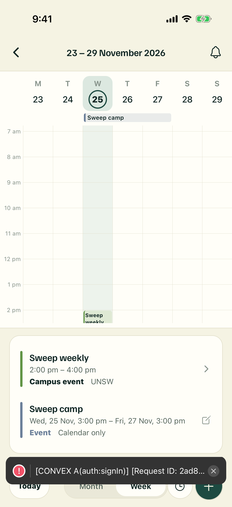 | 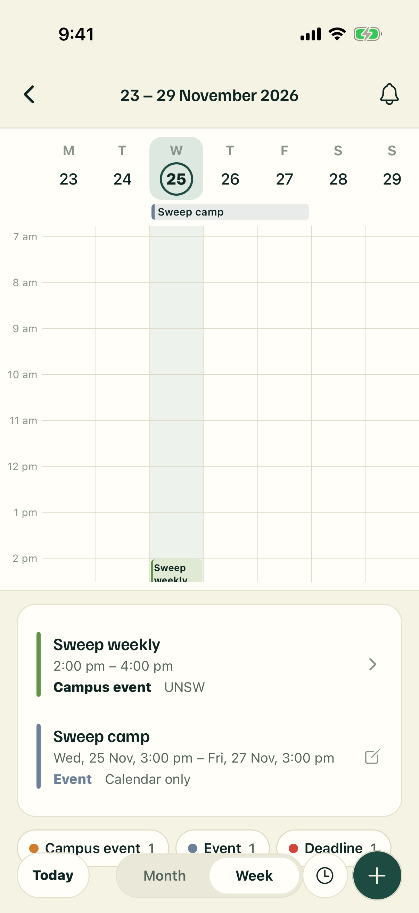 |
| ios `admin-world_praise` | 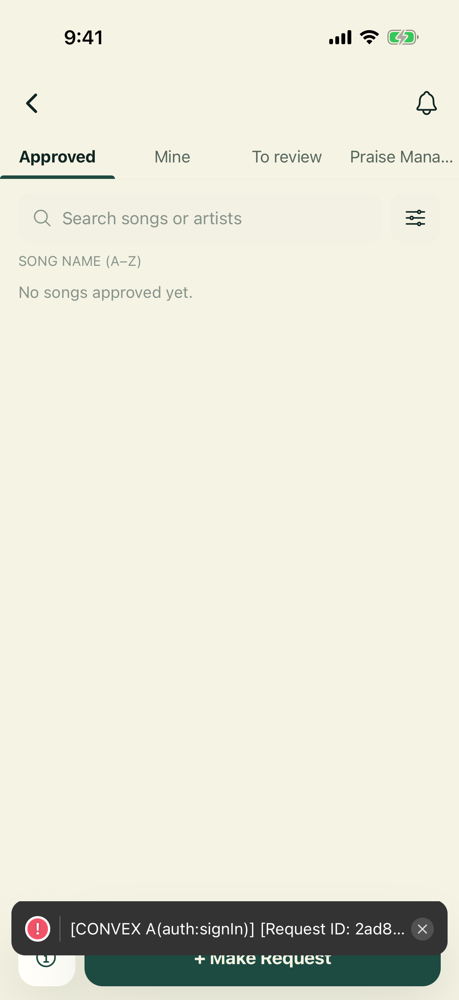 |  |
| ios `admin-world_sheet_character` | 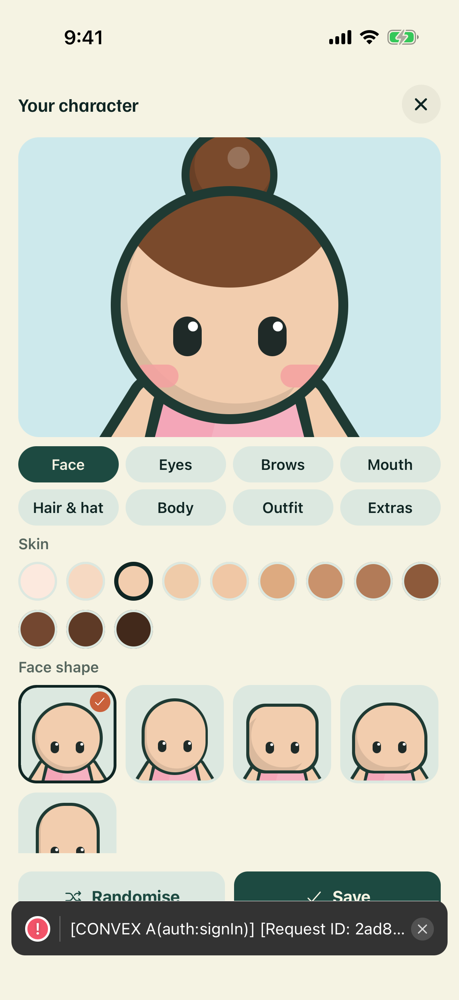 | 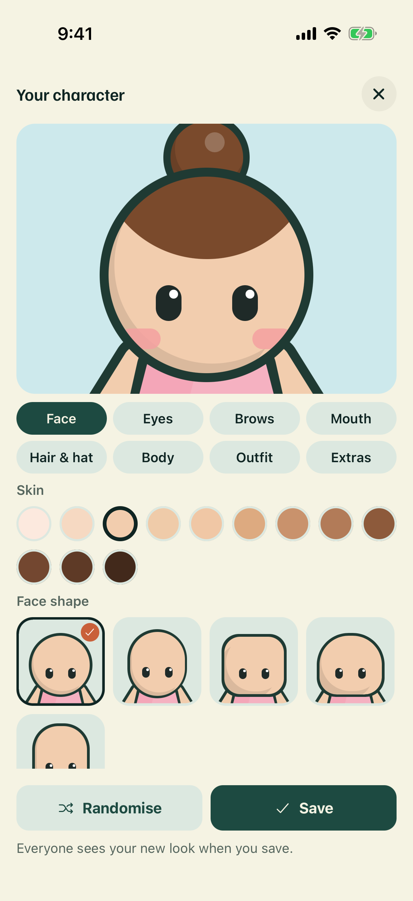 |
| ios `admin-world_sheet_poke` |  |  |
| ios `out-home` | 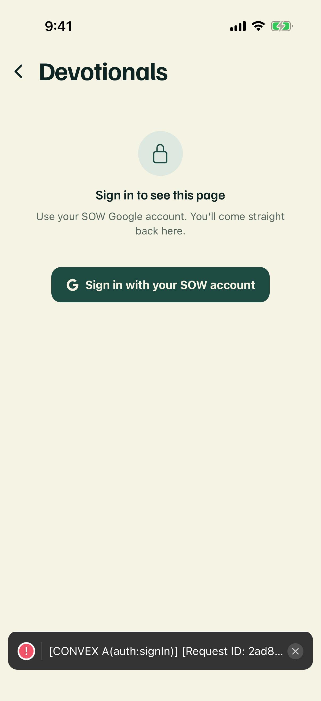 |  |
| ios `out-root` | 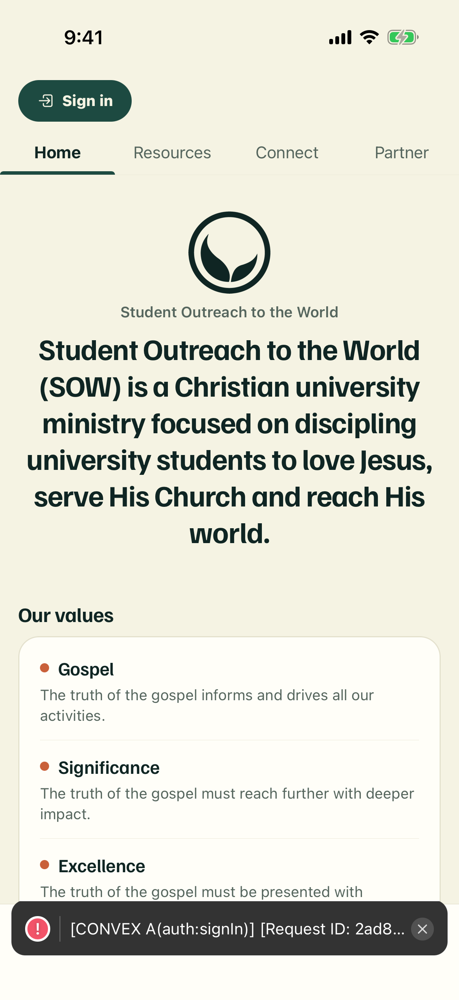 |  |
