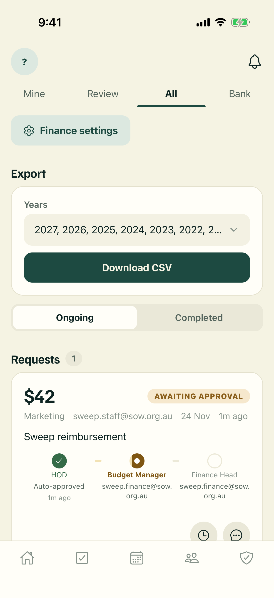
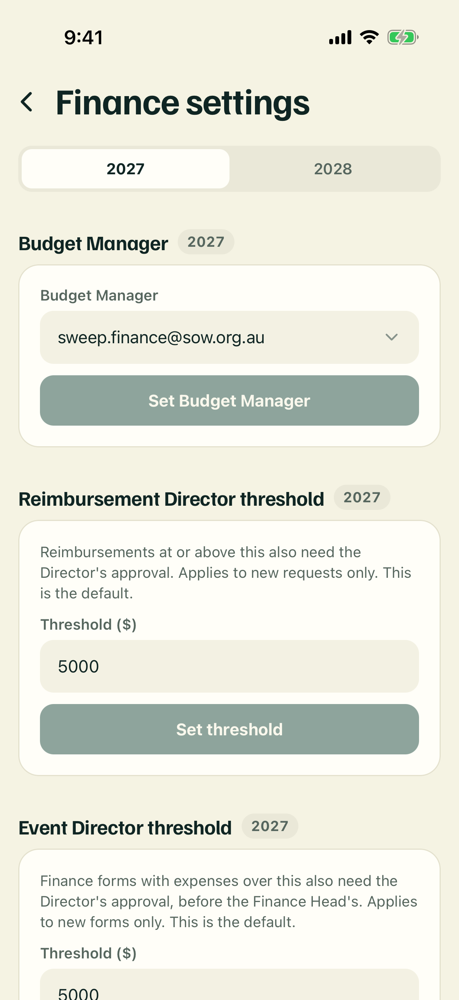
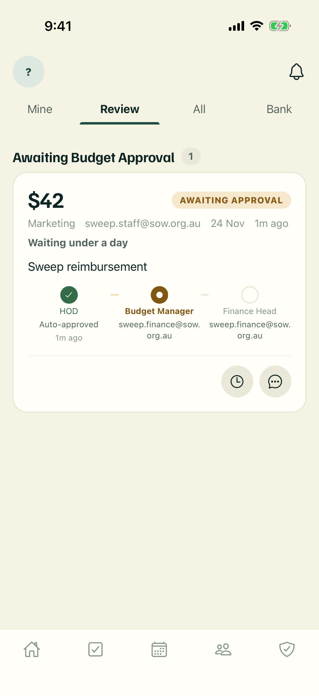

# verify: scoped

- because reimbursements: convex/requests.ts
- because reimbursements: shared/flow.ts
- because reimbursements: src/components/AllRequestsList.tsx
- because reimbursements: src/components/MyRequests.tsx
- because reimbursements: src/components/RequestCard.tsx
- because reimbursements: src/components/ReviewList.tsx
- because reimbursements: src/hooks/useRequestStepActors.ts

| Step | Result | Time | Detail |
| --- | --- | --- | --- |
| base tree | ✔ pass | 0s |  |
| native fingerprint | ✔ pass | 10s | unchanged on iOS and Android: over-the-air updates reach current builds |
| lint | ✔ pass | 93s |  |
| unused code (knip) | ✔ pass | 5s |  |
| typecheck | ✔ pass | 18s |  |
| related unit tests | ✔ pass | 18s | 2056 passed (2056) |
| verify lock | ✔ pass | 137s | took it after waiting 137s for pid 65615, HEAD in /Users/xtectra/GitHub/worktrees/the-shed-mobile-verify-pr529, since 2026-11-24T01:48:57.240Z |
| before: local backend | ✔ pass | 16s | before functions on :3270 |
| before: iOS reset | ✔ pass | 1s |  |
| before: iOS | ⚠ warning | 58s | maestro failed, see .verify/run/before/logs/maestro.log Assert that "(?i).*(something went wrong\|configuration error\|unmatched route\|\(ESC\)).*" is not visible... COMPLETED Assert that "(?i).*(something went wrong\|configuration error\|unmatched route\|\(ESC\)).*" is not visible... COMPLETED Assert that "Sign in" is not visible... COMPLETED Assert that "Sign in" is not visible... COMPLETED |
| after: local backend | ✔ pass | 21s | after functions on :3270 |
| after: iOS reset | ✔ pass | 2s |  |
| after: iOS | ✔ pass | 94s | 7 screenshots; still moving after 10 frames: admin-review, admin-all |

## Screenshots

| Screen | Before | After |
| --- | --- | --- |
| ios `admin-all` | (none) |  |
| ios `admin-finance_settings` | (none) |  |
| ios `admin-home` |  |  |
| ios `admin-review` | (none) |  |
| ios `admin-root` |  |  |
| ios `out-home` |  |  |
| ios `out-root` |  |  |
