# verify: scoped

- because reimbursements: src/components/RequestCard.tsx

| Step | Result | Time | Detail |
| --- | --- | --- | --- |
| base tree | ✔ pass | 2s |  |
| native fingerprint | ✔ pass | 23s | unchanged on iOS and Android: over-the-air updates reach current builds |
| lint | ✔ pass | 371s |  |
| unused code (knip) | ✔ pass | 15s |  |
| typecheck | ✔ pass | 108s |  |
| related unit tests | ✔ pass | 4s |  |
| verify lock | ✔ pass | 3906s | took it after waiting 3906s for pid 62522, feat/garden-custom in /Users/xtectra/GitHub/worktrees/the-shed-mobile-garden-custom, since 2026-11-23T17:01:19.969Z |
| Playwright Chromium | ✔ pass | 1s |  |
| before: local backend | ✔ pass | 16s | before functions on :3270 |
| before: web | ✔ pass | 70s | 10 screens, 0 broken, still moving: admin-review, admin-all. |
| before: iOS reset | ✔ pass | 1s |  |
| before: iOS | ✔ pass | 77s | 7 screenshots; still moving after 10 frames: admin-review, admin-all |
| after: local backend | ✔ pass | 15s | after functions on :3270 |
| after: web | ✔ pass | 67s | 10 screens, 0 broken, still moving: admin-review, admin-all. |
| after: iOS reset | ✔ pass | 1s |  |
| after: iOS | ✔ pass | 78s | 7 screenshots; still moving after 10 frames: admin-review, admin-all |

## Screenshots

| Screen | Before | After |
| --- | --- | --- |
| web `admin-all` |  | 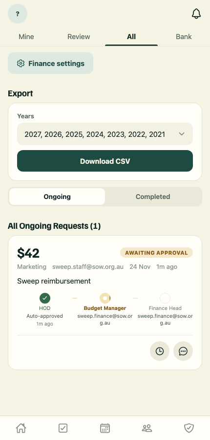 |
| web `admin-finance_settings` | 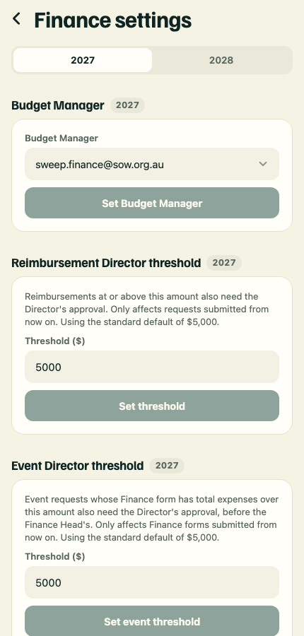 |  |
| web `admin-home` |  |  |
| web `admin-review` | 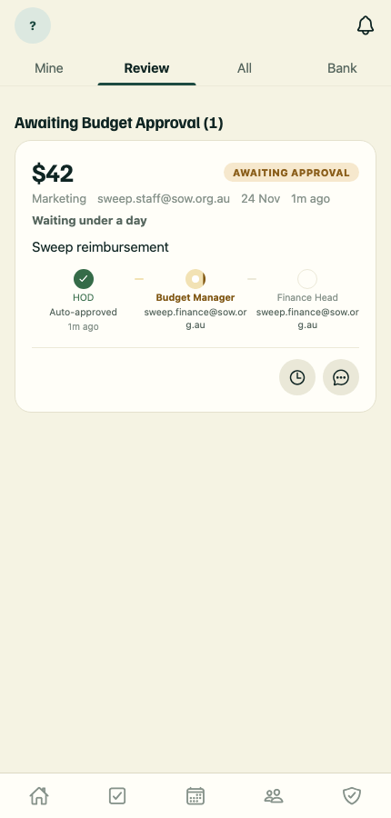 | 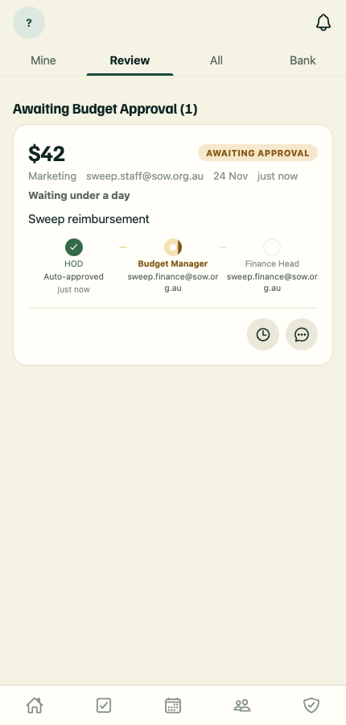 |
| web `admin-root` |  | 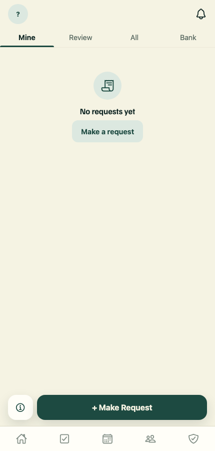 |
| web `out-all` | 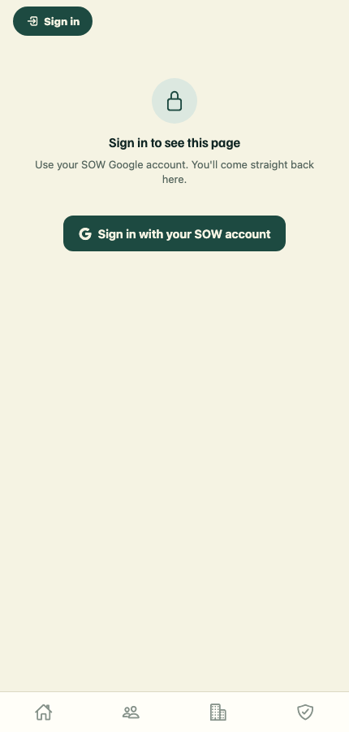 |  |
| web `out-finance_settings` | 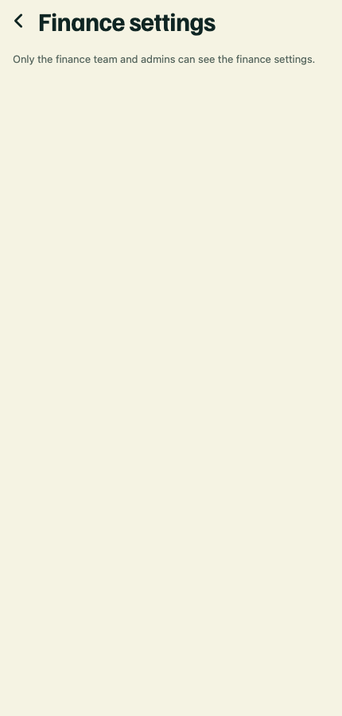 |  |
| web `out-home` |  |  |
| web `out-review` |  |  |
| web `out-root` |  |  |
| ios `admin-all` | 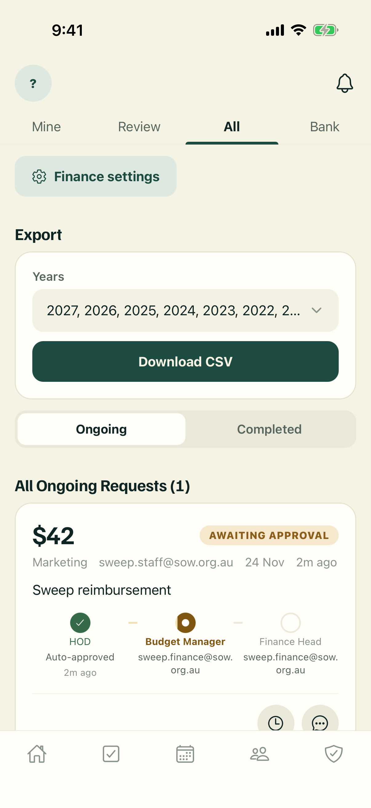 | 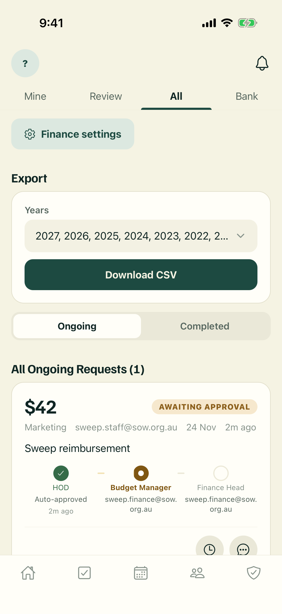 |
| ios `admin-finance_settings` | 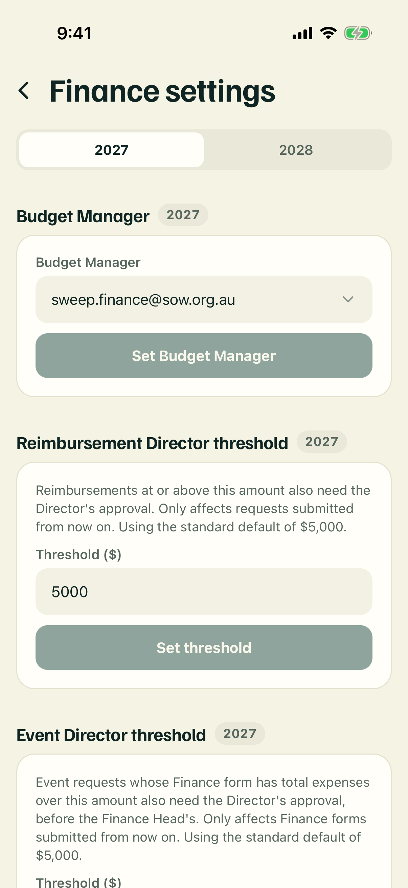 |  |
| ios `admin-home` |  |  |
| ios `admin-review` | 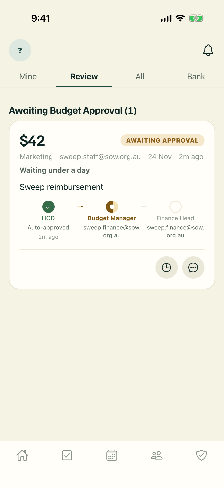 | 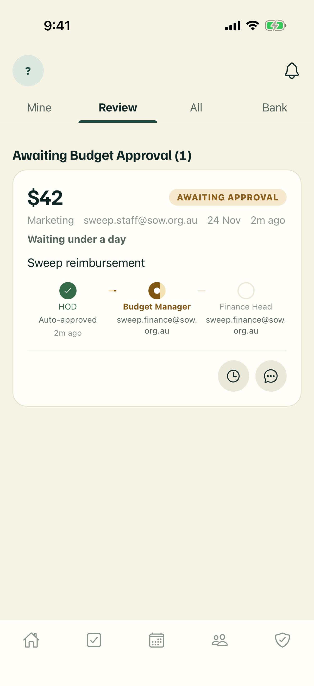 |
| ios `admin-root` |  |  |
| ios `out-home` |  |  |
| ios `out-root` |  |  |
