# verify: scoped

- because design-requests: src/app/design-requests/[id].tsx
- because event-requests: src/app/event-requests/[id]/index.tsx
- because design-requests, event-requests: src/lib/requestPdfs.ts

| Step | Result | Time | Detail |
| --- | --- | --- | --- |
| base tree | ✔ pass | 0s |  |
| native fingerprint | ✔ pass | 6s | unchanged on iOS and Android: over-the-air updates reach current builds |
| lint | ✔ pass | 181s |  |
| unused code (knip) | ✔ pass | 12s |  |
| typecheck | ✔ pass | 40s |  |
| related unit tests | ✔ pass | 4s |  |
| verify lock | ✔ pass | 288s | took it after waiting 288s for pid 36327, feat/games-header-leaderboard in /Users/xtectra/GitHub/worktrees/the-shed-mobile-games-header, since 2026-11-23T11:03:49.036Z |
| Playwright Chromium | ✔ pass | 3s |  |
| before: local backend | ✔ pass | 25s | before functions on :3280 |
| before: web | ✔ pass | 162s | 12 screens, 0 broken. |
| before: iOS reset | ✔ pass | 243s |  |
| before: iOS | ⚠ warning | 1246s | maestro failed, see .verify/run/before/logs/maestro.log Assert that "(?i).*(something went wrong\|configuration error\|unmatched route\|\(ESC\)).*" is not visible... COMPLETED Assert that "(?i).*(something went wrong\|configuration error\|unmatched route\|\(ESC\)).*" is not visible... COMPLETED Assert that "Sign in" is not visible... COMPLETED Assert that "Sign in" is not visible... COMPLETED |
| after: local backend | ✔ pass | 21s | after functions on :3280 |
| after: web | ✔ pass | 98s | 12 screens, 0 broken. |
| after: iOS reset | ✔ pass | 2s |  |
| after: iOS | ✔ pass | 111s | 8 screenshots, every one settled |

## Screenshots

| Screen | Before | After |
| --- | --- | --- |
| web `admin-design_requests` | 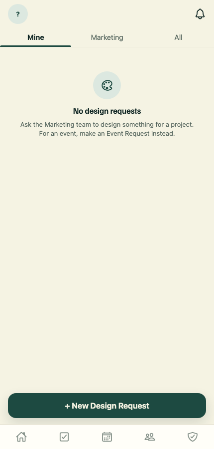 |  |
| web `admin-design_requests_new` |  | 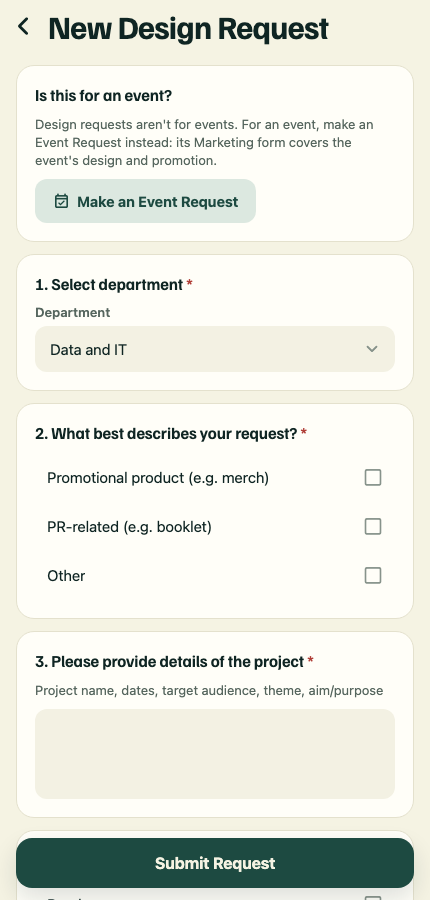 |
| web `admin-event_requests` |  |  |
| web `admin-event_requests_new` | 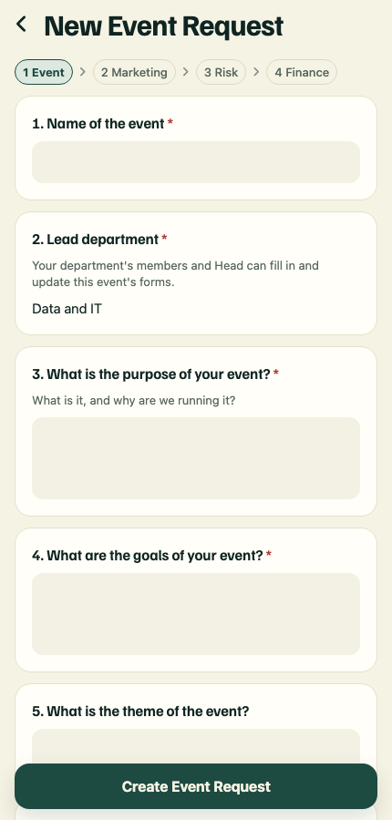 |  |
| web `admin-home` |  |  |
| web `admin-root` |  |  |
| web `out-design_requests` |  |  |
| web `out-design_requests_new` | 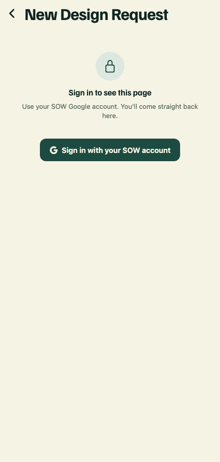 |  |
| web `out-event_requests` |  |  |
| web `out-event_requests_new` | 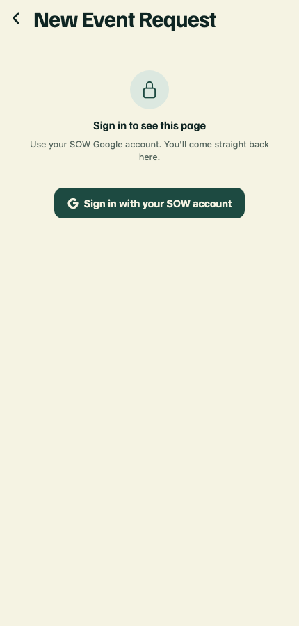 |  |
| web `out-home` |  |  |
| web `out-root` |  |  |
| ios `admin-design_requests` |  |  |
| ios `admin-design_requests_new` | 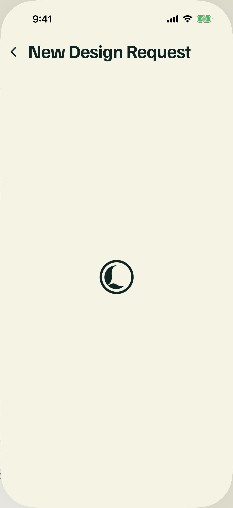 | 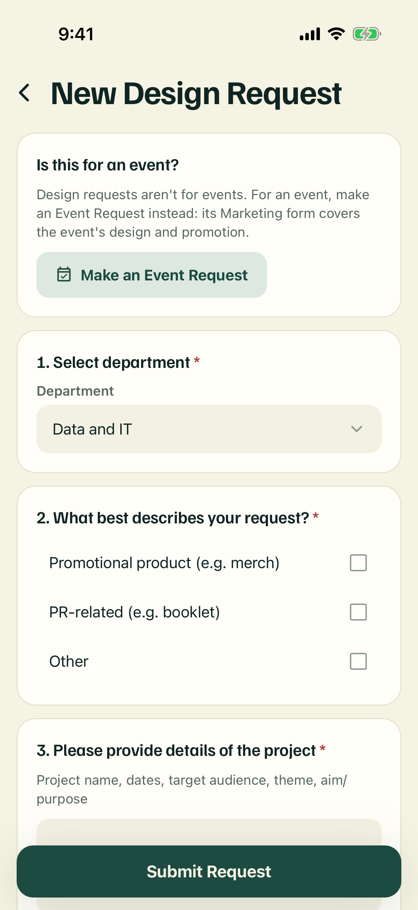 |
| ios `admin-event_requests` | (none) | 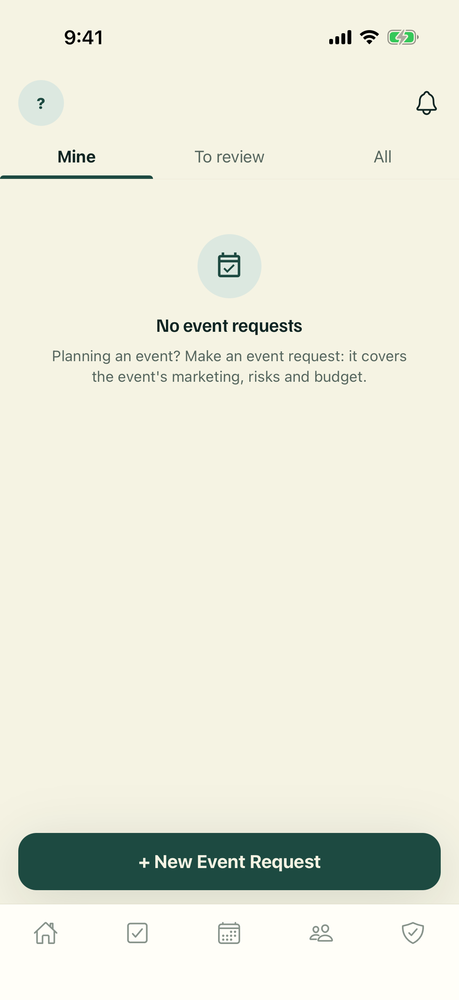 |
| ios `admin-event_requests_new` | (none) | 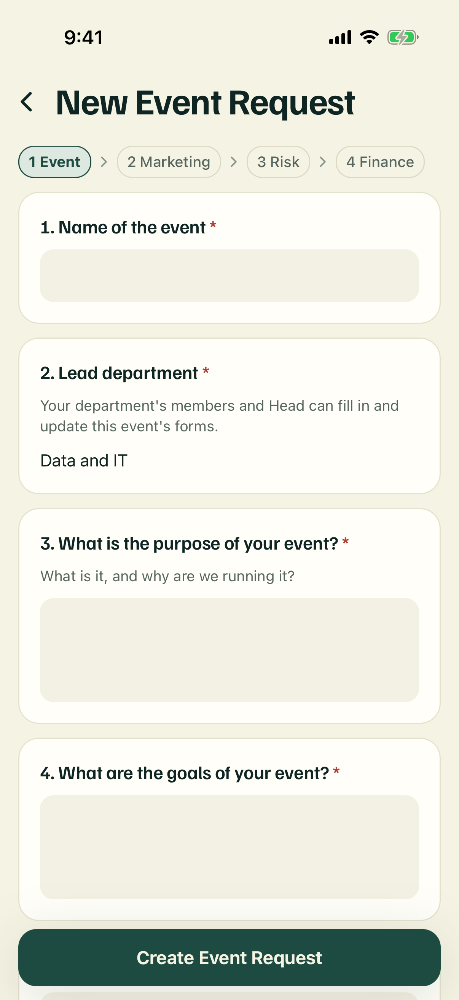 |
| ios `admin-home` |  |  |
| ios `admin-root` |  | 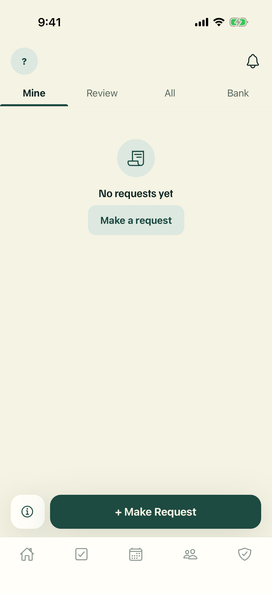 |
| ios `out-home` |  | 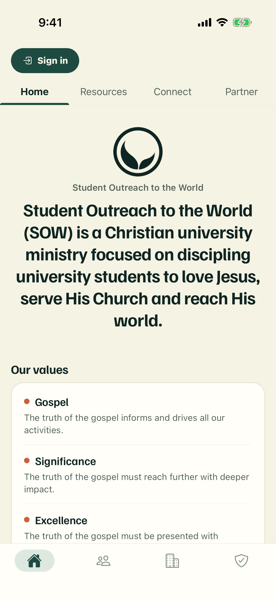 |
| ios `out-root` |  |  |
